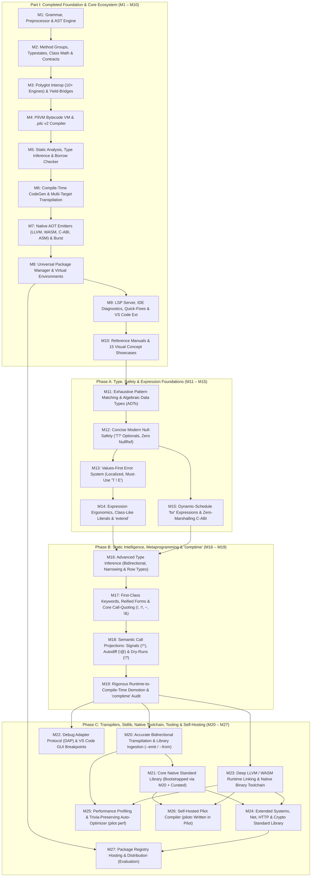

# Pilot Programming Language — Master Milestones & Roadmap Tracker

> **Purpose**: This document is the single source of truth for tracking completed milestones, active engineering goals, resolved grammar/semantic invariants, and architectural roadmaps across development sessions.
> **Session Continuity Protocol**: When starting or completing work in any session, consult this file, respect all **Cross-Milestone Conflict Resolutions & Invariants**, check off completed sub-tasks (`[x]`), and update status badges and verification notes.

---

## Roadmap Overview (Dependency-Verified Architecture)



---

## Status Summary Table

| ID | Milestone | Phase | Status | Primary Modules / Paths |
| :--- | :--- | :--- | :--- | :--- |
| **M1** | Core Grammar, Preprocessor & AST Execution Engine | Core | ✅ **Completed** | `antlr/Pilot.g4`, `Preprocessing/`, `Runtime/Execution/` |
| **M2** | Advanced Paradigms: Method Groups, Typestates, Class Math & Contracts | Core | ✅ **Completed** | `Runtime/Values/`, `Runtime/Adapters/`, `Runtime/Contracts/` |
| **M3** | Deep Polyglot Interoperability & Resumable Yield-Bridges | Core | ✅ **Completed** | `Runtime/Interop/PolyglotRegistry.cs`, `PolyglotTypeBridge.cs` |
| **M4** | PilVM Bytecode Virtual Machine & `.pilc` Binary Format | Core | ✅ **Completed** | `Runtime/Bytecode/PilVirtualMachine.cs`, `Compiler/PilotBytecodeCompiler.cs` |
| **M5** | Static Analysis: Type Inference, Borrow Checker & Verification | Core | ✅ **Completed** | `Analysis/PilotAnalysisPipeline.cs`, `Analysis/Ownership/`, `Analysis/TypeSystem/` |
| **M6** | Compile-Time Source Generation & Multi-Target Transpilation | Core | ✅ **Completed** | `CodeGen/`, `Transpilation/` |
| **M7** | Native AOT Emitters (LLVM, WASM, C-ABI, ASM) & Burst Engine | Core | ✅ **Completed** | `Native/`, `Runtime/Burst/`, `Runtime/NativeMemory/` |
| **M8** | Universal Package Manager (`pilot pkg`) & Virtual Environments (`pilot venv`) | Core | ✅ **Completed** | `Runtime/Packaging/`, `Runtime/Venv/`, `Cli/Program.cs` |
| **M9** | Language Server Protocol (LSP), Diagnostic Catalog & VS Code Extension | Core | ✅ **Completed** | `Pilot.LanguageServer/`, `vscode-pilot/` |
| **M10** | Exhaustive Reference Manuals & 15 Interactive Visual Showcases | Core | ✅ **Completed** | `docs/`, `examples/showcase/`, `README.md` |
| **M11** | Exhaustive Pattern Matching & Algebraic Data Types (ADTs) | Phase A | ✅ **Completed** | `antlr/Pilot.g4`, `Analysis/PatternMatching/`, `Runtime/Values/`, `Compiler/` |
| **M12** | Concise Modern Null-Safety (`T?` Optionals, Zero `NullReferenceException`) | Phase A | ✅ **Completed** | `Analysis/TypeSystem/`, `Runtime/Values/`, `Compiler/` |
| **M13** | Values-First Error System (Transparent, Localized, Must-Use `T ! E`) | Phase A | ✅ **Completed** | `antlr/Pilot.g4`, `Analysis/TypeSystem/`, `Runtime/Execution/` |
| **M14** | Unified Expression Ergonomics, Class-Like Literals & Zero-Cost `extend` | Phase A | ✅ **Completed** | `antlr/Pilot.g4`, `Runtime/Values/PilotValue.cs`, `Compiler/` |
| **M15** | Dynamic-Schedule `for` Expressions & Zero-Marshalling C-ABI Guarantees | Phase A | ✅ **Completed** | `antlr/Pilot.g4`, `Analysis/Loops/`, `Runtime/NativeMemory/`, `Native/` |
| **M16** | Advanced Type Inference (Bidirectional, Flow-Narrowing & Row Polymorphism) | Phase B | 🎯 **Next Up** | `Analysis/TypeSystem/`, `Pilot.LanguageServer/` |
| **M17** | First-Class Keywords, Reified Forms & Core Call-Quoting (`:kw`, `!`, `!!`, `~`, `!&`) | Phase B | 📋 **Planned** | `Runtime/Values/PilotKeyword.cs`, `Analysis/CallQuoting/`, `Native/` |
| **M18** | Semantic Call Projections: Signals (`!^`), Autodiff (`!@`) & Dry-Runs (`!?`) | Phase B | 📋 **Planned** | `Analysis/Autodiff/`, `Runtime/Reactive/`, `Runtime/Effects/` |
| **M19** | Rigorous Runtime-to-Compile-Time Demotion & `comptime` Audit | Phase B | 📋 **Planned** | `Analysis/Comptime/`, `Compiler/`, `Transpilation/PilotOptimizer.cs` |
| **M20** | Accurate Bidirectional Language Transpilation & Library Ingestion (`--emit` / `--from`) | Phase C | 📋 **Planned** | `Transpilation/`, `Formatting/PilotFormatter.cs`, `Cli/Program.cs` |
| **M21** | Core Native Standard Library (`std.core`, `collections`, `mem`, `io`, `fs`, `math`) | Phase C | 📋 **Planned** | `stdlib/core/`, `stdlib/collections/`, `stdlib/io/`, `stdlib/math/` |
| **M22** | Debug Adapter Protocol (DAP) & VS Code GUI Breakpoints | Phase C | 📋 **Planned** | `Debugging/Dap/`, `Debugging/PilotDebugger.cs`, `vscode-pilot/` |
| **M23** | Deep LLVM / WASM Runtime Linking & Native Binary Toolchain (`pilot build`) | Phase C | 📋 **Planned** | `Native/Llvm/`, `Native/Wasm/`, `Native/Runtime/` |
| **M24** | Extended Systems, Networking, HTTP & Crypto Standard Library | Phase C | 📋 **Planned** | `stdlib/net/`, `stdlib/http/`, `stdlib/crypto/`, `stdlib/formats/` |
| **M25** | Advanced Performance Analysis & Trivia-Preserving Auto-Optimizer (`pilot perf`) | Phase C | 📋 **Planned** | `Analysis/Performance/`, `Transpilation/PilotOptimizer.cs` |
| **M26** | Self-Hosted Pilot Compiler (`pilotc` Written in Pilot) | Phase C | 📋 **Planned** | `selfhost/` (`lexer.pilot`, `parser.pilot`, `analyzer.pilot`, `pilotc.pilot`) |
| **M27** | Package Registry Hosting & Distribution Architecture | Phase C | 🔍 **Evaluating** | `Runtime/Packaging/`, Registry Spec |

---

## Concurrency Schedule & Prerequisite Matrix (`M11` – `M27`)

To parallelize work across sessions, branches, or subagents **without dependency inversions or shared-file merge conflicts** (especially on `antlr/Pilot.g4`), follow these verified execution waves:

### 1. Parallel Execution Waves

| Wave | Concurrent Milestones (Zero Conflict Within Wave) | Unlocks After | Why Safe Together |
| :--- | :--- | :--- | :--- |
| **Wave 1** | **`M11`** *(+ optional early design/UI work on `M22.1`/`M22.4` Core DAP & `M27` Registry RFC)* | `M1`–`M10` *(Done)* | `M11` owns `Pilot.g4` ADT/`match` foundations; `M22` DAP transport & `M27` RFC touch disjoint paths. |
| **Wave 2** | **`M12`** | `M11` | Builds `T?` (`some \| none`) atop `M11` tagged unions and cleans up `trailer: EXCLAMATION` (`x!`). |
| **Wave 3** *(2-Way Parallel)* | **Track A**: **`M13`** (`T ! E`) $\rightarrow$ **`M14`** (Literals, `extend`, `?.`, Expr Flow)<br>**Track B**: **`M15`** (Dynamic `for` Exprs + C-ABI `RangeWindow`/`SliceBuffer`) | `M12` | `M15` only needs `M11` + `M12` (`T?` for `ScalarBreak`) and edits isolated `for_stmt`/`flow_stmt` + `Runtime/NativeMemory/`, completely independent of `M13`/`M14`. |
| **Wave 4** | **`M16`** (Advanced Bidirectional Type Inference) | `M14` & `M15` *(all of `M11`–`M15`)* | Unifies static inference across every Phase A construct (`match`, `T?`, `T ! E`, `extend`, `if`/`for` exprs). |
| **Wave 5** | **`M17`** (`:kw`, Reified Forms & Core Call-Quoting `!`, `!!`, `~`, `!&`) | `M16` | Reifies the complete Phase A AST once and uses `M16` resolved types for `CallFrame_<FnId>` (`!&`). |
| **Wave 6** *(3 Internal Sub-Tracks)* | **`M18`** (`18.1` Signals `!^` $\parallel$ `18.2` Autodiff `!@` $\parallel$ `18.3` Dry-Run `!?`) | `M17` | Extends `M17` `CallQuoteKind`; `Runtime/Reactive/`, `Analysis/Autodiff/`, and `Runtime/Effects/` are 100% disjoint. |
| **Wave 7** | **`M19`** (Runtime-to-`comptime` Demotion & Audit) | `M18` | Freezes `Pilot.g4` (`comptime`) and bakes static slots, offsets, `.rodata`, and `!@`/`!!` folding compiler-wide. |
| **Wave 8** *(3-Way Parallel)* | **`M20`** (`--emit` / `--from` Library Transpilers + `pilot fmt`)<br>**`M22`** (Full DAP + Slot/Dry-Run Watch)<br>**`M23`** (`pilot build` + `libpilot_rt` LLVM/WASM) | `M19` | **100% disjoint directories**: `Transpilation/`+`Formatting/` vs. `Debugging/`+`vscode-pilot/` vs. `Native/`. Putting `M20` ahead of `M21` lets `stdlib/` bootstrap from donor libraries. |
| **Wave 9** *(Parallel as Ready)* | **`M21`** (Core `stdlib/` — *unlocks right after `M20`*)<br>**`M25`** (`pilot perf` — *unlocks after `M20` & `M23`*) | `M20` *(for `M21`)*;<br>`M20` & `M23` *(for `M25`)* | `M21` (`stdlib/`) starts immediately once `M20` finishes (even while `M22`/`M23` are still running) and runs cleanly alongside `M25` (`Analysis/Performance/`). |
| **Wave 10** *(3-Way Parallel)* | **`M24`** (Extended Net/HTTP/Crypto `stdlib/`)<br>**`M26`** (Self-Hosted `pilotc` Compiler)<br>*(+ **`M25`** if still active)* | `M21` & `M23` | **100% disjoint directories**: `stdlib/net\|http\|crypto/` vs. `selfhost/` vs. `Analysis/Performance/`. |
| **Wave 11** | **`M27`** (Package Registry Implementation & Ed25519 Signing) | `M8` *(Done)* & `M24` | Uses `M24` `std.http`, `std.formats.json`, and `std.crypto` Ed25519 verification. |

### 2. Per-Milestone Exact Prerequisites

| Milestone | Must Be Completed Before Starting | Can Run Concurrently With |
| :--- | :--- | :--- |
| **`M11`** (ADTs & Exhaustive `match`) | `M1`–`M10` *(✅ Completed)* | `M22.1`/`M22.4` (Core DAP/Gutter UI), `M27` (Architecture RFC) |
| **`M12`** (Null-Safety `T?`) | `M11` *(✅ Completed)* | `M22.1`/`M22.4`, `M27` (RFC) |
| **`M13`** (Values-First Errors `T ! E`) | `M11`, `M12` *(✅ Completed)* | **`M15`** |
| **`M14`** (Literals, `extend`, `?.`, Expr Flow) | `M11`, `M12` *(✅ Completed)*, `M13` | **`M15`** |
| **`M15`** (Dynamic `for` & Zero-Marshalling C-ABI) | `M11`, `M12` *(✅ Completed)* | **`M13`**, **`M14`** |
| **`M16`** (Advanced Type Inference) | `M11`, `M12`, `M13`, `M14`, `M15` | `M20.4` *(optional early foreign-AST parser prototyping)*, `M22.1`/`M22.4` |
| **`M17`** (Keywords & Core Call-Quoting) | `M11`–`M16` | `M20.4` *(foreign-AST parser prototyping)*, `M22.1`/`M22.4` |
| **`M18`** (`!^`, `!@`, `!?` Projections) | `M11`–`M17` | Internal 3-way split (`18.1` $\parallel$ `18.2` $\parallel$ `18.3`) |
| **`M19`** (`comptime` Demotion & Audit) | `M11`–`M18` | `M22.1`/`M22.4`, `M27` (RFC) |
| **`M20`** (Bidirectional `--emit` / `--from` + `pilot fmt`) | `M11`–`M19` | **`M22`**, **`M23`** |
| **`M21`** (Core `stdlib/` — Bootstrapped via `M20`) | `M11`–`M19`, **`M20`** | **`M22`**, **`M23`**, **`M25`** |
| **`M22`** (DAP & VS Code GUI Breakpoints) | `M18`, `M19` *(full watch/slot support; `M9` for core UI)* | **`M20`**, **`M21`**, **`M23`**, **`M24`**, **`M25`**, **`M26`** |
| **`M23`** (LLVM/WASM Linking & `pilot build`) | `M7` *(Done)*, `M15`, `M17`, `M19` | **`M20`**, **`M21`**, **`M22`** |
| **`M24`** (Extended Net/HTTP/Crypto `stdlib/`) | **`M20`**, **`M21`**, **`M23`** | **`M22`**, **`M25`**, **`M26`** |
| **`M25`** (`pilot perf` & Auto-Optimizer) | `M19`, **`M20`**, **`M23`** | **`M21`**, **`M22`**, **`M24`**, **`M26`** |
| **`M26`** (Self-Hosted `pilotc`) | **`M21`**, **`M23`** | **`M22`**, **`M24`**, **`M25`** |
| **`M27`** (Package Registry Hosting & Signing) | `M8` *(Done)*, **`M24`** | `M22`, `M25`, `M26` |

---

## Cross-Milestone Conflict Resolutions & Architectural Invariants

During architectural review against `antlr/Pilot.g4`, seven concrete syntax/semantic collisions and ordering hazards were identified and resolved. **All future implementation sessions must preserve these invariants**:

1. **Resolution of the Triple `!` Collision (`macro_call` vs. Unsafe Non-Null `x!` vs. `ShallowQuote` `fn!(...)`)**:
   - **Dropped Feature**: The unchecked postfix non-null assertion `trailer: EXCLAMATION` (`x!` in `Pilot.g4` line 1098) **is removed**. It directly violated `M12` (zero `NullReferenceException`s) and created an unresolvable parse/semantic ambiguity with `fn!(args)` when `fn` is an optional callable. Safe narrowing (`guard some x else`, `if x != none`), `??`, or explicit `.OrPanic("reason")` replace it.
   - **Macro vs. Shallow-Quote Unification**: `Pilot.g4` line 1164 (`macro_call: identifier EXCLAMATION (...)`) and `M17` (`fn!(a, b)`) are unified in a single `CallExprNode` rule: brace/bracket invocations `name!{...}` / `name![...]` remain hygienic block/list macro sugar, while `target!(a, b)` dispatches statically via symbol resolution—expanding macros when `target` is a `defmacro`, and projecting `CallQuoteKind.ShallowQuote` (`CallExpr[TReturn]`) when `target` is a `def`/`fn` or callable value.
2. **Resolution of the Postfix `?` Collision (`M12` Presence Check vs. `M13` Error Propagation)**:
   - Overloading postfix `expr?` as *both* a boolean presence check (`if x?`) and an early-return try-unwrap (`call()?`) creates a fatal ambiguity on expressions like `if check_perm(u)?` (does it return `IoError` early or convert failure to `false`?).
   - **Invariant**: Postfix `expr?` has **one universal meaning everywhere in Pilot**: *unwrap success/present value or propagate failure/`none` early from the enclosing function*.
   - **Concise Optional Narrowing**: Presence checks in `if` / `guard` / `while` use zero-boilerplate **`guard some x else { ... }`** / **`if some x { ... }`** (in-place narrowing of `x: T?` $\rightarrow$ `x: T` without repeating `let x = x`) or `if x != none`.
3. **Resolution of Range (`..`, `..=`, `..<`) vs. Worklist Spread (`...`) in `Pilot.g4`**:
   - Currently `Pilot.g4` lacks an `ELLIPSIS` (`...`) token (lexing `...` as `DOTDOT` + `DOT`) and labels `..` as half-open while `M15` defines `a..b` as inclusive.
   - **Invariant**: Add `ELLIPSIS : '...'` *before* `DOTDOT_EQUAL` and `DOTDOT` in `Pilot.g4`. Standardize `a..b` (and alias `a..=b`) as **inclusive** (`[a, b]`) and add `DOTDOT_LESS : '..<'` for **half-open** (`[a, b)`), eliminating off-by-one mismatches across `for` loops (`0..<buf.Length` and `1..10`), slices, and `match` range patterns.
4. **Resolution of Coroutine Generator `yield` (`M1`/`M3`) vs. `ForExpr` `CollectionYield` (`M15`)**:
   - Capturing `yield x` inside every statement-level `for` loop would break existing generator functions (`def gen() { for i in 1..5 { yield i; } }`).
   - **Invariant**: `yield <expr>` targets the enclosing `ForExpr` (`LoopReturnMode.CollectionYield`) **if and only if** the `ForExpr` is in a value-producing expression position (`let y = for ...`, `return for ...`, call argument, etc.). Inside a statement-position `for` (`Void` context), `yield <expr>` targets the enclosing `def` generator coroutine (and emits diagnostic `LOOP004` if the enclosing function is not a generator).
5. **Resolution of Quasiquote Unquote `~arg` (`M17`) vs. Unary Bitwise NOT `~x` (`Pilot.g4` line 1066)**:
   - **Invariant**: Inside `fn!!(...)` argument lists only, a leading top-level `~expr` sets `CallArgNode.IsUnquoted = true` (eagerly evaluating `expr` and constant-folding it into the spliced AST). To pass a symbolic bitwise-NOT expression without unquoting, parenthesize it: `fn!!((~mask), b)`. To unquote the evaluated result of a bitwise NOT, write `fn!!(~(~mask), b)`.
6. **Resolution of `T ! E` Return-Type Precedence (`M12` + `M13`)**:
   - **Invariant**: In `type_spec`, postfix `?` (`Optional`) binds tighter than `|`/`&` (`Union`/`Intersection`), which bind tighter than infix `!` (`Fallible`). Thus `User? ! IoError | ParseError` unambiguously parses as `(Option[User]) ! (IoError | ParseError)`.
7. **Unified Error Stratification (No Split Ecosystem Between `raise` and `T ! E`)**:
   - **Invariant**: All recoverable errors in native Pilot and `stdlib/` use `T ! E` return values (`M13`). Unrecoverable contract/invariant bugs use `panic(...)` / `requires` traps. Legacy `try` / `except` / `raise` is strictly scoped to foreign polyglot FFI boundaries (`python {}`, `csharp {}`, `js {}`) and actor/thread fault-isolation supervisors (`isolate`), enforced by lint `ERR005`.

---

# Part I: Completed Milestones (M1 – M10)

### Milestone 1: Core Grammar, Preprocessor & AST Execution Engine
- [x] Master ANTLR4 grammar (`antlr/Pilot.g4`) supporting both `{}` brace blocks and Pythonic `:` suites.
- [x] Lexical preprocessor (`Preprocessing/PilotPreprocessor.cs`) with `#define`, `#undef`, `#if`, `#elif`, `#else`, `#endif`, `#region`, `#pragma`, and `PREPROC001`–`PREPROC011` diagnostics.
- [x] Scoped execution environment (`Runtime/Environment/PilotEnvironment.cs`, `PilotScope.cs`) and dynamic/static value model (`Runtime/Values/PilotValue.cs`).
- [x] Tree-walk interpreter (`Runtime/Execution/PilotInterpreterVisitor.cs`), control-flow signals, `guard`/`defer` LIFO execution, and structured `try`/`except`/`else`/`finally` error protections.

### Milestone 2: Advanced Paradigms: Method Groups, Typestates, Class Math & Contracts
- [x] First-class method groups (`Runtime/Values/PilotMethodGroup.cs`): heterogeneous switchboard `.map()`, currying signature sieve, fallback unions (`|`), multi-cast broadcasts (`*`), and overload introspection.
- [x] First-class type adapters (`Runtime/Adapters/PilotTypeAdapterRegistry.cs`) and scalar-to-collection call vectorization (`each`, `..`, `*`, `with auto_repeat`).
- [x] Algebraic class composition (`|`, `-`, `&`), typestate morphing classes (`state`), structural DTO projections (`->`), and scoped lexical extensions (`extension ... on ...` with `with extension`).
- [x] Contextual dependency injection (`context` parameters & `with context` blocks), structural pattern matching assignments, and Design-by-Contract (`requires`, `ensures`, `old()`, contract delegation, and method stealing).

### Milestone 3: Deep Polyglot Interoperability & Resumable Yield-Bridges
- [x] Inline execution blocks for Python, JavaScript, Java, Lua, C, C++, Assembly, C#, Rust, PostgreSQL, and MySQL (`Runtime/Interop/PolyglotRegistry.cs`).
- [x] Bidirectional variable injection and type bridging (`Runtime/Interop/PolyglotTypeBridge.cs`).
- [x] Resumable generator/coroutine yield-bridges across language boundaries.

### Milestone 4: PilVM Bytecode Virtual Machine & `.pilc` Binary Format
- [x] Stack/register bytecode instruction set (`Runtime/Bytecode/PilotOpcode.cs`, `PilotInstruction.cs`, `PilotBytecodeChunk.cs`).
- [x] Two-phase bytecode compiler (`Compiler/PilotBytecodeCompiler.cs`) and binary `.pilc` v2 serialization (`Compiler/PilotCompiledProgram.cs`).
- [x] High-speed virtual machine execution engine (`Runtime/Bytecode/PilVirtualMachine.cs`).

### Milestone 5: Static Analysis, Type Inference, Borrow Checker & Verification
- [x] Unified static analysis pipeline (`Analysis/PilotAnalysisPipeline.cs`).
- [x] Hindley-Milner-inspired type inference engine (`Analysis/TypeSystem/PilotTypeInferenceEngine.cs`).
- [x] Ownership & borrow checker (`Analysis/Ownership/PilotBorrowChecker.cs`).
- [x] Physical dimensional unit checker (`Analysis/DimensionalAnalysis/PilotDimensionChecker.cs`) and static contract verifier (`Analysis/ContractVerification/PilotContractVerifier.cs`).

### Milestone 6: Compile-Time Source Generation & Multi-Target Transpilation
- [x] Pythonic compile-time code generator pipeline (`CodeGen/Engine/PilotCodeGeneratorPipeline.cs`) with built-in `@builder`, `@equality`, `@json`, `@metadata`, `@observable`, and `@repr` generators.
- [x] Multi-target transpilation and foreign code ingestion (`Transpilation/TranspilationRegistry.cs`) for C, C++, C#, JavaScript, Lua, Python, and Rust.

### Milestone 7: Native AOT Emitters (LLVM, WASM, C-ABI, Assembly) & Burst Engine
- [x] Ahead-of-Time compilation driver (`Native/PilotNativeCompiler.cs`) emitting LLVM IR (`PilotLlvmEmitter.cs`), WebAssembly (`PilotWasmEmitter.cs`), C-ABI (`PilotCAbiEmitter.cs`), and native x86_64/ARM64 assembly (`PilotAssemblyEmitter.cs`).
- [x] Burst high-performance execution engine (`Runtime/Burst/PilotBurstEngine.cs`) and unmanaged zero-GC structures (`PilotNativeArray.cs`, `PilotNativeMap.cs`).

### Milestone 8: Universal Package Manager (`pilot pkg`) & Virtual Environments (`pilot venv`)
- [x] Native `pilot.json` manifest, `pilot.lock.json` lockfile, and `.pilpkg` archiving (`Runtime/Packaging/PilotPackageManager.cs`).
- [x] Foreign package adoption adapters for **NuGet**, **npm**, **pip**, **Cargo**, **Maven**, and **LuaRocks**.
- [x] Isolated virtual environments (`Runtime/Venv/PilotVirtualEnvironment.cs`) with `pilotvenv.cfg`, cross-platform activation scripts (`activate.ps1`, `activate.bat`, `activate`), automatic `.pilot_modules` routing, and runtime `venv` API.

### Milestone 9: Language Server Protocol (LSP), Diagnostic Catalog & VS Code Extension
- [x] JSON-RPC LSP server (`Pilot.LanguageServer/Lsp/PilotLspServer.cs`) with semantic tokens, hover, go-to-definition, document symbols, completion, and code actions.
- [x] Comprehensive IDE diagnostic catalog (`PilotDiagnosticCatalog.cs`) and quick-fix descriptors in `PilotSemanticAnalyzer.cs`.
- [x] Packaged production `.vsix` extension (`vscode-pilot/`) with bundled language server, Run/Debug editor buttons, and automatic `launch.json` configuration provider.

### Milestone 10: Exhaustive Reference Manuals & 15 Interactive Visual Showcases
- [x] Master documentation portal (`docs/index.md`), Lexical Reference (`docs/lexical-reference.md`), Syntax/EBNF Reference (`docs/syntax-reference.md`), Functions/APIs Reference (`docs/functions-and-apis.md`), and 15 concept guides (`docs/concepts/`).
- [x] 15 visual `.pilot` concept showcase scripts (`examples/showcase/`) with `run_all.ps1`.

---

# Part II: Upcoming Strategic Milestones (M11 – M27)

---

## Phase A: Type, Safety & Expression Foundations (M11 – M15)

## Milestone 11: Exhaustive Pattern Matching & Algebraic Data Types (ADTs)
**Goal**: Expand Pilot's existing `enum_def`, structural destructuring, and class composition (`|`, `&`, `-`) into a complete, zero-cost **Algebraic Data Types (ADTs)** and **Compile-Time Exhaustive Pattern Matching** system with compact unboxed C-ABI tagged unions and Maranget decision-tree compilation.

### Why This Comes First (No Cart Before the Horse)
Every modern safety and metaprogramming construct in Pilot—Optionals `T?` (`M12`), Value Errors `T ! E` (`M13`), primitive conversion return types (`M14`), homoiconic `AstExpr` nodes (`M17`), and `pilotc` compiler IR (`M26`)—is fundamentally an Algebraic Data Type inspected via exhaustive pattern matching. Building ADTs and the exhaustiveness engine first prevents rewriting any downstream milestone.

### Sub-Tasks & Deliverables
- [x] **11.1: First-Class Sum Types (`type` / `enum` Variants) & Product Types (`record`)**
  - Extend `type_alias_stmt` and `enum_def` in `antlr/Pilot.g4` to support discriminated sum types with unit, positional-tuple, or named-field payloads, plus immutable value-semantic `record` product types:
    ```pilot
    type Shape =
        | Circle(radius: f64)
        | Rectangle(width: f64, height: f64)
        | Polygon(points: Point[])
        | Origin;

    record Point(x: f64, y: f64);

    // Recursive ADTs use explicit or compiler-inferred indirection:
    type Expr[T] =
        | Const(value: T)
        | Add(left: Expr[T], right: Expr[T])
        | Mul(left: Expr[T], right: Expr[T]);
    ```
  - **Compact Unboxed Memory Layout**: Non-recursive ADTs lower inline to `{ u8/u16 tag; union payload }` (`#[repr(C, u8)]` equivalent) with zero heap object allocation per variant; recursive ADTs detect cycle edges in the type graph and box/arena-allocate recursive pointers cleanly.
- [x] **11.2: Maranget Decision-Tree Exhaustiveness & Redundancy Verifier (`Analysis/PatternMatching/PilotExhaustivenessChecker.cs`)**
  - Implement usefulness matrix checking over ADTs, `bool`, integer intervals (`0..255`), tuples, fixed/slice arrays, `:kw` keywords, and typestates:
    - **`MATCH001` (Non-Exhaustive Match)**: Hard compile-time error reporting exact missing witness counterexamples (e.g., `Missing pattern: Polygon([_, ..])`).
    - **`MATCH002` (Unreachable / Subsumed Arm)**: Diagnostic when prior arms completely cover a subsequent `case` (note: arms with arbitrary `when` guards do not contribute to exhaustiveness unless statically proven).
  - Lower `match` into optimal $O(1)$ jump tables / DAG decision trees in `PilotBytecodeCompiler` and `PilotLlvmEmitter` so shared sub-patterns are tested at most once.
- [x] **11.3: Deep Nested Destructuring, `@` Bindings, Range/Slice Patterns & Conditional Bindings**
  - Support nested variant + record + slice patterns (`case :ok([head, ..tail]) => ...`), inclusive/half-open range patterns (`case 200..299 => ...`), or-patterns (`case :pending | :running => ...`), `@` whole-value bindings (`case sq @ Rectangle(w, h) when w == h => ...`), and conditional pattern forms (`if let Circle(r) = s { ... }`, `guard let ... else { ... }`, `while let ...`).
- [x] **11.4: Verification & Showcase**
  - Add `Pilot.Tests/PilotAdtAndExhaustivenessTests.cs`, `tests/28_adt_and_exhaustive_matching.pilot`, and `examples/showcase/16_algebraic_data_types.pilot`.
  - **Verification**: 345/345 tests passing across `Pilot.slnx` (`PilotAdtAndExhaustivenessTests` + Suites `01`–`28`), with full Interpreter $\leftrightarrow$ PilVM `.pilc` V2 bytecode parity, C-ABI tagged-union headers (`PilotCAbiEmitter`), and LLVM `switch` IR (`PilotLlvmEmitter`).

---

## Milestone 12: Concise Modern Null-Safety System (`T?` Optionals, Zero `NullReferenceException`) — ✅ Completed
**Goal**: Eliminate `NullReferenceException`s across Pilot at compile time using an algebraic optional model (`some(T) | none`) that is **far more concise and effortless** than verbose `Something(x)` / `Nothing` wrapper ceremony.

### Why This Sits Here (Logical Flow)
Built directly atop `M11`'s sum-type representation and exhaustiveness checker, `M12` establishes `T?` before `M13` (Error System), `M14` (Primitive Methods like `"42".ToInt() -> int?`), and `M15` (`ScalarBreak` loop without `else` returning `T?`).

### Sub-Tasks & Deliverables
- [x] **12.1: Non-Nullable by Default & Removal of Unsafe `x!` (`NULL001`–`NULL005`)**
  - Every standard Pilot type (`int`, `str`, `User`, `f64[]`) is **strictly non-nullable**. Assigning `none` / `null` to `T` emits **`NULL001`**; accessing members on `T?` without narrowing or `?.` emits **`NULL002`**.
  - **Grammar Cleanup**: Removed the unchecked postfix `EXCLAMATION` non-null assertion from `trailer` in `antlr/Pilot.g4` (resolving Conflict #1 and guaranteeing no silent runtime null crashes; explicit `.OrPanic("msg")` is provided for deliberate invariant traps).
- [x] **12.2: Effortless `T?` Ergonomics (Implicit Lifting + `none` + Zero-Repetition `some` Narrowing)**
  - `T?` is canonical syntax for `Option[T]` (`some(T) | none`):
    - **Implicit Value Lifting**: Any `T` value implicitly lifts to `T?` on assignment, argument passing, or `return` (`let nickname: str? = "Maverick";`, `let empty: str? = none;`)—zero `Something(...)` wrapper noise in everyday code (explicit `some(x)` remains available for nested `T??` disambiguation and `match` patterns).
    - **Concise In-Place Presence Narrowing (`some x` & `!= none`)**: Without overloading postfix `?` (preserving Conflict Resolution #2), `if some nickname { ... }` and `guard some nickname else { return; }` test presence and narrow `nickname` in-place from `str?` to non-null `str`:
      ```pilot
      def greet(nickname: str?) {
          guard some nickname else {
              println("Hello, Pilot!");
              return;
          }
          // 'nickname' is statically narrowed to non-null 'str' here:
          println(f"Hello, {nickname.ToUpper()}!");
      }

      let port: int = env_port ?? 8080;
      cached_session ??= open_session();
      ```
- [x] **12.3: Zero-Allocation Niche Memory Optimization**
  - Reference types, classes, non-null pointers, strings, `bool`, enums, and records with niche-carrying fields exploit bit-pattern niches for `none` (`sizeof(User?) == sizeof(User)` and `sizeof(str?) == sizeof(str)`, 0 heap wrapper allocations).
  - Unboxed value primitives (`int?`, `f64?`, `bool?`) and nested `some(none)` live inline in stack/register slots (`PilotValue` tag/depth in PilVM; sequential `{ T value, u8 has_value }` in C-ABI).
- [x] **12.4: Foreign Interop & SQL Null-Boundary Hardening**
  - Automatically surface nullable C pointers, unannotated/nullable .NET/Python/JS FFI returns, and nullable SQL columns as `T?` at interop boundaries (`PilotNullSafetyAnalyzer`, `PolyglotTypeBridge`).
  - **Verification**: 12/12 unit & integration tests passing in `Pilot.Tests/PilotNullSafetyTests.cs`, `tests/29_null_safety_and_optionals.pilot`, and `examples/showcase/17_modern_null_safety.pilot`.

---

## Milestone 13: Values-First Error System (Transparent, Localized, Must-Use Return Errors `T ! E`)
**Goal**: Make recoverable errors **normal, register-returned values** (`T ! E`) rather than hidden stack-unwinding exceptions—ensuring errors are **transparent in function signatures, localized at call sites, deterministic in `@hard_realtime` code, and impossible to accidentally forget or ignore**.

### Why This Sits Here (Logical Flow)
Built on `M11` ADTs and `M12` `T?` optionals, `M13` completes Pilot's core return-type algebra (`(T?) ! E`) before `M14` defines fallible primitive/extension methods and `M21` builds `stdlib/` I/O APIs.

### Sub-Tasks & Deliverables
- [x] **13.1: Fallible Return Type Grammar (`T ! E` and Inferred Error Sets `T!`)**
  - Add `fallible_type : union_type (EXCLAMATION union_type)?` at the top of `type_spec` in `antlr/Pilot.g4` (so `User? ! IoError | ParseError` parses cleanly as `(User?) ! (IoError | ParseError)`).
  - Allow functions to declare `-> T ! E` explicitly or `-> T!` (where the compiler infers the closed union of all `fail(...)` variants returned in the body):
    ```pilot
    type ConfigError =
        | FileMissing(path: str)
        | BadPort(raw: str);

    def read_port(path: str) -> int ! ConfigError {
        let text = fs_read_text(path)?; // Unwraps 'str' or returns 'ConfigError' immediately
        guard some parsed = text.Trim().ToInt() else {
            return fail(BadPort(text.Trim()));
        }
        return parsed; // Implicitly wraps success value
    }
    ```
  - **Zero-Unwinding Register ABI**: Lower `T ! E` to `{ u8 is_ok; union { T ok; E err } }` returned directly in CPU registers / PilVM stack slots (0 stack-trace allocations, 0 unwinding tables, `@hard_realtime` WCET-safe).
- [x] **13.2: Universal Postfix `?` Propagation & Localized Call-Site `catch` Recovery**
  - **Postfix `?` Operator**: Works uniformly on `T ! E` (unwraps `T` or returns `fail(adapted_err)` via registered error `adapter`s) and on `T?` inside `U?`-returning functions (unwraps `T` or returns `none`).
  - **Inline `catch` & `guard ... catch`**: Recover, fallback, or transform errors right at the call site without nested `try` blocks:
    ```pilot
    // 1. Concise default value on any error:
    let port = read_port("app.conf") catch 8080;

    // 2. Localized error inspection/exhaustiveness right at the call site:
    let port2 = read_port("app.conf") catch err => match err {
        case FileMissing(_) => 8080,
        case BadPort(raw) => { log_warn(f"Invalid port '{raw}'"); 8080 }
    };

    // 3. Flat happy-path guard-catch:
    guard let active_port = read_port("app.conf") catch err {
        log_error(f"Cannot boot: {err}");
        return;
    }
    ```
- [x] **13.3: Must-Use Enforcement & Unified Error Stratification (`ERR001`–`ERR005`)**
  - **`ERR001` (Unhandled Error Return)**: Statement-level call to a `T ! E` function without `?`, `catch`, `match`, or explicit `ignore_err(...)` is a **hard compile-time error**—making errors impossible to accidentally ignore.
  - **`ERR002` / `ERR003`**: Partial `catch` narrowing shrinks the remaining error union statically.
  - **`ERR005` (Error Stratification Lint)**: Scope legacy `try`/`except`/`raise` strictly to polyglot FFI exception boundaries (`T ! ForeignError` adapters) and `isolate` fault supervisors, reserving `panic(...)` for unrecoverable invariant bugs.

---

## Milestone 14: Unified Expression Ergonomics, Class-Like Primitive Literals & Zero-Cost Extensions (✅ Completed)
**Goal**: Unify **zero-cost class-like methods/properties on every primitive literal**, **module & generic `extend` declarations**, **deep optional chaining (`?.`, `?[]`, `?()`)**, and **expression-oriented control flow** into a single cohesive static-dispatch layer.

### Why These Were Merged Here (Granularity & Order Fix)
Class-like primitive literal methods (`"hello world".Substring(0, 5)`, `42.Clamp(0, 100)`) and user `extend` methods share the **exact same unboxed static-dispatch architecture**, and primitive parsing/lookup methods (`"42".ToInt() -> int?`, `"hi".IndexOf("x") -> int?`) require `M12` (`T?`) and `M13` (`T ! E`) to already exist so they never resort to `-1` sentinels or exceptions.

### Sub-Tasks & Deliverables
- [x] **14.1: Zero-Cost Class-Like Methods & Properties on All Primitive Literals**
  - Allow every primitive literal and value type to be used directly like a rich class (`PascalCase` and `snake_case` aliases) while keeping `PilotValue` 100% unboxed:
    - **`str`**: `"hello world".Substring(0, 5)`, `.Split(" ")`, `.Replace("world", "Pilot")`, `.IndexOf("world") -> int?`, `.PadLeft(15)`, `.Trim()`, `.StartsWith(...)`, `.Chars()`, `.Lines()`, `.ToInt() -> int?`, `.ParseInt() -> int ! ParseError`.
    - **`int` (`i8`..`i64`, `u8`..`u64`)**: `42.Abs()`, `42.Clamp(0, 100)`, `255.ToHex()`, `42.ToBinary()`, `42.IsEven`, `42.IsOdd`, `2.Pow(10)`, `255.PopCount()`, `16.BitLength()`, `5.Times(i => println(i))`.
    - **`float` / `decimal` (`f32`, `f64`)**: `3.14159.Round(2)`, `3.7.Floor()`, `3.2.Ceil()`, `(-9.5).Abs()`, `16.0.Sqrt()`, `0.5.Lerp(0.0, 100.0)`, `val.IsNaN`, `val.IsInfinite`.
    - **`bool` & `char`**: `true.Toggle()`, `flag.Select("On", "Off")`, `'a'.ToUpper()`, `'9'.IsDigit`, `'A'.CodePoint`.
    - **Dimensional Literals**: `250ms.ToMicroseconds()`, `50kHz.Period()`, `64KB.ToBytes()`.
  - **Unboxed Intrinsic Lowering**: Emit `OP_CALL_PRIM_INTRINSIC` in PilVM and inline LLVM/C instructions in native emitters with **zero delegate/wrapper heap allocation**.
- [x] **14.2: Ergonomic `extend` Methods, Computed Properties & Generic Extensions**
  - Support concise `extend Type { ... }` and constrained generic `extend[T: Numeric] T[] { ... }` alongside scoped `extension Name on Type` blocks, lowering statically to direct function calls (`TypeExt_Method(self, ...)`):
    ```pilot
    extend str {
        property IsBlank: bool { get => self.Trim().Length == 0 }
        def Slugify() -> str => self.Trim().ToLower().Replace(" ", "-");
    }

    extend[T: Numeric] T[] {
        def Mean() -> f64? => if self.Length == 0 { none } else { self.Sum().ToFloat() / self.Length };
    }
    ```
- [x] **14.3: Deep Single-Evaluation Optional Chaining (`?.`, `?[]`, `?()`)**
  - Extend `SAFE_NAV` in `antlr/Pilot.g4` to cover member access (`order?.Customer?.City`), optional indexing (`items?[0]`), and optional callable invocation (`on_done?(res)`), short-circuiting to `none` in a single forward jump without re-evaluating receivers and composing cleanly with `??` and `?..` safe cascades.
- [x] **14.4: Unified Expression-Oriented Control Flow**
  - Promote `if` / `elif` / `else`, `match` (including shorthand `items.Map(match { case :a => 1, case :b => 2 })`), `{ stmt*; trailing_expr }` blocks, and `with context (...) { expr }` to first-class expressions in `antlr/Pilot.g4`, PilVM, and native emitters, plus fluent member piping (`raw |> .Trim() |> .Slugify()`).

---

## Milestone 15: Expression-Oriented & Dynamic-Schedule `for` Loops + Zero-Marshalling C-ABI Guarantees
**Goal**: Implement a unified `for` loop construct that operates both as a statement and as a **value-producing expression** with **dynamic schedule mutation** (`continue start..end;` and `continue start..end, ...;`), single-pass 3-tier lowering (`FixedScalar`, `MutableBounds`, `WorklistStack`), and **strict Zero-Marshalling C-ABI memory layout invariants** across FFI/IPC boundaries.

### Why These Were Unified Into One Milestone
`WorklistStack` (`RangeWindow<TIter>`) and `CollectionYield` (`SliceBuffer<T>`) are the exact runtime representations lowered by `ForExpr`. Unifying the loop specification and its C-ABI memory invariants into one atomic milestone guarantees zero rework.

### 15.1: Concrete Pilot Syntax, Range Tokens & Disambiguation (`antlr/Pilot.g4`)
Add `ELLIPSIS : '...'` (above `DOTDOT_EQUAL` and `DOTDOT`), `DOTDOT_LESS : '..<'`, and `THEN : 'then'` to `antlr/Pilot.g4`:
```ebnf
ForExpr        ::= "for" ( "(" Identifier "in" RangeExpr ")" | Identifier "in" RangeExpr ) Suite ( "then" Expr )?
RangeExpr      ::= Expr ( ".." | "..=" | "..<" ) Expr       (* ".." / "..=" inclusive; "..<" half-open *)

ContinueStmt   ::= "continue" ( RangeExpr ( "," "..." )? )? ";"?
BreakStmt      ::= "break" Expr? ";"?
YieldStmt      ::= "yield" Expr ";"?
```
**Disambiguation & Generator Compatibility Rules**:
1. `continue;` — Standard post-iteration increment jump.
2. `continue <RangeExpr>;` — **Destructive range pivot** (`MutableBounds`: overwrites active registers in-place, 0 allocations).
3. `continue <RangeExpr>, ...;` — **Resumable sub-loop prepend** (`WorklistStack`: pushes remaining unvisited range onto LIFO `RangeWindow<TIter>` worklist, then pivots active registers to `<RangeExpr>`).
4. `break;` vs `break <Expr>;` — Valued `break <Expr>;` exits the loop returning `<Expr>` (`ScalarBreak`).
5. `then <Expr>` — Post-completion branch executed when the loop completes all iterations without an early `break` ("complete the loop and then move on").
6. `yield <Expr>;` — When `ForExpr` is in **expression position**, appends `<Expr>` to the loop's `CollectionYield` buffer; when `for` is in **statement (`Void`) position**, delegates to the enclosing generator `def` coroutine (preserving 100% backward compatibility with `M1`/`M3` generators; emits `LOOP004` if outside a generator).

### 15.2: AST Nodes, Single-Pass Scoped Inference & Diagnostics (`LOOP001`–`LOOP004`)
```csharp
public enum LoopScheduleMode { FixedScalar, MutableBounds, WorklistStack }
public enum LoopReturnMode   { Void, ScalarBreak, CollectionYield }
```
- Walk `Body` **stopping at nested `ForExpr` boundaries** so inner loop statements never pollute outer loop inference:
  - **Schedule Inference**: Any `continue range, ...` $\rightarrow$ `WorklistStack`; else any `continue range` $\rightarrow$ `MutableBounds`; else `FixedScalar`.
  - **Return Inference**: Expression-position `yield expr` $\rightarrow$ `CollectionYield` (`T[]` / `SliceBuffer<T>`); `break expr` + `then expr` $\rightarrow$ `ScalarBreak` (`T | U`); `break expr` without `then` $\rightarrow$ `ScalarBreak` (`T?`, defaults to `none`); neither $\rightarrow$ `Void`.
  - **`CanPreallocateYieldArray`**: `true` iff `ScheduleMode == FixedScalar`, single top-level unconditional `yield`, and no `break`/`continue`—pre-allocating exact length `max(0, end - start + 1)` (for `..`) or `max(0, end - start)` (for `..<`).
  - **Diagnostics**: **`LOOP001`** (cannot mix `break <expr>` and `yield <expr>`), **`LOOP002`** (cannot mix `break;` and `break <expr>;`), **`LOOP003`** (`then` branch only valid with `ScalarBreak`), **`LOOP004`** (`yield` in statement-position `for` outside generator).

### 15.3: Zero-Marshalling & Cross-Language C-ABI Guarantees
To ensure loop state, input buffers, and yielded collections can be shared across FFI, IPC (`mmap`), and multi-language polyglot runtimes (C, C#, Rust, Zig, Python `memoryview`) with **zero marshalling or copying**, enforce the following lowering invariants:

#### 15.3.1: ABI-Stable Worklist Struct (`RangeWindow<TIter>`)
Do NOT use language-native tuples `(TIter, TIter)` (which default to `LayoutKind.Auto` / `repr(Rust)`). Emit an explicit C-ABI sequential struct:
```csharp
[StructLayout(LayoutKind.Sequential)] // Equivalent to #[repr(C)]
public struct RangeWindow<TIter> where TIter : unmanaged
{
    public TIter Current; // Offset: 0
    public TIter Max;     // Offset: sizeof(TIter)
}
// Invariant: sizeof(RangeWindow<TIter>) == 2 * sizeof(TIter) with 0 padding bytes.
```

#### 15.3.2: Base-Address Independence (Relative Offset Invariant)
Worklist frames MUST always store zero-based or range-relative integer values (`TIter`), never raw memory pointers (`T*`). When iterating over a shared contiguous memory block `Span<T> sharedData`:
- The Pilot loop header `for (i in 0..sharedData.Length - 1)` (or `0..<sharedData.Length`) tracks `TIter` indices.
- Element access reads `sharedData[i]` directly in-place (`base_ptr + i * sizeof(T)`), allowing the worklist and data buffer to reside in shared memory or `mmap` regions mapped at different virtual addresses across processes without pointer swizzling.

#### 15.3.3: Zero-Marshalling `yield` Output (`Span<T>` / `SliceBuffer<T>`)
When a `CollectionYield` loop crosses an FFI/shared-memory boundary or targets a pre-allocated shared buffer:
1. Do NOT allocate a managed `List<T>` with a runtime GC header.
2. Write yielded elements directly into a contiguous `Span<T>` or an unmanaged C-ABI `SliceBuffer<T>`:
```csharp
[StructLayout(LayoutKind.Sequential)] // 24-byte universal C-ABI slice header on 64-bit targets
public unsafe struct SliceBuffer<T> where T : unmanaged
{
    public T* DataPtr;     // Offset 0: Raw pointer to contiguous T elements
    public nuint Length;   // Offset 8: Number of elements yielded
    public nuint Capacity; // Offset 16: Allocated element capacity
}
```

### 15.4: Canonical Acceptance Suite
- [x] Verify all 5 loop acceptance cases (`Standard Fixed Yield`, `Destructive Pivot`, `Resumable Worklist`, `Scalar Break + Then`, `Nested Scope Isolation`) + C-ABI `sizeof(RangeWindow<int>) == 8` and `sizeof(SliceBuffer<float>) == 24` layout invariants in `Pilot.Tests/PilotDynamicForExpressionTests.cs`.

---

## Phase B: Static Intelligence, Metaprogramming & `comptime` (M16 – M19)

## Milestone 16: Advanced Type Inference (Bidirectional, Flow-Sensitive, Row-Polymorphic & Principal Types)
**Goal**: Upgrade `Analysis/TypeSystem/PilotTypeInferenceEngine.cs` into a full **Bidirectional + Hindley-Milner + Dominator Control-Flow Narrowing** engine so Pilot code requires minimal type annotations while guaranteeing complete static type resolution for metaprogramming (`M17`–`M18`) and `comptime` lowering (`M19`).

### Why This Must Precede M17–M19 (Cart-Before-the-Horse Fix)
Synthesizing C-ABI `CallFrame` structs (`M17` `!&`), checking `IDifferentiable` ASTs (`M18` `!@`), and demoting runtime lookups to static offsets (`M19`) all require concrete parameter, field, and return types to be inferred *first*.

### Sub-Tasks & Deliverables
- [ ] **16.1: Bidirectional Type Synthesis & Top-Down Checking (`PilotBidirectionalInferencer.cs`)**
  - Propagate expected types top-down from bindings, call parameters, return signatures, and ADT constructors into unannotated multi-statement lambdas (`users.Filter(u => u.Age >= 21).Map(u => u.Name)`), overloaded `PilotMethodGroup` calls, empty literals (`[]`, `{}`), and `if`/`match`/`for` expressions.
  - Solve recursive and mutually recursive function return types and inferred `! ErrorSet` unions via Tarjan SCC fixed-point unification.
- [ ] **16.2: Dominator-Based Control-Flow Type Narrowing (Flow-Sensitive Typing)**
  - Narrow types across `if`, `else`, `guard ... else`, `match`, `&&`, `||`, and early `return`/`break`/`continue`:
    - `guard some x else` / `if x != none` narrows `x: T?` $\rightarrow$ `T`.
    - `if val is Circle(r)` narrows `A | B` $\rightarrow$ `A` in `then` and `B` in `else`.
    - Track typestate transitions (`Conn[Closed]` $\rightarrow$ `Conn[Open]`) across branching control-flow graphs.
- [ ] **16.3: Structural Row Polymorphism & Compile-Time Monomorphization**
  - Infer principal structural row constraints on unannotated parameters (`def area(s) => s.width * s.height;` infers `{ width: T, height: T, ..R } where T: Numeric`) and monomorphize call sites to fixed field offsets.
- [ ] **16.4: Constraint-Provenance Diagnostics & VS Code LSP Inlay Hints**
  - Attach exact AST source spans to every unification constraint for crystal-clear mismatch explanations (`TYPE001`–`TYPE025`) and expose LSP `textDocument/inlayHint` for inferred types and error sets.

---

## Milestone 17: First-Class Keywords, Reified Special Forms & Core Homoiconic Call-Quoting (`:kw`, `!`, `!!`, `~`, `!&`)
**Goal**: Make keywords (`:ns/kw`), finalized AST nodes, types, contracts, scopes, and special forms first-class citizens, and implement **Core Homoiconic Call-Quoting Modes 0–4** (`fn(a)`, `fn!(a)`, `fn!!(a)`, `fn!!(~a, b)`, `fn!&(a)`) with zero-whitespace maximal-munch lexing.
- **Lexer Constraint**: `#` is strictly reserved for preprocessor directives / language quotes / comments and **MUST NOT** be used in any call-quoting token (`!&` is used for C-ABI Call-Frames).

### Why This Sits Here (Scope & Ordering Fix)
Placed *after* `M11`–`M16` finalize Pilot's AST and static type inference, `M17` reifies the **complete, final Pilot AST** once (no rework!) and implements all core syntactic/ABI call-quoting modes (`!`, `!!`, `~`, `!&`), while cleanly separating the three heavy domain runtimes (`!^` Reactive, `!@` Autodiff, `!?` CoW Shadow Sandbox) into `M18`.

### 17.1: Pervasive First-Class Keywords & Reified Language Citizens
- [ ] **First-Class Interned Keywords (`PilotKeyword`)**: Support `:kw` and namespaced `:ns/kw` across maps (`{ :id: 101, :user/role: :admin }`), callable lookup (`:user/role(u, default=:guest)`), keyword hierarchies (`:admin.Derive(:user)`, `:admin.IsA(:user)`), and keyword-dispatched method groups.
- [ ] **Reified Special Forms, Types, Contracts, Operators & Scopes**: Allow referencing special forms (`keyword(guard)`, `defkeyword retry(...)`), types (`let T = int | str;`), contracts, operators (`(+)`), and lexical scopes (`current_scope()`) as first-class values.

### 17.2: Call-Quoting Lexer & Parser Grammar (`antlr/Pilot.g4`)
Tokenize call-quoting operators **only when immediately followed by `(` with zero whitespace** (resolving `!expr`, `a != b`, and `fn(a)?` unambiguously, and unifying `macro_call` per Conflict Resolution #1):
```ebnf
CALL_QUOTE_DEEP     ::= "!!"  (? followed immediately by "(" ?)
CALL_QUOTE_ABI      ::= "!&"  (? followed immediately by "(" ?)
CALL_QUOTE_REACT    ::= "!^"  (? followed immediately by "(" ?)
CALL_QUOTE_ADJOINT  ::= "!@"  (? followed immediately by "(" ?)
CALL_QUOTE_EFFECT   ::= "!?"  (? followed immediately by "(" ?)
CALL_QUOTE_SHALLOW  ::= "!"   (? followed immediately by "("; do NOT match "!=" ?)
UNQUOTE_PREFIX      ::= "~"   (? top-level prefix inside argument lists of "!!" calls ?)

PostfixExpr         ::= PrimaryExpr ( CallSuffix | MemberAccess | IndexSuffix )*
CallSuffix          ::= CallQuoteOp? "(" ArgumentList? ")"
CallQuoteOp         ::= "!!" | "!&" | "!^" | "!@" | "!?" | "!"
ArgumentList        ::= CallArg ( "," CallArg )*
CallArg             ::= "~"? Expr
```

### 17.3: Unified `CallQuoteKind` AST, Projection Matrix & Core Lowering (Modes 0–4)
```csharp
public enum CallQuoteKind
{
    None = 0,            // fn(a, b)      -> TReturn
    ShallowQuote = 1,    // fn!(a, b)     -> CallExpr<TReturn>
    DeepSplice = 2,      // fn!!(a, b)    -> AstExpr<TReturn> (Supports `~arg` quasiquoting)
    AbiFrame = 3,        // fn!&(a, b)    -> CallFrame_<FnSig> (C-ABI repr(C) struct)
    ReactiveSignal = 4,  // fn!^(a, b)    -> Signal<TReturn>            (Implemented in M18)
    SymbolicAdjoint = 5, // fn!@(a, b)    -> Dual<TReturn, TGradTuple>  (Implemented in M18)
    EffectDryRun = 6     // fn!?(a, b)    -> EffectPlan<TReturn>        (Implemented in M18)
}
```
- [ ] **Mode 1 — `ShallowQuote` (`fn!(a, b)`)**: Do not execute `fn`; emit lightweight `CallExpr<TReturn>(fnPtr, fnMetadataId, evaluatedArgs)`.
- [ ] **Modes 2 & 3 — `DeepSplice` & Quasiquote (`fn!!(a, b)` & `fn!!(~a, b)`)**:
  - Load white-box body AST from `.pilc` / module metadata (`QUOTE001` if external FFI without AST; `QUOTE002` if `~arg` used outside `!!`).
  - Clone body AST with hygienic **alpha-renaming** of locals; for `~arg`, evaluate eagerly in caller scope, substitute `ConstVal`, and run **Constant Folding & Dead-Branch Elimination** (`ComputeImpulse!!(~10.0, v)` $\rightarrow$ `Mul(5.0, Mul(Sym("v"), Sym("v")))`).
- [ ] **Mode 4 — `AbiFrame` (`fn!&(a, b)`) — Zero-Marshalling C-ABI Struct**:
  - Enforce `unmanaged` / `repr(C)` parameter layouts (`QUOTE003`), synthesize module-level `[StructLayout(LayoutKind.Sequential)]` struct `CallFrame_<FnName>_<Hash> { uint FnId; T_0 P_0; ... }` (100% stack-allocated, 0 heap/GC headers), and emit static `FnId` dispatch trampoline.
- [ ] **Acceptance Tests (Cases 1–5)**: Verify Lexer Inequality/Hash Safety, `!`, `!!`, `!!(~a, b)`, and 12-byte `CallFrame_ComputeImpulse` `!&` struct in `Pilot.Tests/PilotCallQuotingCoreTests.cs`.

---

## Milestone 18: Advanced Semantic Call Projections: Reactive Signals (`!^`), Symbolic Autodiff (`!@`) & CoW Effect Dry-Runs (`!?`)
**Goal**: Complete Modes 5, 6, and 7 of Pilot's homoiconic call-quoting architecture by implementing a **glitch-free Reactive Signal engine (`!^`)**, a **compile-time Symbolic Differentiation + CSE engine (`!@`)**, and a **Copy-on-Write Transactional Effect Dry-Run sandbox (`!?`)**.

### Why Promoted to Its Own Milestone (Granularity Fix)
Each of `!^`, `!@`, and `!?` is a substantial compiler/runtime subsystem (`Runtime/Reactive/`, `Analysis/Autodiff/`, `Runtime/Effects/`) rather than a minor parser tweak; dedicating `M18` gives each engine proper architectural rigor before `M19`'s `comptime` pass.

### Sub-Tasks & Deliverables
- [ ] **18.1: Mode 5 — `ReactiveSignal` (`fn!^(a, b) -> Signal[TReturn]`)**
  - Build a lightweight push-pull glitch-free topological `Signal[T]` & `ComputedSignal[T]` runtime (`Runtime/Reactive/PilotSignalGraph.cs`).
  - Walk argument ASTs in `fn!^(...)` to extract observable LValue property paths / `Signal[U]` dependencies (enforcing **`QUOTE005`** when zero observable inputs exist) and emit `ComputedSignal<TReturn>`.
- [ ] **18.2: Mode 6 — `SymbolicAdjoint` (`fn!@(a, b) -> Dual[TReturn, Grad_<FnId>]`)**
  - Implement a compile-time **Symbolic / Adjoint Differentiation Pass** (`Analysis/Autodiff/PilotSymbolicDifferentiator.cs`) over white-box `ResolvedSymbol.Body` ASTs (enforcing **`QUOTE001`** on missing ASTs and **`QUOTE004`** on unbounded loops or impure I/O).
  - Run **Common Subexpression Elimination (CSE)** across primal and partial derivative expressions $\frac{\partial \text{fn}}{\partial P_i}$ so shared intermediates execute once in CPU registers, emitting an unboxed sequential `Dual_<FnId>` value struct (`0` heap allocations).
- [ ] **18.3: Mode 7 — `EffectDryRun` (`fn!?(a, b) -> EffectPlan[TReturn]`)**
  - Synthesize shadow-instrumented `fn__DryRun` clones that redirect `StoreField`, `ArrayWrite`, `DatabaseExec` (in-memory & SQL savepoint dry-run), and `FileWrite` operations into a thread-local Copy-on-Write `ShadowEffectContext` diff log without mutating live memory.
  - Return `EffectPlan[TReturn] { Value: TReturn, Diffs: EffectDiff[] }` with `.Commit()` and `.Inspect()` methods.
- [ ] **18.4: Acceptance Tests (Cases 6–7 + Signal Graph)**: Verify `ComputeImpulse!@(10.0, 5.0)` $\rightarrow$ `(125.0, 12.5, 50.0)`, `MutateRecord!?(rec, 42)` zero live mutation, and reactive `ComputeImpulse!^(ship.Mass, ship.Vel)` updates in `Pilot.Tests/PilotSemanticCallProjectionsTests.cs`.

---

## Milestone 19: Rigorous Runtime-to-Compile-Time Demotion & `comptime` Audit
**Goal**: Rigorously audit **every runtime structure, lookup, and dispatch mechanism in Pilot** and demote everything statically representable into **zero-overhead compile-time structures**, leaving runtime dispatch strictly for explicit `dynamic` or open trait boundaries.

### Why This Sits Here (Logical Flow)
Placed immediately after `M16` (Bidirectional Inference) and `M17`–`M18` (Metaprogramming & Projections), the compiler now knows static types across the entire language and freezes `Pilot.g4`, allowing it to bake all static layouts, offsets, jump tables, and `comptime` data *before* bidirectional `--emit`/`--from` library transpilers (`M20`), DAP (`M22`), and `pilot build` (`M23`) fan out in parallel.

### Sub-Tasks & Deliverables
- [ ] **19.1: Compiler-Wide Runtime-to-Compile-Time Demotion Matrix (`Analysis/Comptime/PilotStaticDemotionPass.cs`)**
  1. **Lexical Variables & Struct/Class Fields**: Demote `Dictionary<string, PilotValue>` lookups to compile-time `(frameDepth, slotIndex)` register coordinates and fixed byte offsets.
  2. **Method Groups, Primitive Intrinsics, `extend` & Contracts**: Resolve overloads, extensions, `steal` compositions, and contracts statically to direct function indices / compact vtable slots.
  3. **Type Adapters & DTO Arrow Projections (`->`)**: Compile `PilotTypeAdapterRegistry` chains and `src -> TargetDto` mappings into inline field-to-field register moves (0 runtime reflection).
  4. **Typestates (`state`), Refinement Types & Units of Measure (`250ms`, `64KB`, `Meter`)**: Erase typestate tags and dimensional wrappers completely after compile-time verification (`0` runtime bytes, `0` runtime instructions).
  5. **Call-Quote Projections (`!!`, `!&`, `!@`)**: Fold `!!(~const, x)`, `CallFrame_<FnId>` descriptors, and `!@` symbolic derivatives completely at compile time.
  6. **Design-by-Contract (`requires` / `ensures`)**: Discharge statically provable contracts via interval/algebraic analysis in `PilotContractVerifier`, eliding proven checks in release builds.
  7. **Contextual DI (`context` / `with context`)**: Thread statically resolved contexts as hidden register parameters; use $O(1)$ indexed thread-local display slots when dynamic.
  8. **Pattern Matching, Keywords & Native SQL Queries**: Lower `match` and `:kw` switches to integer jump tables (`u32` compile-time keyword IDs) and pre-compile in-memory `Table` / SQL query execution plans at compile time.
- [ ] **19.2: First-Class `comptime` Execution & Frozen `.rodata` Materialization**
  - Execute `comptime { ... }` blocks, `comptime` parameters, and pure `const` initializers inside `PilVirtualMachine` during compilation, serializing resulting arrays, `FrozenMap` perfect-hash tables, and lookup tables directly into `.pilc` constant pools and native `.rodata` pages (**0 ms startup cost**).
- [ ] **19.3: Runtime-Leak Verification CLI (`pilot check --comptime-audit` & `@zero_runtime`)**
  - Emit a line-by-line report of any remaining dynamic lookup, heap box, or runtime check (`COMPTIME001`–`COMPTIME010`) and enforce `@zero_runtime` / `@hard_realtime` purity at compile time.

---

## Phase C: Transpilers, Standard Library, Native Toolchain, Tooling & Self-Hosting (M20 – M27)

## Milestone 20: Accurate Bidirectional Multi-Language Transpilation & AST Library Ingestion (`pilot --emit` & `pilot --from`)
**Goal**: Overhaul `Transpilation/` so emitting Pilot to foreign languages (`pilot --emit <target>`) and ingesting foreign files or entire library trees into Pilot (`pilot --from <lang>` / `PilotLibraryTranspiler`) produce **100% syntactically and semantically accurate, compiler-verified code** across all 7 targets (**C11/C23, C++20, C#/.NET, Rust, Python 3.10+, JavaScript/ESM, and Lua**), backed by a lossless **Pilot CST/AST Formatter (`pilot fmt`)**, idiomatic `--strict-pilot` semantic upgrading, and opt-in CLI license verification.

### Why This Precedes M21 (`stdlib/` Core)
1. **Zero Upstream Dependency on `stdlib/`**: `PilotLibraryMapper` targets core language/VM intrinsics during `M20`, so `M20` has zero dependency on `M21` and runs **3-way concurrently** alongside `M22` (DAP) and `M23` (`pilot build`) right after `M19`.
2. **Force Multiplier for `M21` & `M24` (`stdlib/` Bootstrapping)**: Having `PilotLibraryTranspiler` fully operational *first* lets `M21` and `M24` automatically scaffold standard library modules from battle-tested Python, Rust, and C11 donor libraries with minimal manual hookup while stress-testing `--from` on real production code.

### Sub-Tasks & Deliverables
- [ ] **20.1: Canonical Typed Transpilation IR (`Transpilation/Ir/PilotTranspileIr.cs`)**
  - Run the full `PilotPreprocessor` $\rightarrow$ `PilotParser` $\rightarrow$ `PilotAnalysisPipeline` (`M16` inferred types + `M19` static demotion/`comptime` folding) *before* emission so every node carries its resolved `PilotType`, operator precedence, mutability (`let` vs `var`), and C-ABI layout (`SliceBuffer<T>`, `RangeWindow<TIter>`).
- [ ] **20.2: Lossless Trivia-Preserving Pilot CST/AST Formatter (`Formatting/PilotFormatter.cs` / `pilot fmt`)**
  - Build a canonical Pilot pretty-printer and Concrete Syntax Tree (CST) trivia round-tripper preserving comments, blank lines, and brace/colon suite conventions—used both by `pilot --from` to emit clean `.pilot` source and by `M25` (`pilot perf optimize --apply`) for safe in-place source rewrites.
- [ ] **20.3: Full AST-Driven Target Emitters (`pilot --emit c|cpp|csharp|rust|python|js|lua`)**
  - Rewrite all 7 target emitters (`CTargetConverter`, `CppTargetConverter`, `CSharpTargetConverter`, `RustTargetConverter`, `PythonTargetConverter`, `JavaScriptTargetConverter`, `LuaTargetConverter`) using structured target AST writers with precedence-aware parenthesization (**zero calls to raw `ctx.GetText()`**):
    - **Expressions, Operators & Interpolation**: Accurate token spacing, operator mapping (`and`/`or`/`not`, `**`, `//`, `??`, `?.`, `|>`), interpolated strings (`f"Hi {x}"` $\rightarrow$ C# `$"Hi {x}"`, Rust `format!("Hi {}", x)`, JS `` `Hi ${x}` ``, Python `f"Hi {x}"`, C `snprintf`), and `..` vs `..<` range bounds.
    - **ADTs, `T?`, `T ! E`, `extend` & `ForExpr`**: Idiomatic lowering per target (Rust `enum` / `Option<T>` / `Result<T, E>` / `?`; C# `record` / `T?` / static extensions; C11/C++20 tagged unions, `SliceBuffer`, and `RangeWindow` loops; Python `dataclass` / `match` / `Optional`).
    - **AST-Scoped `PilotLibraryMapper`**: Move ecosystem/API translation (`matrix`, `zeros`, `Table`, math, JSON, I/O) onto typed AST `CallExpr` and `Import` nodes so string literals and comments are never corrupted.
- [ ] **20.4: Real Lexer/Parser Foreign Language & Library Ingesters (`pilot --from <lang> [--strict-pilot]`)**
  - Replace line-splitting regexes in `Targets/*` and `PilotLibraryTranspiler.IngestLibraryToPilot` with structured foreign-language AST parsers:
    - **C#**: Roslyn (`Microsoft.CodeAnalysis.CSharp`) syntax tree walker $\rightarrow$ `PilotAst` (`record`, `T?`, `?.`, `??`, LINQ, extension methods $\rightarrow$ `extend`, `switch` $\rightarrow$ `match`).
    - **Rust, C11/C++20, Python 3, JS/TS & Lua**: Dedicated grammar/recursive-descent AST frontends mapping foreign enums/structs (`enum` $\rightarrow$ Pilot ADT, `Option<T>` $\rightarrow$ `T?`, `Result<T, E>`/`?` $\rightarrow$ `T ! E` + `?`, Python comprehensions $\rightarrow$ `ForExpr` `CollectionYield`) into `PilotAst`, emitted via `PilotFormatter`.
  - **`--strict-pilot` Idiom Upgrade Flag**: Automatically lift foreign `raise ValueError(...)` / `Err(...)` into `return fail(...)` (`-> T ! ErrorSet`), `Optional` / `None` checks into `T?` + `guard some x else`, and mutability-analyzed locals into `let` vs `var` so ingested code obeys `M12`, `M13`, and `M19` zero-overhead rules.
  - **Mandatory Post-Ingest Parse Gate**: Validate every generated `.pilot` output through `PilotLexer` + `PilotParser` before returning success (`INGEST001`–`INGEST010`).
- [ ] **20.5: Viable License Restriction CLI Flag (`--viable-license-only` / `--license-policy <permissive|spdx-allowlist|any>`)**
  - Add opt-in license enforcement flags to `Cli/Program.cs` (`pilot --from <lang> --viable-license-only <path>` and `--license-policy <policy>`, defaulting to `any` so developers can freely convert private/internal codebases):
    - Inspect repository `LICENSE` / `COPYING` files, package manifests (`pyproject.toml`, `Cargo.toml`, `package.json`, `.csproj`), and per-file `SPDX-License-Identifier` headers.
    - When `--viable-license-only` (or `--license-policy permissive`) is active, allow redistributable permissive licenses (`MIT`, `Apache-2.0`, `BSD-2-Clause`, `BSD-3-Clause`, `ISC`, `PSF-2.0`, `Zlib`, `0BSD`, `CC0-1.0`, `Unlicense`) and reject copyleft, proprietary, or unidentified/missing licenses (`GPL-*`, `LGPL-*`, `AGPL-*`, `SSPL-*`, `EUPL-*`) with diagnostics **`INGEST_LIC001`–`INGEST_LIC003`**.
    - Automatically record SPDX license provenance in `pilot.json` and emit `THIRD_PARTY_NOTICES.md` attribution headers in the output package directory.
- [ ] **20.6: Compiler-in-the-Loop Round-Trip Verification (`Pilot.Tests/PilotBidirectionalTranspilationTests.cs`)**
  - Compile/syntax-check every `--emit` output against real target toolchains (`Roslyn` C#, `rustc --emit=metadata`, `clang -std=c11 -fsyntax-only`, `clang++ -std=c++20 -fsyntax-only`, `python -m py_compile`, `node --check`, `luac -p`) and execute ingested `--from` programs in `PilVirtualMachine` to verify behavioral equivalence.

---

## Milestone 21: Foundational Native Pilot Standard Library (`stdlib/` Core — Bootstrapped via `M20` + Curated)
**Goal**: Build the foundational, zero-external-dependency core of `stdlib/` in idiomatic Pilot—using `M20` (`pilot --from <python|rust|c> --strict-pilot --viable-license-only`) to bootstrap pure algorithmic/container scaffolds from optimal permissive donor libraries with minimal manual hookup, followed by zero-overhead curation (`M19.3` `pilot check --comptime-audit`).

### Donor Selection & Curation Rules
- **Pure Python Donors** (`PSF-2.0` / `MIT` — avoiding CPython `_c_ext` wrappers): Scaffold pure algorithmic, path, globbing, statistics, and iterator combinator logic (`pathlib`/`posixpath`, `fnmatch`/`glob`, `statistics`, `bisect`, `heapq`, `itertools`).
- **Rust / C11 Donors** (`MIT` / `Apache-2.0`): Scaffold unboxed, zero-GC value-semantic containers and low-level memory/PRNG routines (`Deque`, `RingBuffer`, `BitSet`, `SliceBuffer` helpers, `PCG`/`SplitMix64` PRNGs) where `Option<T>` and `Result<T, E>` map 1:1 onto Pilot's `T?` and `T ! E`.

### Sub-Tasks & Deliverables
- [ ] **21.1: `std.*` Module Resolver, Precompiled `.pilc` Stdlib Cache & `PilotLibraryMapper` Registration**
- [ ] **21.2: `std.core`, `std.option`, `std.result`, `std.mem` & `std.meta`** — Combinators for `T?`, `T ! E`, `SliceBuffer<T>`, `RangeWindow<TIter>`, `CallExpr` / `AstExpr` / `EffectPlan` reflection, and keyword hierarchies.
- [ ] **21.3: `std.collections` & `std.itertools`** — Bootstrapped & curated `Deque`, `PriorityQueue`, `OrderedMap`, `MultiMap`, `RingBuffer`, `BitSet`, `FrozenMap`, and lazy/eager range combinators (`zip`, `chain`, `chunk`, `window`, `group_by`).
- [ ] **21.4: `std.text`, `std.math` & `std.random`** — UTF-8 zero-copy string slices, regex (`comptime` DFA compilation), `IDifferentiable` elementary math (`PI`, `E`, `TAU`, trig, stats), and seeded PRNGs.
- [ ] **21.5: `std.io`, `std.fs` & `std.path`** — Fallible (`! IoError`), null-safe buffered streams, `fs.mmap` zero-copy file views, directory traversal, globbing, and cross-platform `Path` manipulation.

---

## Milestone 22: Debug Adapter Protocol (DAP) & VS Code GUI Breakpoints
**Goal**: Upgrade debugging from CLI sessions to full visual IDE debugging in VS Code using the official Debug Adapter Protocol (DAP).

### Sub-Tasks & Deliverables
- [ ] **22.1: DAP Protocol Server (`Debugging/Dap/PilotDapServer.cs`)** — JSON-RPC / `Content-Length` server (`pilot debug --dap`) handling `initialize`, `launch`, `setBreakpoints` (conditional, hit-count, logpoints), `threads`, `stackTrace`, `scopes`, `variables`, `continue`, `next`, `stepIn`, `stepOut`, `evaluate`, `readMemory`, and `disconnect`.
- [ ] **22.2: PilVM & Slot-Mapped Debugger Hooks (`Debugging/PilotDebugger.cs`)** — Map `M19` compile-time `(frameDepth, slotIndex)` registers back to source variable names and erased typestate/unit metadata.
- [ ] **22.3: Rich Watch & Live Dry-Run (`!?`) Inspection** — Inspect ADTs, `T?`, `T ! E`, `SliceBuffer<T>`, `RangeWindow<TIter>` worklists, and evaluate `fn!?(...)` shadow dry-runs live in the Debug Console without mutating paused program state.
- [ ] **22.4: VS Code Gutter Breakpoints (`vscode-pilot/`)** — Enable `.pilot` red-dot breakpoints and connect `PilotDebugAdapterDescriptorFactory` to `pilot debug --dap`.

---

## Milestone 23: Deep LLVM / WASM Runtime Linking & Native Binary Toolchain (`pilot build`)
**Goal**: Evolve Pilot's LLVM IR, WebAssembly, and C-ABI emitters into a complete native compilation toolchain (`pilot build`) linking against `libpilot_rt` to produce standalone native executables, shared libraries, and `.wasm` + WASI modules.

### Why This Precedes M24, M25 & M26 (Cart-Before-the-Horse Fix)
Moving `pilot build` *ahead* of Extended Systems/Net `stdlib` (`M24`), `pilot perf` (`M25`), and Self-Hosting (`M26`) ensures OS sockets/crypto have a working C-ABI native runtime (`libpilot_rt`) to link against, `pilot perf` can profile real native binaries (`--pgo`), and `pilotc` can bootstrap standalone native executables.

### Sub-Tasks & Deliverables
- [ ] **23.1: Linkable C-ABI Native Runtime (`Native/Runtime/pilot_runtime.c` & `.h`)** — Arena/RC memory allocator, `SliceBuffer<T>`, `RangeWindow<TIter>`, `CallFrame_<FnId>` dispatch trampolines, unboxed ADT/`T?`/`T ! E` helpers, `.rodata` `comptime` pools, OS file/socket/clock shims, and contract panic traps.
- [ ] **23.2: Complete LLVM IR Lowering & DWARF Debug Info (`PilotLlvmEmitter.cs`)** — Tagged ADTs, niche-optimized `T?` pointers, register-returned `T ! E` and `Dual` structs, SIMD `<4 x float>` matrices, 3-tier `ForExpr` CFGs, and `!dbg` DWARF metadata for `lldb`/`gdb`/DAP.
- [ ] **23.3: Binary `.wasm` + WASI & JS/TS Host Bindings (`PilotWasmEmitter.cs`)** — Direct `.wasm` binary emission, `SharedArrayBuffer` linear memory, `wasi_snapshot_preview1` imports, and `.mjs` + `.d.ts` zero-copy `SliceBuffer` wrappers.
- [ ] **23.4: Unified `pilot build` Driver** — `pilot build <file.pilot> [--target native|llvm|wasm|c] [-O0|-O2|-O3] [--pgo <trace>] [-o <out>]` auto-invoking `clang`/`llc`/`lld`/`wasm-ld`.

---

## Milestone 24: Extended Systems, Networking, HTTP & Cryptography Standard Library
**Goal**: Expand `stdlib/` with production networking, web, serialization, time, and cryptographic libraries—bootstrapping pure parser/codec/crypto state machines via `M20` (`--strict-pilot --viable-license-only`) from permissive Python/Rust/C11 donors and linking OS/network primitives against `M21` Core `stdlib` and `M23` `libpilot_rt`.

### Sub-Tasks & Deliverables
- [ ] **24.1: `std.time`** — Monotonic `Instant`, dimensional `Duration` interop, `DateTime`, timezones, and timers.
- [ ] **24.2: `std.formats` & `std.encoding`** — Bootstrapped & curated zero-copy `json`, `toml`, `csv`, `env` parsers (returning `T ! ParseError`) plus `base64`, `hex`, and RFC-3986 `url` codecs.
- [ ] **24.3: `std.crypto`** — Permissive Rust/C11-bootstrapped & `comptime`-table-verified `sha256`, `sha512`, `blake3`, `hmac`, CSPRNG, and Ed25519 signature verification.
- [ ] **24.4: `std.net` & `std.http`** — TCP/UDP sockets, ergonomic HTTP client (`http.get`, `http.post` $\rightarrow$ `Response ! HttpError`), and declarative `http.Server` with `context`-injected request/middleware pipelines.

---

## Milestone 25: Advanced Performance Analysis, Profiling & Trivia-Preserving Auto-Optimizer (`pilot perf`)
**Goal**: Deliver an end-to-end performance suite that **measures and profiles** AST, PilVM, and `M23` native binaries, and **safely rewrites Pilot source code** using `M20`'s lossless `PilotFormatter` CST while preserving user comments and formatting.

### Sub-Tasks & Deliverables
- [ ] **25.1: Multi-Target Profiler & Flamegraphs (`Analysis/Performance/PilotProfiler.cs`)** — Per-function, per-loop, and per-line wall-clock, CPU cycle, instruction, and branch metrics across PilVM and native runs (`pilot perf profile <file.pilot>` exporting Speedscope / Chrome Tracing JSON).
- [ ] **25.2: Static & Dynamic Allocation, WCET & Complexity Analyzer (`PilotPerfAnalyzer.cs`)** — Detect heap allocations, remaining `dynamic` fallbacks, accidental $O(N^2)$ nested loops, unindexed `Table` scans, and `@hard_realtime` WCET/jitter budgets.
- [ ] **25.3: Automated Trivia-Preserving Source Optimizer (`pilot perf optimize [--diff|--apply]`)**:
  - Built atop `Formatting/PilotFormatter.cs` (`M20.2`) so in-place rewrites never strip user comments or brace/colon style:
    - Rewrite pure startup computations and loop-invariant calls into `comptime { ... }` (`M19`) or staged `fn!!(~invariant, x)` splices (`M17`).
    - Rewrite imperative `list.append` loops into pre-allocated `FixedScalar` `for` expressions (`SliceBuffer<T>`).
    - Rewrite bounded recursive traversals into `MutableBounds` / `WorklistStack` (`RangeWindow<TIter>`) loops.
    - Promote short-lived escaping buffers to `stackalloc` / `region` arenas, vectorize scalar loops (`each` / SIMD / `@burst`), and push predicates/indexes into `Table` queries.
- [ ] **25.4: Profile-Guided Optimization (`pilot build --pgo`) & VS Code CodeLens Quick-Fixes** — Feed `.pilprof` traces into `M23` native/bytecode specialization, run before/after benchmarks to prove speedups, and surface one-click `PERF001`–`PERF020` Quick Fixes in VS Code.

---

## Milestone 26: Self-Hosted Pilot Compiler (`pilotc` Written in Pilot)
**Goal**: Write the Pilot compiler in Pilot itself (`selfhost/`), achieving full self-hosting and proving that ADTs (`M11`), `T?` (`M12`), `T ! E` (`M13`), `ForExpr` + `SliceBuffer` (`M15`), call-quoting (`M17`), `comptime` (`M19`), Core `stdlib` (`M21`), and `pilot build` (`M23`) can express a fast, zero-overhead production compiler.

### Sub-Tasks & Deliverables
- [ ] **26.1: Stage 1 Scanner & Preprocessor (`selfhost/lexer.pilot`, `preprocessor.pilot`)** — Tokenize all Pilot tokens (including `:kw`, `...`, `..<`, maximal-munch `!!`/`!&`/`!^`/`!@`/`!?`/`!` with `(` lookahead, dimensional literals, and `#define`/`#if`) using zero-copy UTF-8 slices, `MutableBounds` loops, and `Token[] ! LexError`.
- [ ] **26.2: Stage 1 Parser (`selfhost/parser.pilot`, `ast.pilot`)** — Represent Pilot AST nodes with unboxed Pilot ADTs (`type Expr`, `type Stmt`, `type Decl`) and `T?` optional fields.
- [ ] **26.3: Stage 1 Bidirectional Type Inferencer, Exhaustiveness & `comptime` Lowerer (`selfhost/analyzer.pilot`, `comptime.pilot`)** — Implement `M11`–`M19` static analysis, `ForExpr` 3-tier inference, `CallQuoteKind` projections, and static slot/offset demotion in pure Pilot.
- [ ] **26.4: Stage 1 `.pilc` Bytecode & C-ABI/LLVM Emitter (`selfhost/emitter.pilot`)** — Emit `.pilc` v2 chunks and native C-ABI / LLVM IR linkable via `M23` `libpilot_rt`.
- [ ] **26.5: Fixed-Point Bootstrap Verification** — Compile `selfhost/pilotc.pilot` with the C# reference compiler (`stage1`), compile `pilotc.pilot` with `stage1` (`stage2`), compile `pilotc.pilot` with `stage2` (`stage3`), and verify byte-identical `stage2 == stage3` fixed-point output across all integration tests.

---

## Milestone 27: Package Registry Hosting & Distribution Architecture (Under Evaluation)
**Goal**: Evaluate and select the optimal architecture for hosting, discovering, signing, and distributing `.pilpkg` packages across teams and the public ecosystem.

### Candidate Options to Evaluate
1. **Option A — Git-Backed Decentralized Index (Cargo / Homebrew / Go style)**
   - Metadata index in a Git repository (`pilot-registry-index`); `.pilpkg` archives on GitHub Releases or S3/Cloudflare R2.
   - *Pros*: Zero server maintenance cost, free hosting, immutable Git audit trail, offline-friendly.
2. **Option B — Static Object Storage + Edge Worker Index (S3 / Cloudflare R2 + Workers)**
   - Static JSON manifest index on global CDN with a lightweight serverless Worker handling `pilot pkg publish` and token auth.
   - *Pros*: Ultra-fast CDN downloads, near-zero cost, simple HTTP REST API.
3. **Option C — OCI Container Registry Backend (GitHub Packages / GHCR / Docker Hub)**
   - Store `.pilpkg` archives as standard OCI artifacts.
   - *Pros*: Enterprise auth, org permissions, and private registries out-of-the-box.
4. **Option D — Self-Hosted Registry Server Written in Pilot**
   - Dedicated registry microservice written in Pilot (`std.http` + `postgresql {}` + `std.crypto` from `M24`) dogfooding the language in production.
   - *Pros*: Ultimate showcase of Pilot's native database, HTTP, `T ! E` error safety, and Ed25519 verification; supports private enterprise self-hosting.

### Sub-Tasks (Once Option is Selected)
- [ ] Select primary registry hosting model (or hybrid **Option A Git Index + Option D Self-Hosted Pilot Server**).
- [ ] Implement `pilot pkg search <query>`, `pilot pkg login`, and `pilot pkg publish` CLI commands.
- [ ] Add SHA-256 checksum & `std.crypto` Ed25519 signature verification to `pilot.lock.json` and `PilotPackageManager`.
