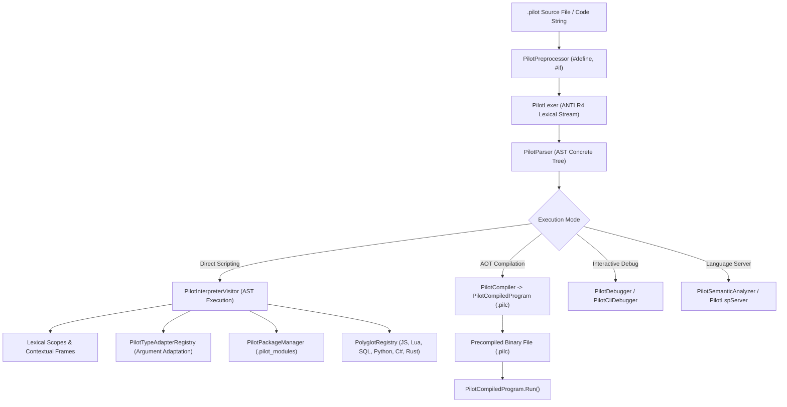

# Pilot Programming Language

> **Type-Safe, Flexible, Configurable, Decoupled, Beautiful, Efficient, and Extendible.**

**Pilot** is a modern general-purpose programming language blending Pythonic elegance with C#-style robustness, native relational database operations, real-time determinism, polyglot interoperability, and universal package adoption.

---

## Table of Contents

- [Documentation & Reference Manuals](#documentation--reference-manuals)
- [Core Highlights](#core-highlights)
- [Design Philosophy](#design-philosophy)
- [Architecture & Repository Structure](#architecture--repository-structure)
- [Getting Started & Installation](#getting-started--installation)
- [Universal Package Manager (`pilot pkg`)](#universal-package-manager-pilot-pkg)
  - [Native Pilot Packages](#native-pilot-packages)
  - [Adopting Interop Packages (NuGet, npm, pip, Cargo, Maven, LuaRocks)](#adopting-interop-packages)
  - [Packaging CLI Reference](#packaging-cli-reference)
- [Virtual Environment System (`pilot venv`)](#virtual-environment-system-pilot-venv)
  - [Creating and Activating Environments](#creating-and-activating-environments)
  - [Virtual Environment CLI Reference](#virtual-environment-cli-reference)
  - [Automatic Dependency Sandboxing](#automatic-dependency-sandboxing)
  - [Programmatic Runtime API](#programmatic-runtime-api)
- [Language Features & Syntax Reference](#language-features--syntax-reference)
  - [1. Type Safety, Variables & Control Flow](#1-type-safety-variables--control-flow)
  - [2. Preconditions & Cleanup (`guard` and `defer`)](#2-preconditions--cleanup-guard-and-defer)
  - [3. Type Adapters, Argument Adaptation & Repeated Calls](#3-type-adapters-argument-adaptation--repeated-calls)
  - [4. Advanced Method Groups & Dispatch](#4-advanced-method-groups--dispatch)
  - [5. Algebraic Class Composition & Typestates](#5-algebraic-class-composition--typestates)
  - [6. Structural Projection & Scoped Lexical Extensions](#6-structural-projection--scoped-lexical-extensions)
  - [7. Contextual Parameters (Native Dependency Injection)](#7-contextual-parameters-native-dependency-injection)
  - [8. Design-by-Contract (`requires` and `ensures`)](#8-design-by-contract-requires-and-ensures)
  - [9. Exhaustive Pattern Matching Assignments](#9-exhaustive-pattern-matching-assignments)
  - [10. Relational & In-Memory Database Set Operations](#10-relational--in-memory-database-set-operations)
  - [11. Concurrency, Channels & Actors](#11-concurrency-channels--actors)
  - [12. Real-Time Determinism & Units of Measure](#12-real-time-determinism--units-of-measure)
  - [13. Metaprogramming, Macros & AST Generative Classes](#13-metaprogramming-macros--ast-generative-classes)
- [Polyglot Interoperability](#polyglot-interoperability)
- [Compilation & Scripting Runtime](#compilation--scripting-runtime)
- [Interactive Debugger & REPL](#interactive-debugger--repl)
- [Language Server Protocol (LSP) & Tooling](#language-server-protocol-lsp--tooling)
- [Running the Test Suites](#running-the-test-suites)
- [Step-by-Step Architecture Guide](#step-by-step-architecture-guide)

---

## Documentation & Reference Manuals

Explore the complete, navigable Pilot documentation suite in [`docs/index.md`](docs/index.md):

### Core Language Reference Manuals
- **[Master Milestones & Roadmap Tracker (`MILESTONES.md`)](MILESTONES.md)** — Dependency-verified roadmap and concurrency matrix tracking completed milestones (M1–M10), cross-milestone grammar/semantic conflict invariants, and upcoming strategic phases (M11–M27: exhaustive ADTs, concise `T?` null-safety, localized `T ! E` value errors, expression ergonomics & class-like literals, dynamic-schedule `for` loops & zero-marshalling C-ABI guarantees, bidirectional type inference, first-class keywords & homoiconic call-quoting, reactive/autodiff/dry-run projections, runtime-to-`comptime` demotion, accurate bidirectional `--emit`/`--from` transpilers & `pilot fmt` with `--viable-license-only`, bootstrapped & curated `stdlib`, DAP GUI breakpoints, deep LLVM/WASM linking, `pilot perf` auto-optimizer, self-hosted compiler, and package registry evaluation).
- **[Master Documentation Hub (`docs/index.md`)](docs/index.md)** — Central navigation portal, architecture pipeline, and cross-reference index.
- **[Exhaustive Lexical Reference (`docs/lexical-reference.md`)](docs/lexical-reference.md)** — Every lexer token, preprocessor directive (`#define`, `#if`, `#region`, `#pragma`), diagnostic code (`PREPROC001`–`PREPROC011`), keyword category, contextual identifier rule, numeric/dimensional literal (`50ms`, `100Hz`, `64KB`), string/f-string/symbol literal, and operator/delimiter.
- **[Exhaustive Syntax & Grammar Reference (`docs/syntax-reference.md`)](docs/syntax-reference.md)** — Every EBNF grammar production from `Pilot.g4`, program structure, `{}` vs `:` suites, type annotations, classes, algebraic class math, typestates, pattern matching, LINQ/SQL queries, concurrency, real-time blocks, macros, and the 19-level operator precedence table.
- **[Exhaustive Functions, Methods & Runtime API Reference (`docs/functions-and-apis.md`)](docs/functions-and-apis.md)** — Every global built-in function, built-in module (`json`, `venv`, `TypeAdapter`), scripting host API, Universal Root Object method, collection/matrix/generator/future/lazy method, Design-by-Contract intrinsic, standard contract (`IList`, `IEquatable`, etc.), and runtime exception type.

### 15 Deep-Dive Concept Guides (`docs/concepts/`)
1. **[Types, Variables, Collections & Control Flow](docs/concepts/01-types-variables-control-flow.md)**
2. **[Guard, Defer & Structured Exception Handling](docs/concepts/02-guard-defer-exceptions.md)**
3. **[First-Class Method Groups & Multi-Dispatch](docs/concepts/03-method-groups-and-dispatch.md)**
4. **[First-Class Type Adapters & Scalar-to-Collection Repetition](docs/concepts/04-type-adapters-and-repetition.md)**
5. **[Algebraic Class Composition & Typestate Classes](docs/concepts/05-algebraic-classes-and-typestates.md)**
6. **[Structural Projections, Scoped Lexical Extensions & Generative Classes](docs/concepts/06-projections-extensions-generative.md)**
7. **[Contextual Parameters & Lexical Dependency Injection](docs/concepts/07-contextual-parameters-di.md)**
8. **[Exhaustive Pattern Matching & Deep Destructuring](docs/concepts/08-exhaustive-pattern-matching.md)**
9. **[Design-by-Contract, Contract Delegation & Method Stealing](docs/concepts/09-design-by-contract.md)**
10. **[Native Database Engine, LINQ Queries & SQL-First DML](docs/concepts/10-database-and-sql.md)**
11. **[Concurrency, Stateful Generators & Lazy Evaluation](docs/concepts/11-concurrency-generators-lazy.md)**
12. **[Polyglot Interoperability & Resumable Yield-Bridge Coroutines](docs/concepts/12-polyglot-interoperability.md)**
13. **[Metaprogramming, Homoiconic Lisp & Universal Root Object](docs/concepts/13-metaprogramming-and-lisp.md)**
14. **[Hard Real-Time Systems, Dimensional Units & Native Matrix Types](docs/concepts/14-realtime-and-matrix-types.md)**
15. **[Universal Package Manager, Virtual Environments, Preprocessor & Tooling](docs/concepts/15-packaging-venv-and-tooling.md)**

---

## Core Highlights

- **Pythonic Syntax + C# Robustness**: Familiar syntax with properties (`get`/`set`), operator overloads, generic `where` constraints, interfaces, contract delegation, and method stealing.
- **Universal Package Manager**: First-class native packaging with full capability to adopt dependencies from **NuGet** (.NET), **npm** (Node), **pip** (Python), **Cargo** (Rust), **Maven** (Java), and **LuaRocks** (Lua).
- **Argument Type Adapters & Auto-Vectorization**: Adapt arguments to matching signatures (e.g. `str` -> `int`, `dict` -> `Model`), or repeat singular calls over collections via `each`, `..` spread, `*` broadcast, or `with auto_repeat`.
- **Method Groups**: Auto-routing switchboards over heterogeneous collections, currying signature sieves, fallback unions (`|`), and multi-cast broadcasts (`*`).
- **Algebraic Types & Typestates**: Compose classes using set algebra (`Admin = BaseUser | AdminPrivileges`, `FreeUser = BaseUser - BillingModule`), and morph object types based on state (`Connection[Disconnected]` -> `Connection[Connected]`).
- **Contextual Parameters**: Implicit downstream parameter propagation (`context db: Database`) bound via lexical `with context db = ...` blocks.
- **Design-by-Contract**: Declarative pre-conditions (`requires`) and post-conditions (`ensures`) with snapshot introspection (`old(expr)`).
- **Deep Polyglot Engine**: Direct inline block execution for JavaScript, Java, Lua, C, C++, Assembly, PostgreSQL, MySQL, Python, C#, and Rust.

---

## Design Philosophy

1. **Flexible**: Adaptable syntax, dynamic-to-static typing continuum, and seamless interop across 10+ programming ecosystems.
2. **Configurable**: Configurable execution contexts, extensible polyglot registries, and pluggable type adapters.
3. **Decoupled**: Distinct boundaries between lexical parsing (ANTLR4), runtime interpretation (`PilotInterpreterVisitor`), compilation (`PilotCompiler`), debugging (`PilotDebugger`), and language server services (`PilotLspServer`).
4. **Beautiful**: Clean, expressive syntax free of excessive boilerplate, inspired by Python, Rust, and modern C#.
5. **Efficient**: Low-overhead interpretation, compiled binary cache format (`.pilc`), and fast deterministic dispatch.
6. **Extendible**: Extensible via macros (`quote`/`quasiquote`), lexical extensions (`extension ... on ...`), and custom user type adapters (`adapter`).

---

## Architecture & Repository Structure

```
Pilot/
├── antlr/
│   └── Pilot.g4                 # Master ANTLR4 compiler grammar
├── Cli/
│   ├── Program.cs               # Production CLI entrypoint (run, compile, debug, pkg, repl, all)
│   └── PilotRepl.cs             # Interactive REPL session
├── Compiler/
│   ├── PilotCompiler.cs         # Two-phase AST compiler
│   └── PilotCompiledProgram.cs  # Serialized binary program format (.pilc)
├── Debugging/
│   ├── PilotDebugger.cs         # Core debugger engine (breakpoints, call stacks, locals)
│   └── PilotCliDebugger.cs      # Interactive CLI debugger terminal
├── Preprocessing/
│   └── PilotPreprocessor.cs     # Macro preprocessor with #define, #if, #region directives
├── Runtime/
│   ├── Adapters/
│   │   └── PilotTypeAdapterRegistry.cs # Argument type adapters & converters
│   ├── Builtins/
│   │   └── PilotBuiltinRegistry.cs    # Global built-in functions
│   ├── Contracts/
│   │   └── PilotContractRegistry.cs   # Contract delegation (IList, IEquatable) & method stealing
│   ├── ControlFlow/
│   │   └── PilotExceptions.cs         # Typed exceptions (PilotTypeException, PilotNullReferenceException)
│   ├── Environment/
│   │   ├── PilotScope.cs              # Lexical symbol scopes
│   │   └── PilotEnvironment.cs        # Scoped runtime environment
│   ├── Execution/
│   │   ├── PilotEngine.cs             # Main execution engine
│   │   ├── PilotExecutionContext.cs    # Execution context state & contextual parameter frames
│   │   └── PilotInterpreterVisitor.cs # High-performance ANTLR AST visitor
│   ├── Interop/
│   │   └── PolyglotRegistry.cs        # Extended providers (JS, Java, ASM, C++, C, Lua, SQL)
│   ├── Packaging/
│   │   ├── PilotPackageManifest.cs    # pilot.json model
│   │   ├── PilotPackageLock.cs        # pilot.lock.json lockfile model
│   │   ├── PilotPackageManager.cs     # Universal package manager
│   │   └── Adapters/                  # Adopted interop adapters (NuGet, npm, pip, cargo, maven, luarocks)
│   └── Values/
│       ├── PilotValue.cs              # High-performance value union struct
│       ├── PilotFunction.cs           # First-class function & coroutine representation
│       ├── PilotMethodGroup.cs        # Auto-routing method group switchboard
│       └── PilotObject.cs             # Prototypal and class-based object instances
├── Pilot.LanguageServer/              # Production JSON-RPC 2.0 Language Server (LSP)
│   └── Semantics/
│       └── PilotSemanticAnalyzer.cs   # Semantic token provider, type checker, diagnostics
├── Pilot.Tests/                       # Automated xUnit test suite (217 tests, 0 warnings)
├── tests/                             # 26 end-to-end integration test suites (.pilot)
└── vscode-pilot/                      # Visual Studio Code syntax & language extension
```

---

## Getting Started & Installation

### Prerequisites
- [.NET 10 SDK](https://dotnet.microsoft.com/) (or .NET 8 / 9+)

### Build & Verification
```bash
# Clone the repository
git clone https://github.com/your-org/pilot.git
cd pilot

# Build solution
dotnet build Pilot.slnx

# Run all unit tests (217 unit tests)
dotnet test

# Run all integration test suites (26 suites)
dotnet run --project Pilot.csproj -- --all
```

### CLI Command Summary
```bash
pilot <file.pilot> [args...]       # Run script file directly
pilot <file.pilc> [args...]        # Run precompiled binary directly
pilot run <file.pilot> [args...]   # Explicit script execution
pilot debug <file.pilot>           # Start interactive CLI debugger session
pilot compile <file> [-o <out>]    # Precompile to binary format (.pilc)
pilot -c "<code>"                  # Execute inline code string
pilot --repl                       # Launch interactive REPL
pilot pkg <subcommand>             # Universal Package Manager
```

---

## Universal Package Manager (`pilot pkg`)

Pilot includes a complete, production-grade package manager capable of managing native Pilot packages and **adopting packages from foreign ecosystems**.

### Native Pilot Packages
Initialize a new project:
```bash
pilot pkg init my-awesome-app
```
This generates a `pilot.json` manifest:
```json
{
  "name": "my-awesome-app",
  "version": "0.1.0",
  "description": "Package my-awesome-app created with Pilot package manager.",
  "main": "main.pilot",
  "dependencies": {},
  "interopDependencies": {
    "nuget": {},
    "npm": {},
    "pip": {},
    "cargo": {},
    "maven": {},
    "luarocks": {}
  }
}
```

Add a native Pilot dependency:
```bash
pilot pkg add pilot-http@1.2.0
```

### Adopting Interop Packages
Pilot allows you to adopt packages from foreign package managers directly into your Pilot project:

```bash
# Adopt a .NET NuGet package
pilot pkg add nuget:Newtonsoft.Json@13.0.3

# Adopt a JavaScript npm package
pilot pkg add npm:lodash@4.17.21

# Adopt a Python PyPI package
pilot pkg add pip:requests@2.31.0

# Adopt a Rust Cargo crate
pilot pkg add cargo:serde@1.0

# Adopt a Java Maven artifact
pilot pkg add maven:org.json:json@20231013

# Adopt a Lua LuaRocks module
pilot pkg add luarocks:luasocket@3.0
```

### Packaging CLI Reference

| Command | Description |
| :--- | :--- |
| `pilot pkg init [name]` | Creates a new `pilot.json` manifest in the current directory |
| `pilot pkg add <pkgSpec>` | Adds a native or interop dependency (`[ecosystem:]package[@version]`) |
| `pilot pkg install` / `restore` | Restores all declared dependencies and writes `pilot.lock.json` |
| `pilot pkg remove <pkgSpec>` | Removes a dependency from `pilot.json` and lockfile |
| `pilot pkg list` | Lists all installed native and adopted interop dependencies |
| `pilot pkg pack [out.pilpkg]` | Bundles the project into a distributable `.pilpkg` archive |

---

## Virtual Environment System (`pilot venv`)

Pilot includes a complete, production-ready virtual environment system that isolates runtime environments, installed native modules, and foreign dependencies across projects.

### Environment Layout

When created, a Pilot virtual environment initializes a deterministic, self-contained filesystem layout:

```
myenv/
├── pilotvenv.cfg              # Key-value environment configuration
├── Scripts/                   # (bin/ on Unix/Linux/macOS)
│   ├── activate.ps1           # PowerShell activation script
│   ├── activate.bat           # Windows Command Prompt activation script
│   ├── deactivate.bat         # Windows Command Prompt deactivation script
│   ├── activate               # POSIX Bash/Zsh activation script
│   └── pilot.cmd / pilot      # Isolated binary launcher
├── lib/
│   └── .pilot_modules/        # Sandboxed module directory
│       ├── pilot/             # Native Pilot packages
│       ├── nuget/             # Adopted NuGet packages
│       ├── npm/               # Adopted npm packages
│       ├── pip/               # Adopted Python wheels
│       ├── cargo/             # Adopted Cargo crates
│       ├── maven/             # Adopted Java JARs
│       └── luarocks/          # Adopted Lua modules
└── include/                   # C/C++ header stubs for native extensions
```

### Creating and Activating Environments

**Create a virtual environment:**
```bash
# Basic creation in .venv
pilot venv create .venv

# Custom prompt name and include system-wide packages
pilot venv create /path/to/myenv --prompt dev-sandbox --system-site-packages
```

**Activate your environment:**
```powershell
# PowerShell
& .venv\Scripts\activate.ps1

# Windows CMD
.venv\Scripts\activate.bat

# Linux / macOS (POSIX)
source .venv/bin/activate
```

Once activated, your terminal prompt is prefixed with `(myenv)` and any `pilot pkg install` or `pilot pkg add` automatically targets the isolated `.venv/lib/.pilot_modules/` location.

**Deactivate:**
```bash
deactivate
```

### Virtual Environment CLI Reference

| Command | Description |
| :--- | :--- |
| `pilot venv create <path> [--prompt <name>] [--system-site-packages]` | Creates a new virtual environment at the specified directory |
| `pilot venv info [path]` | Inspects the currently active or detected virtual environment configuration |

### Automatic Dependency Sandboxing

When a virtual environment is active (detected via `PILOT_VENV` or `VIRTUAL_ENV`), the Pilot Universal Package Manager (`pilot pkg`) automatically switches its module resolution root to:
```
<venv_path>/lib/.pilot_modules
```
This guarantees that projects running different versions of native packages, NuGet assemblies, npm packages, or Python libraries do not conflict or contaminate system directories.

### Programmatic Runtime API

Pilot provides first-class language bindings to manage and query virtual environments directly within Pilot code:

```pilot
import venv # or virtual_environment

# Query activation status
let active = venv.is_active();
print("Is active: " + active);

# Query current environment root path
let env_path = venv.active_path();
print("Active venv path: " + env_path);

# Create a virtual environment programmatically
venv.create("./.custom_venv", "my-script-env");

# Programmatically activate or deactivate in-process
venv.activate("./.custom_venv");
print("Now running inside: " + venv.active_path());

venv.deactivate();
```

---

## Language Features & Syntax Reference

### 1. Type Safety, Variables & Control Flow

```pilot
let greeting : str = "Hello, Pilot!";
var counter : int = 0;
const MAX_LIMIT = 1000;

for i in 0..5:
    counter += i;

if counter > 5:
    println("Counter exceeded 5: " + str(counter));
```

### 2. Preconditions & Cleanup (`guard` and `defer`)

`guard` enforces early-exit preconditions, while `defer` guarantees LIFO cleanup execution:

```pilot
def process_file(path: str):
    guard path.length > 0 else:
        return "invalid_path";

    println("Opening file: " + path);
    defer println("Closing file resource.");
    defer println("Flushing pending buffers.");

    return "processed";
```

### 3. Type Adapters, Argument Adaptation & Repeated Calls

Pilot allows passing a different type into a signature when possible, adapting arguments or unrolling collections into repeated individual calls:

```pilot
let myarr = [];
let myitems : list = [1, 2, 3, 4, 5];

# Option 1: 'each' argument modifier
myarr.append(each myitems);

# Option 2: Collection spread '..' inline
myarr.append(..myitems);

# Option 3: Broadcast operator '*'
myarr.append*(myitems);

# Option 4: Scoped 'with auto_repeat' block
with auto_repeat:
    myarr.append(myitems);

# Repeated calls on functions returning values collects results into a list:
def square(x: int): return x * x;
let squares = square(each [1, 2, 3]); # -> [1, 4, 9]

# Language-level Type Adapters
adapter str -> int:
    return int(self);

def calc(x: int): return x * 10;
let val = calc("42"); # Automatically adapts "42" -> 42 -> 420
```

### 4. Advanced Method Groups & Dispatch

Method groups provide unified dispatch over function overloads:

```pilot
# Overloaded method group
def process(data: int): return data * 2;
def process(data: str): return data.to_upper();
def process(data: list): return data.length;

# 1. Switchboard Auto-Routing over heterogeneous collections:
let mixed = [42, "hello", [1, 2, 3], 99];
let routed = mixed.map(process); # [84, "HELLO", 3, 198]

# 2. Currying (The Signature Sieve):
def draw(shape: Circle, color: Color): ...
def draw(shape: Square, color: Color): ...
def draw(shape: Triangle, angle: float): ...

const draw_red = draw(color=Color.RED); # Narrowed group of (Circle) and (Square)

# 3. Group Fallback & Union (|):
const serialize_any = Json.serialize | Xml.serialize;
serialize_any(my_object);

# 4. Multi-Cast Execution (*):
on_event*(PlayerJoined("Isaac")); # Invokes all matching event overloads
```

### 5. Algebraic Class Composition & Typestates

```pilot
class BaseUser:
    let id = 1;

class AdminPrivileges:
    def ban(self, uid) { return "banned"; }

class BillingModule:
    def pay(self, amount) { return "paid"; }

# Set Algebra on classes:
class Admin = BaseUser | AdminPrivileges;      # Union
class FreeUser = BaseUser - BillingModule;      # Subtraction
class Common = AdminPrivileges & BillingModule; # Intersection

# Typestate Classes (Morphing Types):
class Connection:
    state Disconnected:
        def connect(self) -> Self[Connected]: ...
    state Connected:
        def send(self, data): ...
        def close(self) -> Self[Disconnected]: ...

let conn = Connection();
let active = conn.connect();
active.send("payload");
```

### 6. Structural Projection & Scoped Lexical Extensions

```pilot
# Structural Projection (->)
class Employee:
    let name = "Isaac";
    let department = "Engineering";
    let salary = 120000;

let dto = employee -> { name, department };
# dto is: { "name": "Isaac", "department": "Engineering" }

# Scoped Lexical Extensions (Monkey Patching with Scope Safety)
extension StringHelpers on str:
    def double(self): return self + self;

with extension StringHelpers:
    println("hi".double()); # "hihi"
# Outside the block, 'double' is not present on str
```

### 7. Contextual Parameters (Native Dependency Injection)

Contextual parameters are implicitly propagated downstream without boilerplate passing:

```pilot
def save_user(user, context db: Database):
    db.execute("INSERT", user);

def register_user(payload, context db: Database):
    save_user(payload["username"]); # db implicitly forwarded

with context db = Database("postgresql://localhost:5432"):
    register_user({ "username": "Isaac" });
```

### 8. Design-by-Contract (`requires` and `ensures`)

```pilot
def transfer(amount: float, source: Account, dest: Account)
    requires amount > 0
    requires source.balance >= amount
    ensures source.balance == old(source.balance) - amount:

    source.deduct(amount);
    dest.add(amount);
```

### 9. Exhaustive Pattern Matching Assignments

```pilot
# Record pattern matching destructuring
{ "id": userId, "metadata": { "role": role } } = fetch_user_record();

# List pattern matching with slice rest spread
[head, ..tail] = [10, 20, 30, 40];
```

### 10. Relational & In-Memory Database Set Operations

```pilot
database InMemoryStore:
    table users (id int primary key, name str, active bool);

# LINQ-style query with grouping and ordering
let activeAdmins = from u in users
                   where u.active == true
                   order by u.name ascending
                   select u.name;

# Postgres SQL operations
transaction:
    insert into users values (1, "Isaac", true)
    on conflict do nothing;
    savepoint sp1;
    commit;
```

### 11. Concurrency, Channels & Actors

```pilot
actor Worker:
    def handle(self, task):
        return "completed:" + task;

let ch = channel(10);
spawn:
    ch <- "message";

select:
    case msg = <-ch:
        println("Received: " + msg);
    timeout 500ms:
        println("Timed out waiting for channel.");
```

### 12. Real-Time Determinism & Units of Measure

```pilot
# Dimensional units of measure
let dist = 100 [m];
let duration = 9.58 [s];
let speed = dist / duration; # speed has dimensional unit [m/s]

# Real-time execution budgets
@hard_realtime
@wcet(50us)
def telemetry_tick():
    noalloc:
        # Guarantee zero GC allocation within bounded cycle
        pass;
```

### 13. Metaprogramming, Macros & AST Generative Classes

```pilot
# Compile-time AST macro
macro log_expr(expr):
    quote:
        println("Result of expression is: " + str(expr));

# Generative Class Blocks
class DatabaseModel:
    generate:
        for field in ["id", "username", "created_at"]:
            inject_field(field);
```

---

## Polyglot Interoperability

Pilot provides native inline blocks for 10+ language ecosystems:

```pilot
# 1. SQL with Structured Row Objects
let users = postgresql {
    select id, name, count(*) from accounts where id in (1, 2, 3);
}
for u in users:
    println(u.name);

# 2. Python Interop with Variable Sharing & Yielding
let myVariable = "Hello from Pilot!";
python {
    print(myVariable)
}

# 3. Inline JavaScript, C, C++, Lua, and Assembly
let jsVal = js {
    let x = 10;
    return x * 4;
}

let luaVal = lua {
    return 100
}

let asmVal = asm {
    mov eax, 42
}
```

---

## Compilation & Scripting Runtime

Pilot functions as both a zero-overhead scripting engine and an ahead-of-time precompiler:

```bash
# 1. Scripting mode (Direct execution)
pilot my_script.pilot

# 2. Ahead-Of-Time Precompilation (.pilot -> .pilc)
pilot compile my_script.pilot -o my_script.pilc

# 3. Direct execution of precompiled binary
pilot my_script.pilc
```

---

## Interactive Debugger & REPL

Pilot features a complete interactive command-line debugger with source tracking and breakpoint control:

```bash
pilot debug my_script.pilot
```

Debugger Commands:
- `b <line>`: Set breakpoint at line
- `c` / `continue`: Continue execution
- `n` / `step`: Step over to next statement
- `s` / `stepin`: Step into function
- `o` / `stepout`: Step out of function
- `l` / `locals`: Inspect local variables in current stack frame
- `bt` / `stack`: Print full call stack trace
- `q` / `quit`: Terminate debugger

Interactive REPL:
```bash
pilot --repl
```

---

## Language Server Protocol (LSP) & Tooling

Pilot includes a standalone JSON-RPC 2.0 Language Server communicating over standard I/O:

```bash
dotnet run --project Pilot.LanguageServer/Pilot.LanguageServer.csproj
```

Features:
- **Semantic Tokens Provider**: High-fidelity semantic highlighting.
- **Type Checker & Diagnostics**: Immutability enforcement, type checking, guard/defer checks.
- **VS Code Extension**: Located in `vscode-pilot/` with syntax definitions and language configurations.

---

## Running the Test Suites

Pilot is validated through 217 unit tests and 26 end-to-end integration test suites:

```bash
# Run unit tests
dotnet test

# Run all 26 integration suites
dotnet run --project Pilot.csproj -- --all
```

---

## Step-by-Step Architecture Guide



1. **Preprocessing (`PilotPreprocessor`)**:
   Processes directives (`#define`, `#undef`, `#if`, `#else`, `#endif`, `#region`), filtering active lines and recording macro definitions.
2. **Lexing & Parsing (`antlr/Pilot.g4`)**:
   Transforms preprocessed characters into a token stream and generates a concrete syntax tree (CST).
3. **Semantic Analysis & Scope Resolution (`PilotEnvironment`)**:
   Tracks hierarchical symbol scopes, closures, contextual parameter stacks (`ContextualBindings`), and active lexical extensions (`ActiveExtensions`).
4. **Type Adaptation & Method Dispatch (`PilotTypeAdapterRegistry` & `PilotMethodGroup`)**:
   Evaluates function calls, resolves exact or adapted argument types, and performs repeated call unrolling over collections when singular arguments are expected.
5. **Polyglot Execution (`PolyglotRegistry`)**:
   Routes foreign blocks (`postgresql`, `js`, `lua`, `python`, etc.) to dedicated language adapters, returning structured rows and native Pilot objects.
6. **Package Resolution (`PilotPackageManager`)**:
   Loads native Pilot modules and adopted interop dependencies from `.pilot_modules/` or system feeds based on `pilot.json` and `pilot.lock.json`.
