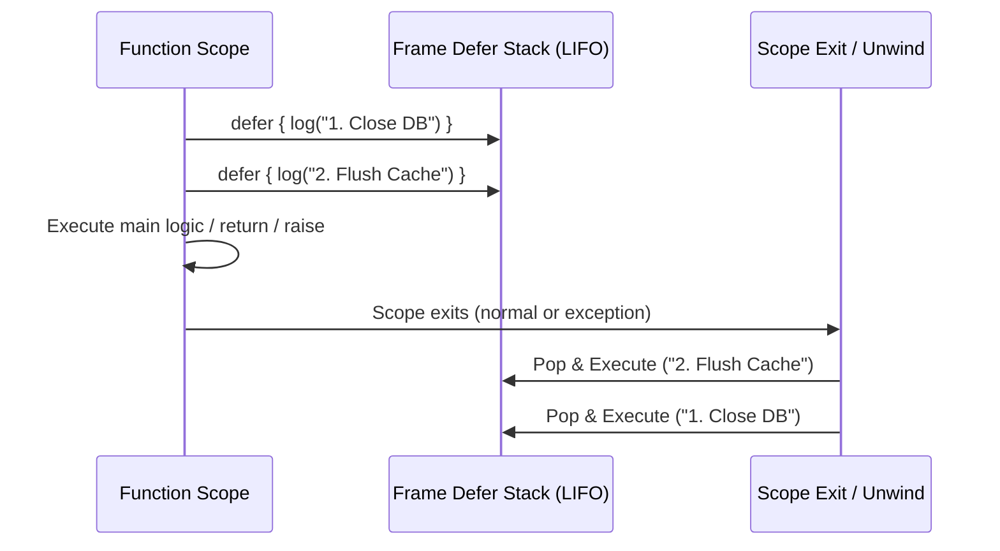

# Concept 02: Guard, Defer & Structured Exception Handling

[← Prev: Types, Variables & Control Flow](./01-types-variables-control-flow.md) | [🏠 Documentation Hub](../index.md) | [🔤 Lexical Reference](../lexical-reference.md) | [📐 Syntax Reference](../syntax-reference.md) | [⚙️ Functions & API](../functions-and-apis.md) | [Next: Method Groups & Dispatch →](./03-method-groups-and-dispatch.md)

---

## 1. Concept Overview & Design Rationale

Pilot combines three complementary mechanisms to keep error handling and resource cleanup flat, predictable, and leak-free:

1. **`guard ... else` Early-Exit Preconditions**: Inspired by Swift, `guard` enforces invariants or unpacks patterns at the top of a scope. If the condition or pattern fails, the `else` block executes and **must** transfer control out of the current flow (`return`, `break`, `continue`, or `raise`), eliminating deeply nested "arrow-code" `if` pyramids.
2. **`defer` LIFO Cleanup Stack**: Inspired by Go and Zig, `defer` registers cleanup code directly next to resource acquisition. Deferred blocks are guaranteed to run in **Last-In, First-Out (LIFO)** order when the enclosing function (or top-level script) exits—even if an exception is raised or an early `return` is taken.
3. **`try` / `except` / `else` / `finally` & `with` Context Managers**: Full structured exception handling with type-filtered catch clauses (`except DivideByZeroError as err`), an `else` branch that runs only when no exception occurred, a `finally` block, and deterministic `with` resource management (`close()` / `dispose()`).

---

## 2. Exact Lexical Tokens Used

| Token Name | Lexeme(s) | Lexical Category & Purpose |
| :--- | :--- | :--- |
| `GUARD`, `ELSE` | `guard`, `else` | Precondition invariant check or pattern-binding guard |
| `LET`, `VAR` | `let`, `var` | Pattern-binding form of `guard` (`guard let ... = ... else`) |
| `DEFER` | `defer` | Schedules a block or statement for LIFO scope-exit execution |
| `TRY`, `EXCEPT`, `CATCH`, `FINALLY` | `try`, `except`, `catch`, `finally` | Structured exception handling blocks (`except` & `catch` supported) |
| `AS` | `as` | Binds the caught exception message or `with` resource variable |
| `RAISE` | `raise` | Raises a runtime user error |
| `ASSERT` | `assert` | Evaluates an invariant and raises `AssertionError` on failure |
| `WITH`, `ASYNC` | `with`, `async` | Deterministic resource management block |

---

## 3. Exact Syntax & Grammar Rules

Formal Grammar Specification ([`pilot-parser`](file:///home/moony/Documents/dev/projects/Pilot/crates/pilot-parser)):

```antlr
// Guard Statement (Boolean Condition or Pattern Unpacking)
guard_stmt
    : GUARD expr ELSE suite
    | GUARD (LET | VAR) pattern_target ASSIGN expr ELSE suite
    ;

// Defer Statement (Suite Block or Single Inline Statement)
defer_stmt
    : DEFER (suite | small_stmt NEWLINE?)
    ;

// Structured Exception Handling
try_stmt
    : TRY suite
      ( (catch_or_except_clause suite)+ (ELSE suite)? (FINALLY suite)?
      | FINALLY suite
      )
    ;

catch_or_except_clause
    : EXCEPT (expr (AS IDENTIFIER)?)?
    | CATCH (LPAREN IDENTIFIER? RPAREN)?
    ;

// Raise & Assert Statements
raise_stmt
    : RAISE (expr (FROM expr)?)?
    ;

assert_stmt
    : ASSERT expr (COMMA expr)?
    ;

// Resource Management With Statement
with_stmt
    : ASYNC? WITH with_item (COMMA with_item)* suite
    ;

with_item
    : expr (AS expr)?
    ;
```

---

## 4. Compiler & Runtime Execution Mechanics

### 4.1 `guard` Execution & Lowering
In [`crates/pilot-parser/src/lib.rs`](../../crates/pilot-parser/src/lib.rs) and [`crates/pilot-analysis/src/infer.rs`](../../crates/pilot-analysis/src/infer.rs):
1. **Boolean Guard (`guard expr else suite`)**: Evaluates `expr`. If the condition evaluates to truthy, execution continues past the guard. If falsy, the `else` block executes and diverges control flow (`return`, `break`, `continue`, `raise`).
2. **Pattern Guard (`guard let pattern = expr else suite`)**: Evaluates `expr` and binds pattern variables directly into the current scope via [`pilot-analysis::patterns`](../../crates/pilot-analysis/src/patterns.rs). If pattern binding fails, the `else` block executes.

### 4.2 `defer` LIFO Scope Cleanup
In Pilot's Perceus linear memory model and PilVM v3 runtime:
- `defer` statements produce `NodeKind::DeferStmt` AST nodes.
- Each activation frame maintains a LIFO unwinding stack. Deferred blocks execute in reverse registration order whenever the enclosing function or block exits—regardless of whether exit occurred via normal fallthrough, early `return`, or an uncaught exception.



### 4.3 Exception Hierarchy & `try` / `except` / `catch` Matching
Structured exception handling in Pilot is represented by `NodeKind::TryStmt` (111) and `NodeKind::CatchClause` (112) in [`crates/pilot-ast/src/lib.rs`](../../crates/pilot-ast/src/lib.rs):

| Exception Type Name | Category | Trigger Condition |
| :--- | :--- | :--- |
| `TypeError` | Type Violation | Invalid operand types, typestate violation, invalid call target |
| `DivideByZeroError` | Arithmetic Error | `/`, `//`, or `%` with a zero divisor |
| `IndexError` | Bounds Check | Out-of-bounds list, tuple, string, or matrix index |
| `KeyError` | Key Lookup | Missing key lookup on a `map` |
| `NullReferenceError` | Null Check | Member access or call on `null`/`none`/`undefined` without `?.` |
| `AssertionError` | Invariant Check | `assert` statement or `assert()` call failed |
| `RecursionError` | Stack Overflow | Call stack depth exceeded configured recursion limit |
| `ContractError` | Contract Violation | `requires`, `ensures`, or contract interface violation |
| `TimeoutError` | Concurrency | `bounded` loop limit or asynchronous timeout exceeded |
| `MatchError` | Pattern Mismatch | Inexhaustive or failed destructuring pattern mismatch |
| `ContextError` | Context Parameter | Unbound `context` parameter with no default value |
| `UserError` | Application Error | Raised explicitly by `raise expr` |

When a `try` block encounters an exception:
- `except TypeName as err:` clauses match when the runtime exception matches `TypeName` or a parent category.
- `catch (err)` or bare `except:` acts as a universal catch-all handler.
- If `as err` or `catch (err)` binds an identifier, the error payload is assigned to that scoped symbol in the catch block.
- Optional `else` blocks execute if and only if no exception occurred within the `try` body.
- Optional `finally` blocks execute unconditionally upon exiting the `try` / `except` / `else` construct.

---

## 5. Available Functions, Methods & Properties

| Construct / Function | Signature | Description |
| :--- | :--- | :--- |
| `assert` (statement) | `assert cond [, message]` | Evaluates `cond`; raises `AssertionError` with optional `message` if falsy. |
| `assert` (function) | `assert(cond[, message]) -> none` | Functional form of `assert` usable inside expressions or pipelines. |
| `raise` (statement) | `raise value` | Raises a runtime exception with `value` payload and unwinds the active stack frame. |
| Context Manager cleanup | `with expr as var { ... }` | Deterministically invokes `close()` or `dispose()` when exiting the `with` block. |

---

## 6. Complete Runnable Examples

See [`examples/showcase/02_guard_defer_and_exceptions.pilot`](../../examples/showcase/02_guard_defer_and_exceptions.pilot) for the full executable showcase.

```pilot
let audit_trail = []

def process_order(payload: map) -> str {
    // Register LIFO defers: guaranteed to run in reverse order on ANY exit
    defer { audit_trail.append("step-3: release connection") }
    defer { audit_trail.append("step-2: flush metrics") }

    // 1. Pattern-binding guard: unpacks 'order_id' and 'amount' into scope
    guard let {"order_id": id, "amount": amt} = payload else {
        audit_trail.append("step-1: rejected malformed payload")
        return "INVALID_PAYLOAD"
    }

    // 2. Boolean invariant guard
    guard amt > 0 else {
        raise f"Invalid order amount: {amt}"
    }

    audit_trail.append(f"step-1: processed #{id}")
    return f"OK:{id}"
}

// Normal execution
let status = process_order({"order_id": 101, "amount": 50})
assert(status == "OK:101")
// audit_trail is now:
// ["step-1: processed #101", "step-2: flush metrics", "step-3: release connection"]

// Exception handling with try / except / else / finally
let caught_msg = ""
let finally_ran = false

try {
    process_order({"order_id": 102, "amount": -10})
} except UserError as err {
    caught_msg = err
} finally {
    finally_ran = true
}

assert(caught_msg == "Invalid order amount: -10")
assert(finally_ran == true)
```

---

[← Prev: Types, Variables & Control Flow](./01-types-variables-control-flow.md) | [🏠 Documentation Hub](../index.md) | [🔤 Lexical Reference](../lexical-reference.md) | [📐 Syntax Reference](../syntax-reference.md) | [⚙️ Functions & API](../functions-and-apis.md) | [Next: Method Groups & Dispatch →](./03-method-groups-and-dispatch.md)
