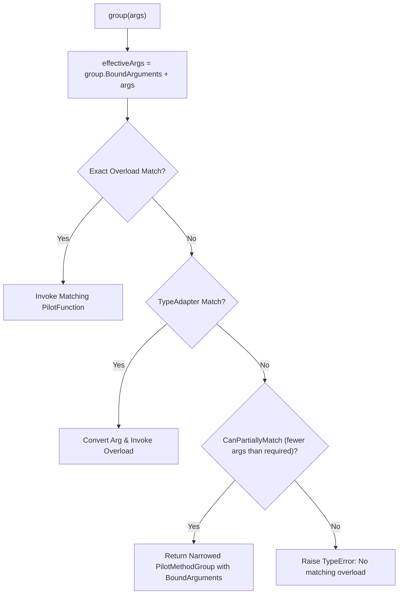

# Concept 03: First-Class Method Groups & Multi-Dispatch

[← Prev: Guard, Defer & Exceptions](./02-guard-defer-exceptions.md) | [🏠 Documentation Hub](../index.md) | [🔤 Lexical Reference](../lexical-reference.md) | [📐 Syntax Reference](../syntax-reference.md) | [⚙️ Functions & API](../functions-and-apis.md) | [Next: Type Adapters & Repetition →](./04-type-adapters-and-repetition.md)

---

## 1. Concept Overview & Design Rationale

In most languages, overloaded functions exist only as a compile-time name-resolution trick and cannot be passed around as first-class values without manually disambiguating their signature. In Pilot, **Method Groups (`PilotMethodGroup`) are first-class runtime values**:

1. **Automatic Overload Promotion**: Defining multiple `def` or `fn` functions with the same name in the same scope automatically coalesces them into a single `PilotMethodGroup`.
2. **Heterogeneous Collection Switchboards**: Passing a method group to `list.map(group)` dynamically dispatches each element in a mixed collection (`[10, "hello", [1, 2]]`) to its matching typed overload at runtime.
3. **Signature Sieve (Partial Application by Arity & Type)**: Calling a method group with fewer arguments than its overloads require filters out incompatible candidates and returns a **narrowed, curried `PilotMethodGroup`** with the supplied arguments pre-bound.
4. **Algebraic Group Composition (`|`)**: Two distinct method groups can be merged into a prioritized fallback pipeline using the union operator (`PrimaryGroup | FallbackGroup`).
5. **Multi-Cast Broadcast (`group*(args)`)**: Invoking a method group with the splat call syntax executes **every** compatible overload in sequence and returns a `list` of all results.
6. **Runtime AST Reflection**: Calling `group.overloads` returns a list of `OverloadInfo` objects exposing parameter counts, type annotations, and AST representations.

---

## 2. Exact Lexical Tokens Used

| Token Name | Lexeme(s) | Lexical Category & Purpose |
| :--- | :--- | :--- |
| `DEF`, `FN`, `FUNCTION`, `FUNC` | `def`, `fn`, `function`, `func` | Function declaration keywords |
| `PIPE` | `\|` | Method group union / fallback composition operator (`g1 \| g2`) |
| `STAR` | `*` | Broadcast multi-cast invocation operator (`group*(args)`) |
| `COLON`, `ARROW` | `:`, `->` | Parameter type annotations (used for overload matching) and return types |

---

## 3. Exact Syntax & Grammar Rules

Formal Grammar Specification ([`pilot-parser`](file:///home/moony/Documents/dev/projects/Pilot/crates/pilot-parser)):

```antlr
// Function / Overload Definitions
func_def
    : decorators? ASYNC? (DEF | FN | FUNCTION | FUNC) func_name type_params?
      LPAREN param_list? RPAREN (ARROW type_annotation)? contract_clause*
      (suite | ASSIGN expr NEWLINE?)
    ;

// Broadcast Call Trailer & Union Composition
bitwise_or_expr
    : bitwise_xor_expr (PIPE bitwise_xor_expr)*
    ;

trailer
    : LPAREN arglist? RPAREN
    | STAR LPAREN arglist? RPAREN   // Multi-cast broadcast: group*(args)
    | LBRACK subscriptlist RBRACK
    | (DOT | QUESTION_DOT) (IDENTIFIER | keyword_as_id)
    ;
```

---

## 4. Runtime Execution Mechanics

### 4.1 Automatic Promotion in Function Definition
When a function definition is evaluated in the runtime ([`pilot-vm`](file:///home/moony/Documents/dev/projects/Pilot/crates/pilot-vm) and [`pilot-analysis`](file:///home/moony/Documents/dev/projects/Pilot/crates/pilot-analysis)):
- It checks if an existing binding exists in the current scope for `name`.
- If an existing function exists with the same name, both are merged into a `MethodGroup`.
- If a `MethodGroup` already exists, the new overload is registered or replaces an overload with an identical signature key.

### 4.2 Overload Dispatch & The Signature Sieve
When a `MethodGroup` is called with arguments `args`:
1. **Prepend Bound Arguments**: If the group was previously narrowed via the Signature Sieve, pre-bound arguments are prepended to `args`.
2. **Exact Overload Search**: Iterates through overloads in registration order, checking parameter count (accounting for defaults and variadic `*args`), `ref` compatibility, and parameter type annotations. The first matching function is invoked.
3. **Type Adapter Fallback**: If no overload matches directly, the runtime checks the type adapter registry to see if converting an argument via a registered `adapter` satisfies an overload.
4. **Signature Sieve**: If arguments are provided and no full overload matched, the runtime filters overloads to find all candidates whose **required parameter count is strictly greater than `args.len()`** and whose leading parameters match the types of `args`. If one or more candidates survive, it returns a new `MethodGroup` containing only the surviving overloads with the arguments pre-bound.



### 4.3 Union Composition (`|`) & Multi-Cast Broadcast (`group*(args)`)
- **Union (`g1 | g2`)**: In `EvaluateBinaryOp("|")`, if either operand is a `MethodGroup` or `Function`, `PilotMethodGroup.Combine(leftGroup, rightGroup)` produces a new `PilotMethodGroup` whose overload table contains all overloads of `g1` followed by all overloads of `g2`.
- **Broadcast (`group*(args)`)**: Handled in `ApplyPostfixWithTarget` when `trailer.STAR() != null`. `InvokeMethodGroupBroadcast` collects **all** overloads matching `effectiveArgs`, executes each one sequentially, and returns a `PilotValue.FromList(results)`.

---

## 5. Available Functions, Methods & Properties

### `MethodGroup` Members
| Member | Kind | Signature / Type | Description |
| :--- | :--- | :--- | :--- |
| `.name` | Property | `str` | Name of the method group (e.g., `"format"` or `"primary|fallback"`). |
| `.overloads` | Property | `list[OverloadInfo]` | Returns a list of reflection objects for all overloads currently in the group. |
| `.broadcast(args...)` | Method | `list` | Explicitly executes all matching overloads and returns their results as a `list` (equivalent to `group*(args)`). |
| `g1 \| g2` | Operator | `MethodGroup` | Combines two functions or method groups into a prioritized fallback group. |
| `group*(args...)` | Operator | `list` | Broadcast splat invocation of all matching overloads. |

### `OverloadInfo` Reflection Object Properties
Each item in `group.overloads` is a `PilotObject` of class `"OverloadInfo"` created by `PilotMethodGroup.CreateOverloadInfoObject`:
- `.name -> str`: The underlying function's name.
- `.param_count -> int`: Total number of non-context parameters.
- `.param_types -> list[str]`: List of parameter type annotations (defaults to `"any"` when unannotated).
- `.ast -> str`: Human-readable signature summary (`def name(p1: int, p2: str)`).

---

## 6. Complete Runnable Examples

See [`examples/showcase/03_method_groups_and_dispatch.pilot`](../../examples/showcase/03_method_groups_and_dispatch.pilot) for the full executable showcase.

```pilot
// 1. Automatic promotion of same-named functions into a MethodGroup
def describe(x: int) -> str { return f"int({x})" }
def describe(x: str) -> str { return f"str({x.upper()})" }
def describe(x: list) -> str { return f"list(len={len(x)})" }

// 2. Heterogeneous collection switchboard routing
let mixed = [42, "pilot", [1, 2, 3]]
let routed = mixed.map(describe)
assert(routed == ["int(42)", "str(PILOT)", "list(len=3)"])

// 3. Signature Sieve: partial application filters by type AND arity
def connect(host: str, port: int) -> str { return f"TCP://{host}:{port}" }
def connect(host: str, socket_path: str) -> str { return f"UNIX://{host}:{socket_path}" }
def connect( retry_count: int, timeout_ms: int, verbose: bool) -> str { return "RETRY_CFG" }

// Passing a single 'str' eliminates the 3-arg retry overload and binds host="localhost"
let local_connect = connect("localhost")
assert(len(local_connect.overloads) == 2)
assert(local_connect(8080) == "TCP://localhost:8080")
assert(local_connect("/tmp/app.sock") == "UNIX://localhost:/tmp/app.sock")

// 4. Union composition (|) for fallback dispatch
def handle_primary(code: int) -> str { return f"Code:{code}" }
def handle_fallback(msg: str) -> str { return f"Fallback:{msg}" }

let pipeline = handle_primary | handle_fallback
assert(pipeline(200) == "Code:200")
assert(pipeline("timeout") == "Fallback:timeout")

// 5. Multi-cast broadcast invocation: validate*(input)
def check(val: int) -> str { return "non-negative" if val >= 0 else "negative" }
def check(val: dynamic) -> str { return f"type={type_of(val)}" }

let reports = check*(10)
assert(reports == ["non-negative", "type=int"])
```

---

[← Prev: Guard, Defer & Exceptions](./02-guard-defer-exceptions.md) | [🏠 Documentation Hub](../index.md) | [🔤 Lexical Reference](../lexical-reference.md) | [📐 Syntax Reference](../syntax-reference.md) | [⚙️ Functions & API](../functions-and-apis.md) | [Next: Type Adapters & Repetition →](./04-type-adapters-and-repetition.md)
