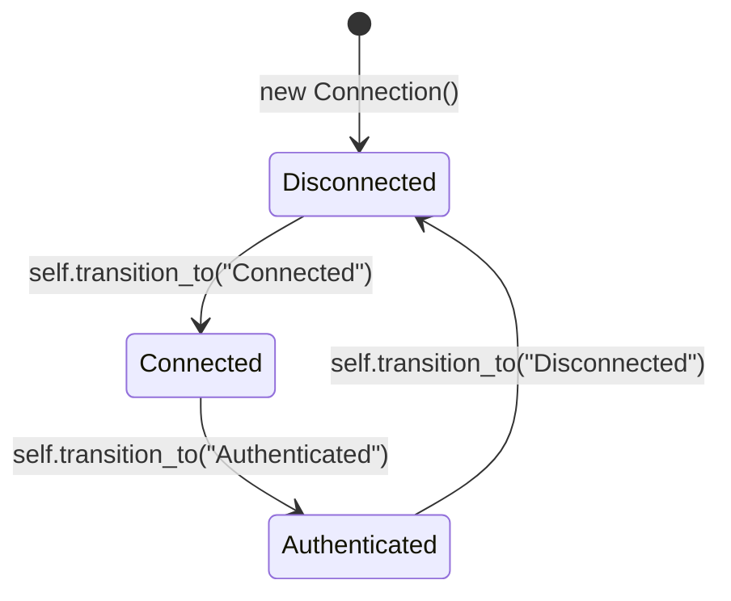

# Concept 05: Algebraic Class Composition & Typestate Classes

[← Prev: Type Adapters & Repetition](./04-type-adapters-and-repetition.md) | [🏠 Documentation Hub](../index.md) | [🔤 Lexical Reference](../lexical-reference.md) | [📐 Syntax Reference](../syntax-reference.md) | [⚙️ Functions & API](../functions-and-apis.md) | [Next: Projections, Extensions & Generative →](./06-projections-extensions-generative.md)

---

## 1. Concept Overview & Design Rationale

Traditional object-oriented inheritance (`class Child : Parent`) forces rigid hierarchies and makes it difficult to exclude unwanted methods or enforce protocol state machines. Pilot introduces two first-class advancements to class design:

1. **Algebraic Class Composition (`|`, `-`, `&`)**: Classes can be synthesized using set-theoretic operators over existing classes:
   - **Union (`class C = A | B`)**: Combines all fields, methods, properties, states, and contracts from both `A` and `B`.
   - **Difference / Subtraction (`class C = A - B` or `A - "member"`)**: Clones `A` while stripping out all members defined in `B` or a specific named member (`"delete"`), making it trivial to construct read-only or restricted capability facades.
   - **Intersection (`class C = A & B`)**: Retains only the members (fields, methods, properties, states) that exist in **both** `A` and `B`.
2. **Typestate Classes (`state Name { ... }`)**: Classes can partition their methods into explicit lifecycle states (`state Closed`, `state Open`, `state Authenticated`). Instances start in the first declared state, transition via `self.transition_to("StateName")`, and automatically raise a `TypeError` if code attempts to call a method belonging to an inactive state.

---

## 2. Exact Lexical Tokens Used

| Token Name | Lexeme(s) | Lexical Category & Purpose |
| :--- | :--- | :--- |
| `CLASS`, `STRUCT` | `class`, `struct` | Class and value-struct declaration keywords |
| `ABSTRACT`, `SEALED`, `PARTIAL` | `abstract`, `sealed`, `partial` | Class modifiers |
| `STATE` | `state` | Declares a typestate block inside a class body |
| `CONSTRUCTOR` | `constructor` | Constructor declaration keyword (alongside `def __init__` or `def ClassName`) |
| `GET`, `SET` | `get`, `set` | Computed property accessor blocks |
| `OPERATOR` | `operator` | Operator overloading declaration (`operator +(other)`) |
| `PIPE`, `MINUS`, `AMPERSAND` | `\|`, `-`, `&` | Algebraic class union, subtraction, and intersection operators |

---

## 3. Exact Syntax & Grammar Rules

Formal Grammar Specification ([`pilot-parser`](file:///home/moony/Documents/dev/projects/Pilot/crates/pilot-parser)):

```antlr
// Standard & Algebraic Class Declarations
class_def
    : decorators? (ABSTRACT | SEALED | PARTIAL)* (CLASS | STRUCT) IDENTIFIER type_params?
      ASSIGN class_expr suite? NEWLINE?
    | decorators? (ABSTRACT | SEALED | PARTIAL)* (CLASS | STRUCT) IDENTIFIER type_params?
      (LPAREN arglist? RPAREN)? ((COLON | EXTENDS | IMPLEMENTS) base_type_list)? suite
    ;

// Set-Theoretic Class Algebra Expressions
class_expr
    : class_expr PIPE class_expr        // Union: A | B
    | class_expr MINUS class_expr       // Subtraction: A - B
    | class_expr AMPERSAND class_expr   // Intersection: A & B
    | LPAREN class_expr RPAREN
    | IDENTIFIER
    | STRING                            // Named member exclusion: A - "secret_method"
    ;

// Typestate Blocks & Class Members
class_member
    : access_modifier? (STATIC | VIRTUAL | OVERRIDE | ABSTRACT | READONLY | CONST)*
      ( func_def
      | var_decl NEWLINE?
      | property_def
      | constructor_def
      | operator_def
      | state_block
      | steal_stmt NEWLINE?
      | contract_delegate_stmt NEWLINE?
      | macro_def
      )
    ;

state_block
    : STATE IDENTIFIER suite
    ;
```

---

## 4. Runtime Execution Mechanics

### 4.1 Algebraic Class Evaluation
In the class compilation and evaluation pipeline ([`pilot-analysis`](file:///home/moony/Documents/dev/projects/Pilot/crates/pilot-analysis) and [`pilot-vm`](file:///home/moony/Documents/dev/projects/Pilot/crates/pilot-vm)), algebraic expressions construct a new class definition by combining member records:
- **Union (`A | B`)**: Copies all members of `A`, then overlays all members of `B` (right-hand side wins on name collisions, or merges overloads). If `class U = A | B { ... }` also includes a trailing body suite, the body members are applied on top of the composed class.
- **Difference (`A - B` or `A - "member_name"`)**: Copies all members of `A`, then removes every field, method, property, or state method present in `B` (or matching `"member_name"`).
- **Intersection (`A & B`)**: Copies only fields, methods, properties, and state methods whose names exist in **both** `A` and `B`.

### 4.2 Typestate Enforcement & Lifecycle Transitions
When a class contains one or more `state Name { ... }` blocks:
1. **Initialization**: The initial state is set to the name of the first `state` block declared in the class. When constructing an object instance, `instance.CurrentState = cls.InitialState`.
2. **State-Scoped Method Storage**: Methods defined inside `state Open { ... }` are stored in state-scoped dispatch tables rather than global method tables. Methods defined outside any `state` block remain available in all states.
3. **Runtime Dispatch Verification**: When `obj.method(args)` is called on an instance:
   - First, the runtime checks if `memberName` is an always-available method or belongs to `obj.CurrentState`.
   - If not found, the runtime checks if the method exists in **another** state of the class.
   - If it exists in another state (e.g., `"Open"` while `CurrentState` is `"Closed"`), Pilot raises a descriptive `TypeError`:
     `Method 'send' is only available in state(s) [Open], but object of class 'Connection' is currently in state 'Closed'.`



---

## 5. Available Functions, Methods & Properties

### Built-In Typestate Instance Methods (Available on All `PilotObject` Instances)
| Method | Signature | Description |
| :--- | :--- | :--- |
| `self.transition_to` | `obj.transition_to(new_state: str) -> none` | Transitions `obj.CurrentState` to `new_state`. Raises `TypeError` if `new_state` is not a declared state on the class (when the class uses `state` blocks). |
| `self.current_state` | `obj.current_state() -> str \| none` | Returns the active state name (`"Closed"`, `"Open"`, etc.), or `none` if the class does not use typestates. |
| `obj.__state__` | Property (`str \| none`) | Direct property read/write for the instance's `CurrentState`. |

### Special Class Methods & Operator Overloads
- **Constructors**: `def __init__(self, ...)`, `constructor(...)`, or `def ClassName(...)`
- **String Representation**: `def __str__(self) -> str` or `def to_string(self) -> str`
- **Equality**: `def equals(self, other) -> bool`
- **Resource Cleanup**: `def close(self)` or `def dispose(self)` (invoked automatically by `with` blocks)
- **Operator Overloading**: `operator +(other)` or `def __add__(self, other)`, `-` (`__sub__`), `*` (`__mul__`), `/` (`__truediv__`), `==` (`__eq__`), `!=` (`__ne__`), `<` (`__lt__`), `<=` (`__le__`), `>` (`__gt__`), `>=` (`__ge__`)

---

## 6. Complete Runnable Examples

See [`examples/showcase/05_algebraic_classes_and_typestates.pilot`](../../examples/showcase/05_algebraic_classes_and_typestates.pilot) for the full executable showcase.

```pilot
// 1. Algebraic Class Composition (Union '|', Subtraction '-', Intersection '&')
class Reader {
    def read() -> str { return "data" }
    def close() -> str { return "closed-reader" }
}

class Writer {
    def write(msg: str) -> str { return f"wrote:{msg}" }
    def delete_all() -> str { return "wiped!" }
    def close() -> str { return "closed-writer" }
}

// Union of Reader and Writer, minus the dangerous 'delete_all' method
class SafeReadWrite = (Reader | Writer) - "delete_all"

// Intersection retains only members present in BOTH Reader and Writer ('close')
class ClosableOnly = Reader & Writer

let rw = SafeReadWrite()
assert(rw.read() == "data")
assert(rw.write("ok") == "wrote:ok")

// 2. Typestate Classes with compile/runtime protocol safety
class TcpSocket {
    let endpoint: str = ""

    state Disconnected {
        def connect(addr: str) -> str {
            self.endpoint = addr
            self.transition_to("Connected")
            return f"Connected to {addr}"
        }
    }

    state Connected {
        def send(payload: str) -> str {
            return f"[{self.endpoint}] <<< {payload}"
        }

        def disconnect() -> none {
            self.transition_to("Disconnected")
        }
    }
}

let sock = TcpSocket()
assert(sock.current_state() == "Disconnected")

// Calling sock.send("hi") here would raise a TypeError!
sock.connect("10.0.0.1:443")
assert(sock.current_state() == "Connected")
assert(sock.send("PING") == "[10.0.0.1:443] <<< PING")

sock.disconnect()
assert(sock.current_state() == "Disconnected")
```

---

[← Prev: Type Adapters & Repetition](./04-type-adapters-and-repetition.md) | [🏠 Documentation Hub](../index.md) | [🔤 Lexical Reference](../lexical-reference.md) | [📐 Syntax Reference](../syntax-reference.md) | [⚙️ Functions & API](../functions-and-apis.md) | [Next: Projections, Extensions & Generative →](./06-projections-extensions-generative.md)
