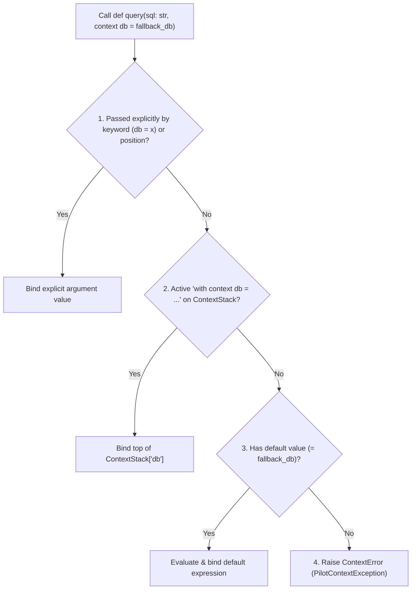

# Concept 07: Contextual Parameters & Lexical Dependency Injection

[← Prev: Projections, Extensions & Generative](./06-projections-extensions-generative.md) | [🏠 Documentation Hub](../index.md) | [🔤 Lexical Reference](../lexical-reference.md) | [📐 Syntax Reference](../syntax-reference.md) | [⚙️ Functions & API](../functions-and-apis.md) | [Next: Exhaustive Pattern Matching →](./08-exhaustive-pattern-matching.md)

---

## 1. Concept Overview & Design Rationale

In large applications, cross-cutting dependencies—such as database connections, loggers, tracing spans, authentication principals, or configuration objects—must either be threaded manually through dozens of intermediate function signatures ("parameter drilling") or stored in brittle mutable globals.

Pilot solves this with **First-Class Contextual Parameters (`context`)** and **Scoped Lexical Context Binding (`with context ...`)**:

- **Explicit Leaf Signatures**: A function declares ambient dependencies right in its parameter list using the `context` modifier (`def save_user(name: str, context db: Database, context log = default_log)`).
- **Zero Parameter Drilling**: Intermediate functions (`handle_request() -> service_layer() -> save_user()`) do **not** need to know about or pass `db` or `log`.
- **Lexically Scoped Injection (`with context name = val`)**: Callers bind contextual values for the duration of a `with` block. bindings automatically propagate down the call stack and are deterministically restored when the `with` block exits (even on exceptions).
- **Explicit Override & Fallback**: Any caller can still pass a `context` parameter explicitly (positionally or by keyword `save_user("alice", db = mock_db)`), or rely on a parameter default value if no `with context` block is active.

---

## 2. Exact Lexical Tokens Used

| Token Name | Lexeme(s) | Lexical Category & Purpose |
| :--- | :--- | :--- |
| `CONTEXT` | `context` | Parameter modifier (`def f(context cfg)`) and `with`-block binding keyword (`with context cfg = val`) |
| `WITH` | `with` | Establishes a lexical scope for one or more `context` bindings |
| `ASSIGN` | `=` | Binds a contextual value in `with context name = expr` or sets a default value in `def f(context name = default)` |

---

## 3. Exact Syntax & Grammar Rules

From [`Pilot.g4`](../../antlr/Pilot.g4):

```antlr
// Contextual Parameter Modifier in Function Definitions
param
    : (CONTEXT | EACH | REPEAT | PARAMS)? REF? IDENTIFIER (COLON type_annotation)? (ASSIGN expr)?
    ;

// Lexical Context Injection in With Statements
with_stmt
    : ASYNC? WITH with_item (COMMA with_item)* suite
    ;

with_item
    : CONTEXT IDENTIFIER ASSIGN expr    // e.g., with context db = prod_db, context log = std_log
    | EXTENSION IDENTIFIER
    | expr (AS expr)?
    ;
```

---

## 4. Runtime Execution Mechanics

### 4.1 Context Stack Management (`PilotExecutionContext`)
In [`PilotExecutionContext.cs`](../../Runtime/Execution/PilotExecutionContext.cs):
- The execution context maintains `_contextStack`, a `Dictionary<string, Stack<PilotValue>>` mapping each contextual variable name to a LIFO stack of bound values.
- When `with context db = prod_db` is entered (`VisitWith_stmt` in [`PilotInterpreterVisitor.cs`](../../Runtime/Execution/PilotInterpreterVisitor.cs)):
  1. `prod_db` is evaluated and pushed via `Context.PushContextValue("db", val)`.
  2. The `with` body `suite` executes. Any nested `with context db = replica_db` pushes onto the same `"db"` stack, shadowing the outer value for the inner scope.
  3. Inside the `finally` block of `VisitWith_stmt`, `Context.PopContextValue("db")` pops the value, restoring the previous binding immediately.

### 4.2 Four-Stage Resolution Order (`BindParameters`)
When a function with `PilotParameter.IsContext == true` is called, `BindParameters` resolves the parameter using a strict 4-stage priority order:



If none of the first three stages succeed, Pilot raises a `PilotContextException` (`ContextError`):
`Contextual parameter 'db' requires a value in context (via 'with context db = ...') or an explicit argument.`

---

## 5. Available Functions, Methods & Properties

| Construct / Exception | Syntax | Description |
| :--- | :--- | :--- |
| `context` parameter | `def fn(a, context dep: Type = default)` | Marks `dep` for automatic resolution from the active lexical context stack. |
| `with context` block | `with context k1 = v1, context k2 = v2 { ... }` | Binds one or more contextual dependencies for the duration of the block and all functions called within it. |
| `ContextError` | `try { ... } except ContextError as e { ... }` | Exception type raised when a required `context` parameter has no active binding, no explicit argument, and no default value. |

---

## 6. Complete Runnable Examples

See [`examples/showcase/07_contextual_parameters_and_di.pilot`](../../examples/showcase/07_contextual_parameters_and_di.pilot) for the full executable showcase.

```pilot
// Leaf function declares contextual dependencies ('env_name' has a default; 'db_url' is required)
def execute_query(table: str, context db_url: str, context env_name: str = "dev") -> str {
    return f"[{env_name}@{db_url}] SELECT * FROM {table}"
}

// Intermediate service layer has ZERO knowledge of 'db_url' or 'env_name'
def fetch_users() -> str {
    return execute_query("users")
}

// 1. Inject dependencies lexically at the top-level boundary
with context db_url = "postgres://prod:5432", context env_name = "prod" {
    assert(fetch_users() == "[prod@postgres://prod:5432] SELECT * FROM users")

    // 2. Nested context override shadows 'db_url' only inside the inner block
    with context db_url = "sqlite://memory" {
        assert(fetch_users() == "[prod@sqlite://memory] SELECT * FROM users")
    }

    // Automatically restored to prod upon exiting inner block
    assert(fetch_users() == "[prod@postgres://prod:5432] SELECT * FROM users")
}

// 3. Explicit keyword override works with or without an active 'with context' block
assert(execute_query("logs", db_url = "local://test") == "[dev@local://test] SELECT * FROM logs")

// 4. Missing required context raises catchable ContextError
let missing_caught = false
try {
    fetch_users()
} except ContextError as err {
    missing_caught = true
}
assert(missing_caught == true)
```

---

[← Prev: Projections, Extensions & Generative](./06-projections-extensions-generative.md) | [🏠 Documentation Hub](../index.md) | [🔤 Lexical Reference](../lexical-reference.md) | [📐 Syntax Reference](../syntax-reference.md) | [⚙️ Functions & API](../functions-and-apis.md) | [Next: Exhaustive Pattern Matching →](./08-exhaustive-pattern-matching.md)
