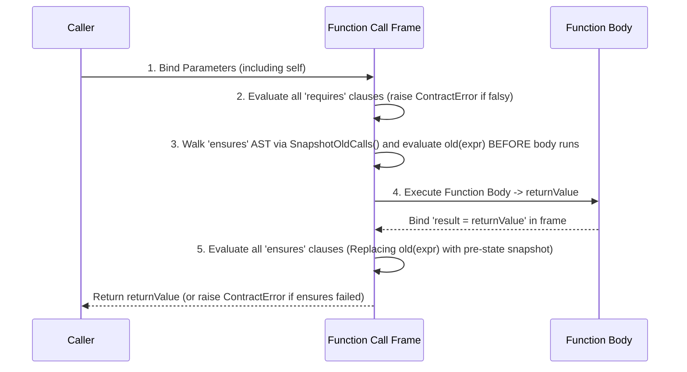

# Concept 09: Design-by-Contract, Contract Delegation & Method Stealing

[← Prev: Exhaustive Pattern Matching](./08-exhaustive-pattern-matching.md) | [🏠 Documentation Hub](../index.md) | [🔤 Lexical Reference](../lexical-reference.md) | [📐 Syntax Reference](../syntax-reference.md) | [⚙️ Functions & API](../functions-and-apis.md) | [Next: Native Database & SQL →](./10-database-and-sql.md)

---

## 1. Concept Overview & Design Rationale

Pilot unifies Eiffel-style **Design-by-Contract (DbC)** with zero-boilerplate **Contract Delegation** and **Horizontal Method Stealing**:

1. **Function & Method Contracts (`requires`, `ensures`, `old()`, `result`)**: Functions declare preconditions (`requires`) and postconditions (`ensures`) directly in their signature. When a function has `ensures` clauses containing `old(expr)`, the runtime automatically snapshots `expr` **before** the function body runs and binds `result` to the return value before verifying the postconditions.
2. **Contract Delegation (`IList.Contracts = self._items`)**: Implementing standard interfaces like `IList`, `IEquatable`, or `IDisposable` via wrapper methods is tedious. In Pilot, a class can delegate an entire contract to an inner field (`IList.Contracts = self._items` or `delegate IList to _items`), automatically wiring all contract operations (`len()`, `[]` indexing, `.append()`, `for ... in` iteration, `map` key equality) while allowing the class to selectively override specific methods (e.g., a custom validating `append`).
3. **Horizontal Method Stealing (`steal` / `steal from`)**: Classes can copy concrete methods directly from unrelated donor classes (`steal Logger` or `steal from MathUtils [clamp, lerp]`) without brittle multiple-inheritance diamonds.

---

## 2. Exact Lexical Tokens Used

| Token Name | Lexeme(s) | Lexical Category & Purpose |
| :--- | :--- | :--- |
| `REQUIRES`, `ENSURES`, `INVARIANT` | `requires`, `ensures`, `invariant` | Precondition, postcondition, and invariant contract clauses |
| `CONTRACTS` | `contracts`, `Contracts` | Contract delegation property/keyword (`IList.Contracts = _items`) |
| `DELEGATE`, `TO`, `FOR` | `delegate`, `to`, `for` | Alternative contract delegation forms (`delegate IList to _items`, `contracts for IList = _items`) |
| `STEAL`, `FROM` | `steal`, `from` | Full (`steal Donor`) or selective (`steal from Donor [m1, m2]`) method stealing |

---

## 3. Exact Syntax & Grammar Rules

From [`Pilot.g4`](../../antlr/Pilot.g4):

```antlr
// 1. Preconditions & Postconditions on Functions/Methods
func_def
    : decorators? ASYNC? (DEF | FN | FUNCTION | FUNC) func_name type_params?
      LPAREN param_list? RPAREN (ARROW type_annotation)? contract_clause*
      (suite | ASSIGN expr NEWLINE?)
    ;

contract_clause
    : (REQUIRES | ENSURES | INVARIANT) expr
    ;

// 2. Contract Delegation Inside Classes
contract_delegate_stmt
    : IDENTIFIER DOT CONTRACTS ASSIGN expr
    | CONTRACTS FOR IDENTIFIER ASSIGN expr
    | DELEGATE IDENTIFIER TO expr
    ;

// 3. Horizontal Method Stealing Inside Classes
steal_stmt
    : STEAL FROM IDENTIFIER (LBRACK identifier_list RBRACK)?
    | STEAL IDENTIFIER (LBRACK identifier_list RBRACK)?
    ;
```

---

## 4. Runtime Execution Mechanics

### 4.1 Preconditions, `old(expr)` Snapshots & Postconditions (`CallFunction`)
In [`PilotInterpreterVisitor.cs`](../../Runtime/Execution/PilotInterpreterVisitor.cs), every call to a `PilotFunction` with `RequiresClauses` or `EnsuresClauses` executes a strict 4-step protocol:



### 4.2 Built-In Standard Contracts (`PilotContractRegistry`)
[`PilotContractRegistry.cs`](../../Runtime/Contracts/PilotContractRegistry.cs) defines 7 standard contracts and their method signatures:
- **`IList`**: `len`, `get`, `set`, `append`, `remove`, `contains`, `clear`
  - **Runtime Integration**: When an object delegates or implements `IList`, global `len(obj)`, subscript `obj[i]`, subscript assignment `obj[i] = v`, and `for x in obj` automatically dispatch through the `IList` contract (or its delegated target field)!
- **`IEquatable`**: `equals`, `hash`
  - **Runtime Integration**: `PilotValue.Equals(PilotValue)` and `PilotValue.GetHashCode()` check if a `PilotObject` implements or delegates `IEquatable`. If so, `Dictionary<PilotValue, PilotValue>` (`map`) and `HashSet<PilotValue>` (`set`) automatically use the object's structural key equality and hash code!
- **`IComparable`**: `compare_to`
- **`IMap` / `IDictionary`**: `len`, `get`, `set`, `contains_key`, `keys`, `values`, `remove`, `clear`
- **`ISet`**: `len`, `add`, `remove`, `contains`, `clear`
- **`IDisposable`**: `dispose`, `close` (invoked automatically at the end of `with obj { ... }`)
- **`IEnumerable`**: `iterator`

When a method is called on an object (`obj.append(x)`):
1. Pilot checks if `obj`'s class defines a custom `def append(x)` method. **Explicit class methods always take precedence**, allowing custom validation before mutating the backing field.
2. If the class does not define `append` directly, Pilot checks `cls.ContractDelegations`. Finding `IList -> "_items"`, it resolves `obj.Fields["_items"]` and forwards `.append(x)` directly to the backing list!

### 4.3 Horizontal Method Stealing (`ExecuteStealStmt`)
When `steal DonorClass` or `steal from DonorClass [m1, m2]` executes inside `VisitClass_def`:
- It resolves `DonorClass` in the current scope.
- It copies either all methods (or only the bracket-listed methods `[m1, m2]`) from `DonorClass.Methods` into `targetClass.Methods` (`TryAdd` so the receiving class's own methods are never overwritten).
- When a stolen method is later invoked on an instance of `targetClass`, `self` binds to the `targetClass` instance!

---

## 5. Available Functions, Methods & Properties

| Intrinsic / Keyword | Context | Description |
| :--- | :--- | :--- |
| `requires <expr>` | Function signature | Precondition evaluated after parameter binding; raises `ContractError` if false. |
| `ensures <expr>` | Function signature | Postcondition evaluated after body execution; raises `ContractError` if false. |
| `old(expr)` | Inside `ensures` | Evaluates `expr` **before** the function body runs and substitutes that snapshot during `ensures` verification. |
| `result` | Inside `ensures` | Automatically bound to the function's return value during `ensures` verification. |
| `<Contract>.Contracts = self.<field>` | Inside `class` | Delegates all un-overridden methods of `<Contract>` (`IList`, `IEquatable`, etc.) to `<field>`. |
| `steal [from] Class [m1, m2]` | Inside `class` | Copies methods horizontally from `Class` into the current class. |

---

## 6. Complete Runnable Examples

See [`examples/showcase/09_contracts_and_method_stealing.pilot`](../../examples/showcase/09_contracts_and_method_stealing.pilot) and [`tests/18_contracts_and_method_stealing.pilot`](../../tests/18_contracts_and_method_stealing.pilot) for the full executable showcases.

```pilot
// 1. Preconditions (requires), Postconditions (ensures), old(), and result
class BankVault {
    let balance: int = 100

    def deposit(amount: int) -> int
        requires amount > 0
        ensures self.balance == old(self.balance) + amount
        ensures result == self.balance
    {
        self.balance = self.balance + amount
        return self.balance
    }
}

let vault = BankVault()
assert(vault.deposit(50) == 150)

// 2. Contract Delegation (IList + IEquatable) & Selective Method Override
class AuditHelper {
    def tag() -> str { return f"AUDITED(len={len(self._items)})" }
    def unused_helper() -> str { return "skip" }
}

class BoundedQueue {
    let id: str = "q1"
    let _items: list = []

    // Delegate IList to self._items and IEquatable to self.id
    IList.Contracts = self._items
    IEquatable.Contracts = self.id

    // Steal only 'tag' from AuditHelper
    steal from AuditHelper [tag]

    // Custom override intercepts .append() while len() and indexing delegate to _items!
    def append(val: int)
        requires len(self._items) < 3
    {
        self._items.append(val)
    }
}

let q1 = BoundedQueue()
q1.append(10)
q1.append(20)
assert(len(q1) == 2 and q1[0] == 10)
assert(q1.tag() == "AUDITED(len=2)")

// Because IEquatable is delegated to self.id ("q1"), two instances with id=="q1" map to the same key!
let q2 = BoundedQueue()
let registry = {}
registry[q1] = "ACTIVE"
assert(registry[q2] == "ACTIVE")
```

---

[← Prev: Exhaustive Pattern Matching](./08-exhaustive-pattern-matching.md) | [🏠 Documentation Hub](../index.md) | [🔤 Lexical Reference](../lexical-reference.md) | [📐 Syntax Reference](../syntax-reference.md) | [⚙️ Functions & API](../functions-and-apis.md) | [Next: Native Database & SQL →](./10-database-and-sql.md)
