# Concept 10: Native Database Engine, LINQ Queries & SQL-First DML

[← Prev: Design-by-Contract & Stealing](./09-design-by-contract.md) | [🏠 Documentation Hub](../index.md) | [🔤 Lexical Reference](../lexical-reference.md) | [📐 Syntax Reference](../syntax-reference.md) | [⚙️ Functions & API](../functions-and-apis.md) | [Next: Concurrency, Generators & Lazy →](./11-concurrency-generators-lazy.md)

---

## 1. Concept Overview & Design Rationale

Pilot treats relational and in-memory querying as a first-class language capability rather than opaque string literals passed to external drivers:

- **Unified LINQ-Style & SQL-First Queries**: Write queries starting with either `from u in users where ... select ...` (C# LINQ style) **or** `select u.name from u in users where ...` (SQL-first style) directly inside Pilot expressions.
- **Joins, Grouping, Aggregations & Set Algebra**: Native support for `join ... in ... on ... == ...`, `group ... by ... into g`, `having`, `order by ... asc/desc`, `select distinct`, `limit`, `offset`, and relational set operations (`union`, `union all`, `intersect`, `except`, `difference`).
- **Declarative Schemas, In-Memory Indexing & ACID Transactions**: Declare `database`, `model`/`table`/`schema`, `index by` (`hash`, `btree`, `unique`), O(1) `lookup ... where`, Postgres-style DML (`insert into ... on conflict ... returning`, `update ... returning`, `delete ... returning`), and `transaction` / `savepoint` / `commit` / `rollback` blocks.

---

## 2. Exact Lexical Tokens Used

| Token Name | Lexeme(s) | Lexical Category & Purpose |
| :--- | :--- | :--- |
| `DATABASE`, `MODEL`, `TABLE`, `SCHEMA` | `database`, `model`, `table`, `schema` | Database and table/entity schema declarations |
| `FROM`, `SELECT`, `DISTINCT` | `from`, `select`, `distinct` | Query source and projection clauses |
| `WHERE`, `HAVING` | `where`, `having` | Row filtering and group filtering clauses |
| `JOIN`, `INNER`, `LEFT`, `RIGHT`, `FULL`, `CROSS`, `OUTER`, `ON`, `EQUALS` | `join`, `inner`, `left`, `right`, `full`, `cross`, `outer`, `on`, `equals` | Relational join clauses and equijoin conditions |
| `GROUP`, `BY`, `INTO` | `group`, `by`, `into` | Grouping and group-continuation binding |
| `ORDER`, `ASC`, `DESC` | `order`, `asc`, `desc` | Multi-key sorting clauses |
| `LIMIT`, `OFFSET` | `limit`, `offset` | Pagination clauses |
| `UNION`, `INTERSECT`, `DIFFERENCE`, `EXCEPT`, `ALL` | `union`, `intersect`, `difference`, `except`, `all` | Set operations across queries |
| `INSERT`, `UPDATE`, `DELETE`, `VALUES`, `SET`, `CONFLICT`, `DO`, `NOTHING`, `RETURNING` | `insert`, `update`, `delete`, `values`, `set`, `conflict`, `do`, `nothing`, `returning` | Postgres-style DML statements |
| `INDEX`, `LOOKUP`, `UNIQUE`, `HASH`, `BTREE` | `index`, `lookup`, `unique`, `hash`, `btree` | In-memory index creation and fast key lookup |
| `TRANSACTION`, `COMMIT`, `ROLLBACK`, `SAVEPOINT`, `RELEASE` | `transaction`, `commit`, `rollback`, `savepoint`, `release` | Transaction lifecycle control |

---

## 3. Exact Syntax & Grammar Rules

From [`Pilot.g4`](../../antlr/Pilot.g4):

```antlr
// 1. LINQ-Style & SQL-First Query Expressions
query_expr
    : single_query (set_op single_query)*
    ;

single_query
    : from_clause query_body
    | select_clause from_clause query_body_no_select
    ;

from_clause
    : FROM IDENTIFIER (COLON type_annotation)? IN expr (WITH INDEX LPAREN identifier_list RPAREN)?
    ;

query_body
    : join_clause* where_clause? group_clause? having_clause? orderby_clause? select_or_group_clause limit_clause? offset_clause?
    ;

join_clause
    : (INNER | LEFT OUTER? | RIGHT OUTER? | FULL OUTER? | CROSS)? JOIN IDENTIFIER IN expr
      (ON expr (EQUALS | EQ) expr)? (INTO IDENTIFIER)?
    ;

group_clause
    : GROUP expr? BY expr (COMMA expr)* (INTO IDENTIFIER)?
    ;

orderby_clause
    : ORDER BY orderby_item (COMMA orderby_item)*
    ;

select_clause
    : SELECT DISTINCT? select_item (COMMA select_item)*
    ;

// 2. Indexing & Fast Lookup
index_stmt
    : CREATE? UNIQUE? INDEX IDENTIFIER? ON expr LPAREN index_column (COMMA index_column)* RPAREN
    | expr DOT INDEX BY LPAREN index_column (COMMA index_column)* RPAREN
    ;

lookup_expr
    : LOOKUP IDENTIFIER? IN? expr WHERE expr
    ;
```

---

## 4. Runtime Execution Mechanics

### 4.1 In-Memory Query Execution Pipeline (`ExecuteSingleQuery`)
In [`PilotInterpreterVisitor.cs`](../../Runtime/Execution/PilotInterpreterVisitor.cs), `VisitQuery_expr` evaluates relational queries directly over any in-memory collection (`list` of `map`s, `list` of `PilotObject` instances, `set`, or `range`):

```mermaid
flowchart LR
    Source["1. FROM source"] --> Joins["2. JOIN clauses (Inner / Left / Cross)"]
    Joins --> Where["3. WHERE predicate filter"]
    Where --> Group["4. GROUP BY key -> into g (key, items, count)"]
    Group --> Having["5. HAVING group filter"]
    Having --> Order["6. ORDER BY keys (ASC / DESC)"]
    Order --> Select["7. SELECT / DISTINCT projection"]
    Select --> Limit["8. OFFSET & LIMIT slicing"]
    Limit --> SetOp["9. UNION / INTERSECT / EXCEPT"]
```



- **Row Variable & Implicit Column Resolution**: Inside `where`, `order by`, and `select`, if the query variable is `from u in users`, both `u.age > 21` (qualified) and bare `age > 21` (unqualified column name on a `map` or `PilotObject`) are resolved automatically in the row scope!
- **Grouping Continuation (`group u by u.dept into g`)**: Produces group objects (`map`s) exposing:
  - `g.key` (or `g["key"]`): The grouping key value.
  - `g.items` (or `g["items"]`): The `list` of rows in that group.
  - `g.count` (or `g["count"]`): The integer number of rows in that group.
- **Aggregates in `select`**: Built-in aggregate calls `count()`, `sum(col)`, `avg(col)`, `min(col)`, and `max(col)` are evaluated over the current group (or over the entire filtered result set when no `group by` is present).

### 4.2 Set Operations (`ExecuteSetOp`)
- **`union`**: Concatenates left and right query results and removes duplicates.
- **`union all`**: Concatenates left and right query results preserving duplicates.
- **`intersect`**: Retains distinct rows present in both left and right results.
- **`except` / `difference`**: Retains distinct rows from the left result that do not appear in the right result.

---

## 5. Available Functions, Methods & Properties

| Query Construct / Aggregate | Signature / Form | Description |
| :--- | :--- | :--- |
| `from ... select` | `from x in src where ... select ...` | LINQ-ordered query returning a `list` of projected items. |
| `select ... from` | `select ... from x in src where ...` | SQL-ordered query returning a `list` of projected items. |
| `g.key`, `g.items`, `g.count` | Group object properties | Exposed on `into g` continuation variables after `group by`. |
| `count()` / `sum(e)` / `avg(e)` / `min(e)` / `max(e)` | Aggregate functions | Computed over grouped rows or whole-table aggregations. |
| `postgresql { ... }` / `mysql { ... }` | Inline SQL polyglot blocks | Executes SQL with automatic Pilot scope variable interpolation (`{var}`). |

---

## 6. Complete Runnable Examples

See [`examples/showcase/10_database_and_sql.pilot`](../../examples/showcase/10_database_and_sql.pilot) for the full executable showcase.

```pilot
let employees = [
    {"id": 1, "name": "Alice", "dept_id": 10, "salary": 120000},
    {"id": 2, "name": "Bob",   "dept_id": 20, "salary": 95000},
    {"id": 3, "name": "Cara",  "dept_id": 10, "salary": 135000},
    {"id": 4, "name": "Dan",   "dept_id": 20, "salary": 88000}
]

let departments = [
    {"id": 10, "dept_name": "Engineering"},
    {"id": 20, "dept_name": "Product"}
]

// 1. LINQ-style query with filter, descending sort, and map projection
let high_earners = from e in employees
                   where e["salary"] >= 100000
                   order by e["salary"] desc
                   select e["name"]

assert(high_earners == ["Cara", "Alice"])

// 2. Relational INNER JOIN across two collections
let joined = from e in employees
             join d in departments on e["dept_id"] == d["id"]
             order by e["id"] asc
             select {"employee": e["name"], "department": d["dept_name"]}

assert(joined[0] == {"employee": "Alice", "department": "Engineering"})

// 3. GROUP BY with 'into g' continuation
let dept_counts = from e in employees
                  group e by e["dept_id"] into g
                  select {"dept": g["key"], "headcount": g["count"]}

assert(len(dept_counts) == 2)

// 4. SQL-first syntax with DISTINCT, LIMIT, and UNION
let top_eng = select e["name"] from e in employees where e["dept_id"] == 10
let top_prd = select e["name"] from e in employees where e["dept_id"] == 20 limit 1
let combined = top_eng union top_prd
assert(len(combined) == 3)
```

---

[← Prev: Design-by-Contract & Stealing](./09-design-by-contract.md) | [🏠 Documentation Hub](../index.md) | [🔤 Lexical Reference](../lexical-reference.md) | [📐 Syntax Reference](../syntax-reference.md) | [⚙️ Functions & API](../functions-and-apis.md) | [Next: Concurrency, Generators & Lazy →](./11-concurrency-generators-lazy.md)
