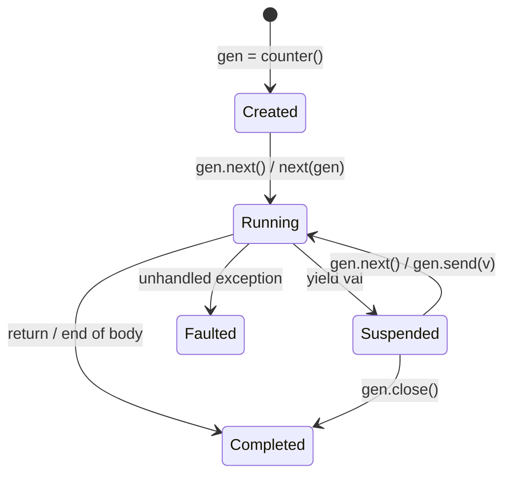

# Concept 11: Concurrency, Stateful Generators & Lazy Evaluation

[← Prev: Native Database & SQL](./10-database-and-sql.md) | [🏠 Documentation Hub](../index.md) | [🔤 Lexical Reference](../lexical-reference.md) | [📐 Syntax Reference](../syntax-reference.md) | [⚙️ Functions & API](../functions-and-apis.md) | [Next: Polyglot Interoperability →](./12-polyglot-interoperability.md)

---

## 1. Concept Overview & Design Rationale

Pilot provides three distinct execution models for deferred, incremental, and multi-threaded computation:

1. **Stateful Resumable Generators (`yield`, `PilotGenerator`)**: Functions containing `yield` compile into true pausable coroutines backed by a dedicated synchronization handshake (`ManualResetEventSlim`). Unlike batch-collected iterators, Pilot generators pause immediately at each `yield`, preserve their exact lexical call stack and local variables, accept bidirectional values via `.send(val)`, and can be closed deterministically via `.close()`.
2. **Thread-Isolated Futures & Data Parallelism (`spawn`, `await`, `parallel_map`)**: `spawn(fn, args...)` launches `fn` on a background thread with an **isolated clone of the execution context** (`Context.CloneIsolated()`), returning a `PilotFuture` handle (`await`, `.get_result(timeout_ms)`, `.cancel()`). `parallel_map(fn, list)` distributes collection items across worker threads using `Parallel.For` while maintaining deterministic output ordering.
3. **Memoized Lazy Thunks (`lazy(callable)`, `PilotLazy`)**: Wraps an expensive computation in a thread-safe deferred thunk. The computation runs at most once—either when `.value` / `.eval()` is accessed or **transparently** when any member or method is accessed on the lazy proxy.

---

## 2. Exact Lexical Tokens Used

| Token Name | Lexeme(s) | Lexical Category & Purpose |
| :--- | :--- | :--- |
| `YIELD`, `FROM` | `yield`, `from` | Suspends a generator and produces a value (`yield x` or `yield from seq`) |
| `ASYNC`, `AWAIT` | `async`, `await` | Asynchronous function modifier and `Future` suspension expression |
| `SPAWN`, `GO` | `spawn`, `go` | Spawns a concurrent task or `PilotFuture` |
| `PARALLEL`, `FOR` | `parallel`, `for` | Data-parallel loop modifier (`parallel for x in items`) |
| `ACTOR`, `CHANNEL`, `SELECT`, `TIMEOUT` | `actor`, `channel`, `select`, `timeout` | Actor declarations, typed channels, and channel multiplexing |
| `CHAN_SEND` | `<-` | Channel send (`ch <- msg`) and channel receive (`<-ch`) operator |
| `ATOMIC`, `SYNC`, `LOCK`, `ISOLATE` | `atomic`, `sync`, `lock`, `isolate` | Concurrency synchronization blocks |

---

## 3. Exact Syntax & Grammar Rules

From [`Pilot.g4`](../../antlr/Pilot.g4):

```antlr
// 1. Yield Expression & Statement
yield_expr
    : YIELD (FROM expr | testlist_star_expr)?
    ;

// 2. Spawn & Await
spawn_stmt
    : (SPAWN | GO) (suite | expr)
    ;

unary_expr
    : (PLUS | MINUS | TILDE | NOT | AWAIT | CHAN_SEND | AMPERSAND | STAR) unary_expr
    | primary (cascade_arm+ | trailer*)
    ;

// 3. Channel Select & Concurrency Blocks
select_stmt
    : SELECT LBRACE NEWLINE? select_clause* RBRACE
    ;

select_clause
    : CASE (IDENTIFIER ASSIGN)? CHAN_SEND expr (COLON suite | FAT_ARROW (stmt | expr) COMMA? NEWLINE?)
    | CASE expr CHAN_SEND expr (COLON suite | FAT_ARROW (stmt | expr) COMMA? NEWLINE?)
    | TIMEOUT expr (COLON suite | FAT_ARROW (stmt | expr) COMMA? NEWLINE?)
    | DEFAULT (COLON suite | FAT_ARROW (stmt | expr) COMMA? NEWLINE?)
    ;

concurrency_block
    : (ATOMIC | SYNC (LPAREN expr RPAREN)? | LOCK LPAREN expr RPAREN | ISOLATE) suite
    ;
```

---

## 4. Runtime Execution Mechanics

### 4.1 True Stateful Coroutines (`PilotGenerator`)
In [`PilotGenerator.cs`](../../Runtime/Values/PilotGenerator.cs) and `CallFunction` (`PilotInterpreterVisitor.cs`):
- **Generator Detection (`ContainsYield`)**: Before executing a `PilotFunction`, `PilotInterpreterVisitor` scans its AST body (ignoring nested inner `func_def`s) for any `yield_stmt` or `yield_expr`. If present, calling the function does **not** run the body immediately; instead, it returns `PilotValue.FromGenerator(new PilotGenerator(...))` in state `Created`.
- **Two-Way Handshake (`ResumeGate` & `CallerGate`)**:
  1. Calling `gen.next()` (or `next(gen)` or iterating in a `for` loop) signals `_resumeGate` and waits on `_callerGate`.
  2. The generator worker thread executes until `VisitYield_stmt` / `VisitYield_expr` calls `gen.Yield(val)`, which stores `_currentValue = val`, transitions state to `Suspended`, signals `_callerGate`, and blocks on `_resumeGate`.
  3. Calling `gen.send(sentVal)` passes `sentVal` into the suspended `Yield(val)` call, which becomes the return value of the `(yield ...)` expression inside the generator!
  4. When the generator body returns or `gen.close()` is called, state transitions to `Completed` and `gen.is_done` becomes `true`.



### 4.2 Thread-Isolated Futures (`PilotFuture`) & `parallel_map`
In [`PilotFuture.cs`](../../Runtime/Concurrency/PilotFuture.cs):
- **`spawn(fn, args...)`**: Creates a cloned `PilotExecutionContext` via `Context.CloneIsolated()` so the background `Task.Run` thread has its own independent call-frame stack while reading current variable bindings safely.
- **Awaiting**: Both `await fut` (` unary_expr`) and `fut.await()` / `fut.get_result(timeout_ms)` block until the task finishes, re-raising any uncaught background `PilotRuntimeException` on the awaiting thread.
- **`parallel_map(fn, list)`**: Allocates `PilotValue[] results = new PilotValue[items.Count]` and uses `Parallel.For` where each worker creates its own isolated `PilotInterpreterVisitor(Context.CloneIsolated())` and writes to `results[i]`.

### 4.3 Transparent Memoized Lazy Values (`PilotLazy`)
In [`PilotLazy.cs`](../../Runtime/Values/PilotLazy.cs):
- Created via `lazy(fn, args...)`. Stores a thread-safe `Func<PilotValue>` factory guarded by `_lock`.
- Accessing `.value` or `.eval()` evaluates the factory once, caches `_cachedValue`, and sets `IsEvaluated = true`.
- **Transparent Forwarding**: In `EvaluatePostfix` (`PilotInterpreterVisitor.cs`), if a member access (`lazy_val.prop`) or subscript (`lazy_val[0]`) is performed on a `PilotLazy` value for any member other than `value`, `eval`, or `is_evaluated`, Pilot automatically forces `lazy_val.Evaluate()` and forwards the access to the underlying value!

---

## 5. Available Functions, Methods & Properties

### Global Concurrency & Lazy Functions
| Function | Signature | Description |
| :--- | :--- | :--- |
| `next` | `next(gen: Generator[, default]) -> any` | Advances `gen` to the next `yield`. Returns `default` (or `none`) when exhausted. |
| `spawn` | `spawn(fn: callable, *args) -> Future` | Executes `fn(*args)` asynchronously on a worker thread and returns a `Future`. |
| `parallel_map` | `parallel_map(fn: callable, items: list) -> list` | Evaluates `fn(item)` across all elements in parallel, preserving order. |
| `lazy` | `lazy(fn: callable, *args) -> Lazy` | Creates a deferred, memoized `Lazy` wrapper around `fn(*args)`. |

### Object Members (`Generator`, `Future`, `Lazy`)
- **`Generator`**: `.next()`, `.send(val)`, `.close()`, `.is_done` (`bool`), `.state` (`"created"`, `"running"`, `"suspended"`, `"completed"`, `"faulted"`)
- **`Future`**: `.await()`, `.get_result([timeout_ms])`, `.cancel()`, `.is_completed` (`bool`), `.is_faulted` (`bool`), `.is_cancelled` (`bool`)
- **`Lazy`**: `.value`, `.eval()`, `.is_evaluated` (`bool`), plus transparent member/subscript forwarding

---

## 6. Complete Runnable Examples

See [`examples/showcase/11_concurrency_generators_and_lazy.pilot`](../../examples/showcase/11_concurrency_generators_and_lazy.pilot) for the full executable showcase.

```pilot
// 1. True stateful coroutine generator with bidirectional .send()
def accumulator(start: int) {
    let total = start
    while true {
        let delta = yield total
        if delta != null {
            total = total + delta
        } else {
            total = total + 1
        }
    }
}

let gen = accumulator(10)
assert(gen.state == "created")
assert(gen.next() == 10)          // Runs to first yield; pauses at total=10
assert(gen.state == "suspended")
assert(gen.send(25) == 35)        // Resumes with delta=25; yields 35
assert(gen.next() == 36)          // Resumes with delta=null; yields 36
gen.close()
assert(gen.is_done == true)

// 2. Concurrent Futures (spawn / await) & Data Parallelism (parallel_map)
def compute_heavy(n: int) -> int {
    return n * n + 1
}

let fut1 = spawn(compute_heavy, 12)
let fut2 = spawn(compute_heavy, 20)
assert((await fut1) + fut2.get_result(5000) == 145 + 401)

let batch = parallel_map((x) => x * 10, [1, 2, 3, 4, 5])
assert(batch == [10, 20, 30, 40, 50])

// 3. Memoized Lazy evaluation with transparent member forwarding
let eval_count = 0
let deferred_list = lazy(() => {
    eval_count = eval_count + 1
    return ["alpha", "beta", "gamma"]
})

assert(deferred_list.is_evaluated == false and eval_count == 0)
// Transparently forces evaluation on first member/index access
assert(deferred_list[1] == "beta")
assert(deferred_list.is_evaluated == true and eval_count == 1)
// Subsequent accesses reuse cached value without re-running the factory
assert(deferred_list.value == ["alpha", "beta", "gamma"] and eval_count == 1)
```

---

[← Prev: Native Database & SQL](./10-database-and-sql.md) | [🏠 Documentation Hub](../index.md) | [🔤 Lexical Reference](../lexical-reference.md) | [📐 Syntax Reference](../syntax-reference.md) | [⚙️ Functions & API](../functions-and-apis.md) | [Next: Polyglot Interoperability →](./12-polyglot-interoperability.md)
