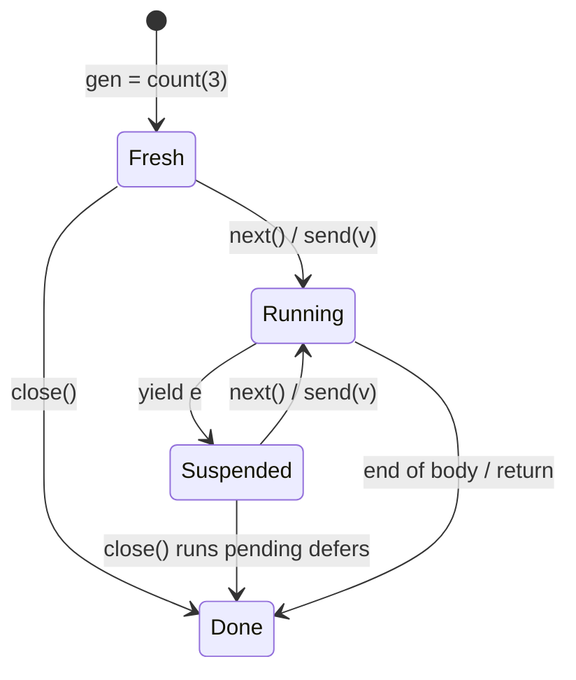

# Concept 11: Generators, Collecting `for` & Concurrency

[← Prev: Native Database & SQL](./10-database-and-sql.md) | [🏠 Documentation Hub](../index.md) | [🔤 Lexical Reference](../lexical-reference.md) | [📐 Syntax Reference](../syntax-reference.md) | [⚙️ Functions & API](../functions-and-apis.md) | [Next: Polyglot Interoperability →](./12-polyglot-interoperability.md)

---

## 1. What works today

`yield` is one of Pilot's 14 seed tokens. It has two uses, and both run on the seed VM (`pilot run`) and on the PilIR interpreter (`pilot ir run`):

1. **Generator functions.** A function whose body has a `yield` that no collecting `for` owns returns a `Generator<TItem, TSent>`. Calling it runs nothing; each `.next()` or `.send(v)` runs the body up to its next `yield`.
2. **Collecting `for` expressions.** A `for` in value position (`let ys = for ..`, `return for ..`, an argument) is the list of what its body yields.

Tasks (`spawn` / `await`), channels, `select`, actors and lazy values are **not built**. The standard-library migration in `M9` owns `std.task`, `std.chan` and `std.sync` (`Task<T>`, `Chan<T>`, `select`, `Mutex<T>`); no milestone owns lazy values yet. Nothing below describes them.

---

## 2. Which construct a `yield` belongs to

| Where the `yield` is | What it does |
| :--- | :--- |
| In the body of a `for` in value position | Appends its value to that loop's result list |
| Anywhere else in a function or lambda body, including a `for` in statement position | Makes that function a generator |
| At a script's top level or in a `comptime` block | `GEN001` |

A `for` is in statement position when it is an item of a block (or of the program); anywhere else it is in value position.

```pilot
fn evens_then_odds(xs: i64[]) {
    let evens = for x in xs { if x % 2 == 0 { yield x; } };  // collects
    for e in evens {
        yield e;                                              // generator
    }
}
```

---

## 3. Generators

### 3.1 The type

```pilot
pub struct Generator<TItem: IAnyValue, TSent: IAnyValue = void> : IObject, IEnumerator<TItem> {
    pub fn next() -> TItem?;           // run to the next `yield`; `none` once the body ended
    pub fn send(v: TSent) -> TItem?;   // the same, with the waiting `yield` worth `v`
    pub fn close();                    // end it now, running its pending `defer`s
    pub is_done: bool { get; }
}
```

It is declared in [`stdlib/core/generator.pilot`](../../stdlib/core/generator.pilot) and bound to the engine with `bind_generator`. The return type is written (`-> Generator<i64>`, `-> Generator<i64, i64>`), or inferred from the `yield` operands when the function declares none. `TSent` defaults to `void`.

### 3.2 `yield` is an expression

`yield e` hands `e` to the caller and suspends. When the generator is resumed with `.send(v)`, the `yield` expression is worth `v`:

```pilot
fn running_total() -> Generator<i64, i64> {
    var total = 0;
    loop {
        let v = yield total;
        total = total + v;
    }
}

let g = running_total();
print(g.next() ?? -1);    // 0: runs to the first `yield`
print(g.send(5) ?? -1);   // 5
print(g.send(10) ?? -1);  // 15
```

The first `.next()` (or `.send(v)`) starts the body. A generator that has not started has no `yield` waiting, so a value sent to it is dropped.

### 3.3 Walking a generator

A generator is its own enumerator, so `for` walks it to the end:

```pilot
fn count(n: i64) -> Generator<i64> {
    var i = 0;
    while i < n {
        yield i;
        i = i + 1;
    }
}

for x in count(3) { print(x); }   // 0, 1, 2
```

### 3.4 Delegation: `yield *xs`

`yield *xs` (readable form `yield splat(xs)`) yields every item of `xs` in order. `xs` may be any enumerable. When it is a generator, values sent to the outer generator go on to it:

```pilot
fn mixed() -> Generator<str> {
    yield *["x", "y"];
    yield *letters();
    yield "z";
}
```

### 3.5 Cleanup

Leaving a `for` over a generator early (`break`, `return`), or calling `.close()`, ends the generator and runs the `defer`s pending in its frame. A generator that never started has none pending. Closing an ended generator does nothing.

```pilot
fn naturals() -> Generator<i64> {
    defer { print("cleanup"); }
    var i = 0;
    loop {
        yield i;
        i = i + 1;
    }
}

for x in naturals() {
    if x == 2 { break; }      // prints "cleanup" here
    print(x);
}
```

The `for` loop calls the enumeration protocol's `close` on any enumerator that declares one, however the loop is left.

### 3.6 Diagnostics

| Code | When |
| :--- | :--- |
| `GEN001` | A `yield` with nothing to belong to (top level, `comptime`) |
| `GEN002` | A `return` with a value inside a generator |
| `GEN003` | A generator resumed while it runs (from inside itself); a run-time error |

An item or sent value of the wrong type is an ordinary type error.

---

## 4. Collecting `for`

```pilot
let squares = for i in 1..=4 { yield i * i; };   // [1, 4, 9, 16]
let picked = for x in [3, 4, 7, 8, 10] { if x % 2 == 0 { yield x; } };
print(picked.len());                              // 3
```

The value is the list of what the body yielded, in order; a body that yields nothing gives the empty list.

---

## 5. How it runs

### 5.1 The seed VM

Calling a generator function builds a frame holding the call's registers and the address to resume at, without running the body ([`crates/pilot-vm/src/lower_yield.rs`](../../crates/pilot-vm/src/lower_yield.rs), [`vm_gen.rs`](../../crates/pilot-vm/src/vm_gen.rs)). Resuming a frame enters it like a call; `yield` saves its registers and returns to the resumer. No OS threads are involved.

### 5.2 PilIR

Before any backend, a generator becomes two ordinary functions ([`selfhost/ir/lower_generator.pilot`](../../selfhost/ir/lower_generator.pilot)):

- the generator function builds a **frame record** (the resume function, a state index, the last item, a closing flag, the call's arguments, then the values the body keeps across a `yield`) and returns `generator_of(frame)`;
- the **resume function** `<name>$resume(frame, sent)` dispatches on the state with `switch_table`. State 0 starts the body; state `k` continues after the `k`-th `yield`. Each `yield` stores the item and its state in the frame and returns.

Values live across a `yield`, and stack slots, are moved into frame fields after the body is lowered. The IR interpreter and the native backends therefore see no coroutines.



### 5.3 Not done yet

- On the seed, `Generator.frame` holds the engine's integer handle for the frame; the PilIR frame record is untyped (`GeneratorFrameHandle` declares none of its fields). This is the registered stand-in `seed.generator_frame`, owned by `F6`.
- A lambda that yields stops at `SEED001` on the seed and at the `ir.lower_construct` seam in PilIR.
- Freeing an unfinished generator's live values is checked by Perceus in `F7`.

---

## 6. Runnable example

[`examples/showcase/11_concurrency_generators_lazy.pilot`](../../examples/showcase/11_concurrency_generators_lazy.pilot) runs every feature above with `pilot run` and `pilot ir run`, and prints the same output on both.

---

[← Prev: Native Database & SQL](./10-database-and-sql.md) | [🏠 Documentation Hub](../index.md) | [🔤 Lexical Reference](../lexical-reference.md) | [📐 Syntax Reference](../syntax-reference.md) | [⚙️ Functions & API](../functions-and-apis.md) | [Next: Polyglot Interoperability →](./12-polyglot-interoperability.md)
