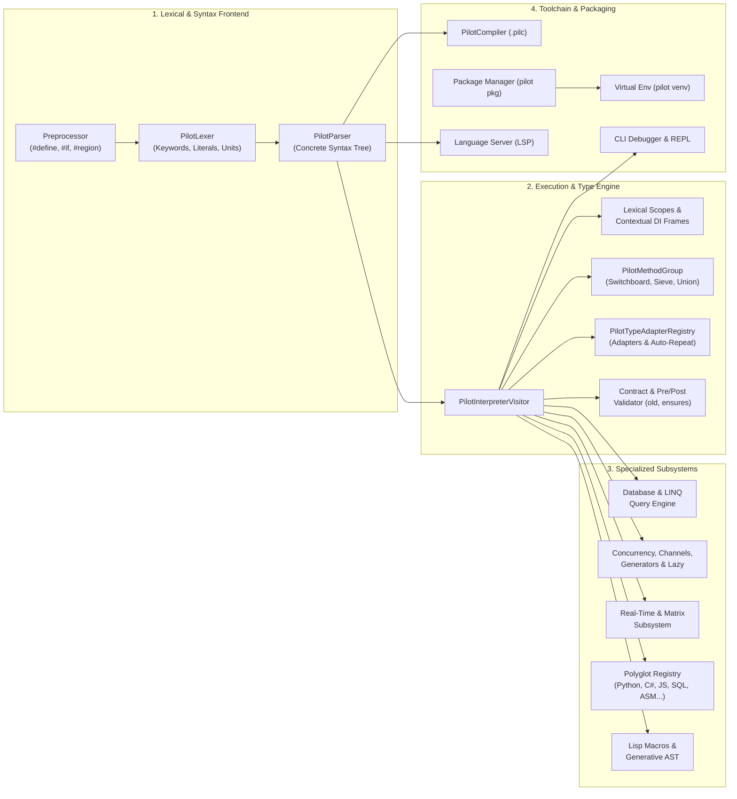

# Pilot Language Documentation Hub

[**Home**](index.md) | [**Lexical Reference**](lexical-reference.md) | [**Syntax Reference**](syntax-reference.md) | [**Functions & API Reference**](functions-and-apis.md) | [**Main README**](../README.md)

---

Welcome to the comprehensive, navigable documentation for the **Pilot Programming Language**. This documentation covers every language concept, lexical token, grammar production, operator, built-in function, type method, runtime contract, and CLI tool in the Pilot ecosystem.

## Quick Navigation

### Core Reference Manuals

| Reference Manual | Description | Key Contents |
| :--- | :--- | :--- |
| [**Lexical Reference**](lexical-reference.md) | Complete specification of Pilot's lexical structure and preprocessor | 140+ Keywords, Contextual Keywords, Numeric/Dimensional/String Literals, Operators, Delimiters, Comments, and Preprocessor Directives (`#define`, `#if`, `#region`, `#pragma`) |
| [**Syntax Reference**](syntax-reference.md) | Formal grammar rules, statement forms, type expressions, and operator precedence | Program structure, Type annotations, Declarations, Functions, Classes, Pattern Matching, Database queries, Concurrency blocks, Real-Time constructs, and Full Precedence Table |
| [**Functions & API Reference**](functions-and-apis.md) | Every global function, module, scripting utility, type method, and contract | Global Built-ins, `json` & `venv` modules, Scripting Host API (`args`, `env`, `cwd`, file I/O), Root Object methods, Collection/String/Matrix/Async methods, Standard Contracts, and Exceptions |

---

### Deep-Dive Concept Guides

Each concept guide provides an in-depth explanation of the feature's design, the exact lexical tokens and syntax rules involved, runtime semantics, available functions/methods, and complete runnable examples.

| # | Concept Guide | Summary | Showcase Script |
| :--- | :--- | :--- | :--- |
| **01** | [**Types, Variables & Control Flow**](concepts/01-types-variables-control-flow.md) | Static/dynamic typing continuum, `let`/`var`/`const`/`ref`/`dynamic`, collections, loops, safe navigation (`?.`), and cascade chaining (`..`). | [`01_types_variables_control_flow.pilot`](../examples/showcase/01_types_variables_control_flow.pilot) |
| **02** | [**Guard, Defer & Exception Handling**](concepts/02-guard-defer-exceptions.md) | Early-exit precondition enforcement (`guard ... else`), deterministic LIFO scope cleanup (`defer`), and `try`/`except`/`else`/`finally` protections. | [`02_guard_defer_exceptions.pilot`](../examples/showcase/02_guard_defer_exceptions.pilot) |
| **03** | [**Method Groups & Advanced Dispatch**](concepts/03-method-groups-and-dispatch.md) | First-class overload groups, heterogeneous auto-routing switchboards, signature-sieve currying, fallback unions (`\|`), and multi-cast broadcasts (`*`). | [`03_method_groups_and_dispatch.pilot`](../examples/showcase/03_method_groups_and_dispatch.pilot) |
| **04** | [**Type Adapters & Repeated Calls**](concepts/04-type-adapters-and-repetition.md) | Custom and built-in `adapter` definitions, structural map-to-class hydration, and scalar-to-collection vectorization (`each`, `..`, `*`, `with auto_repeat`). | [`04_type_adapters_and_repetition.pilot`](../examples/showcase/04_type_adapters_and_repetition.pilot) |
| **05** | [**Algebraic Classes & Typestates**](concepts/05-algebraic-classes-and-typestates.md) | Set-theoretic class composition (`\|` union, `-` subtraction, `&` intersection) and compile-time/runtime typestate machines (`state` blocks, `transition_to`). | [`05_algebraic_classes_and_typestates.pilot`](../examples/showcase/05_algebraic_classes_and_typestates.pilot) |
| **06** | [**Projections, Lexical Extensions & Generative AST**](concepts/06-projections-extensions-generative.md) | Structural DTO arrow projection (`->`), lexically scoped monkey-patching (`extension ... on ...` with `with extension`), and AST generative class macros. | [`06_projections_lexical_extensions_generative.pilot`](../examples/showcase/06_projections_lexical_extensions_generative.pilot) |
| **07** | [**Contextual Parameters (Native DI)**](concepts/07-contextual-parameters-di.md) | Implicit downstream dependency propagation via `context` parameters and lexical `with context` environment frames. | [`07_contextual_parameters_di.pilot`](../examples/showcase/07_contextual_parameters_di.pilot) |
| **08** | [**Exhaustive Pattern Matching & Slicing**](concepts/08-exhaustive-pattern-matching.md) | Structural record/tuple/list destructuring assignments, sequence rest-slice extraction (`..`), relational patterns, and `match`/`case` arms with `when` guards. | [`08_exhaustive_pattern_matching.pilot`](../examples/showcase/08_exhaustive_pattern_matching.pilot) |
| **09** | [**Design-by-Contract & Delegation**](concepts/09-design-by-contract.md) | Preconditions (`requires`), postconditions (`ensures`), pre-state snapshots (`old()`), `result` validation, interface contract delegation, and method stealing (`steal`). | [`09_design_by_contract.pilot`](../examples/showcase/09_design_by_contract.pilot) |
| **10** | [**Relational Databases & SQL Blocks**](concepts/10-database-and-sql.md) | Native LINQ-style queries (`from ... select`), SQL-first queries, indexed tables (`lookup`), transactions/savepoints, set operators, and inline `postgresql`/`mysql` blocks. | [`10_database_and_sql_blocks.pilot`](../examples/showcase/10_database_and_sql_blocks.pilot) |
| **11** | [**Concurrency, Generators & Lazy Evaluation**](concepts/11-concurrency-generators-lazy.md) | Stateful `yield` coroutines, thread-pool futures (`spawn`/`await`), `parallel_map`, channels (`<-`) & `select`, actors, `atomic`/`sync`/`isolate`, and `lazy()` evaluation. | [`11_concurrency_generators_lazy.pilot`](../examples/showcase/11_concurrency_generators_lazy.pilot) |
| **12** | [**Deep Polyglot Interoperability**](concepts/12-polyglot-interoperability.md) | Inline execution blocks for Python, C#, Rust, JavaScript, Java, Lua, C, C++, Assembly, and SQL, plus bidirectional variable sharing, yield-bridge coroutines, and `extern` FFI. | [`12_polyglot_interoperability.pilot`](../examples/showcase/12_polyglot_interoperability.pilot) |
| **13** | [**Metaprogramming, Macros & Lisp Primitives**](concepts/13-metaprogramming-and-lisp.md) | Homoiconic AST manipulation (`quote`, `quasiquote`, `unquote`, `splice`), S-expression primitives (`cons`, `car`, `cdr`, `atom`, `gensym`, `eval`), and root object reflection. | [`13_metaprogramming_and_lisp.pilot`](../examples/showcase/13_metaprogramming_and_lisp.pilot) |
| **14** | [**Real-Time Determinism, Units & Matrices**](concepts/14-realtime-and-matrix-types.md) | Hard/soft real-time blocks (`deadline`, `within`, `periodic`, `noalloc`, `region`, `stackalloc`), dimensional literals (`ns`, `kHz`, `MB`), custom `unit` algebra, and `matrix` types. | [`14_realtime_and_matrix_types.pilot`](../examples/showcase/14_realtime_and_matrix_types.pilot) |
| **15** | [**Packaging, Virtual Environments & Toolchain**](concepts/15-packaging-venv-and-tooling.md) | Universal Package Manager (`pilot pkg` for native + NuGet, npm, pip, Cargo, Maven, LuaRocks), `pilot venv` sandboxing, AOT `.pilc` compiler, interactive debugger, REPL, and LSP. | [`15_virtual_environment_and_packaging.pilot`](../examples/showcase/15_virtual_environment_and_packaging.pilot) |

---

## Language Architecture Map

---

[**Next: Lexical Reference →**](lexical-reference.md)
