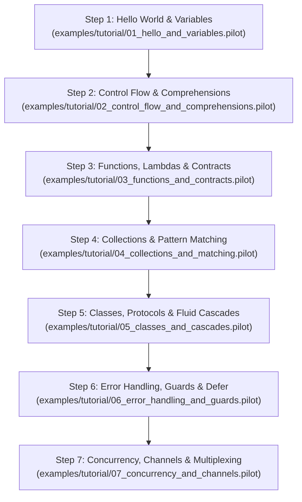

# Step-by-Step Pilot Language Tutorial

Welcome to the official, incremental learning guide for the **Pilot Programming Language**.

Pilot is an industrial-strength, general-purpose programming language designed to unite the ergonomic expressiveness of modern high-level languages with zero-GC deterministic memory management (Perceus reference counting), sub-millisecond compile-time tooling, CSP concurrency, and hard real-time safety.

---

## Tutorial Roadmap



---

## Step 1: Hello World, Variables & Immutability

> [!NOTE]
> Runnable companion code: [`examples/tutorial/01_hello_and_variables.pilot`](../../examples/tutorial/01_hello_and_variables.pilot)

### 1.1 Running Your First Program
To verify your environment and execute code:
```bash
pilot run examples/tutorial/01_hello_and_variables.pilot
```
To run zero-allocation static syntax and semantic analysis:
```bash
pilot check examples/tutorial/01_hello_and_variables.pilot
```

### 1.2 Immutability by Default (`let` vs `var`)
In Pilot, state is immutable by default to prevent data races and unintended side-effects:
```pilot
let language = "Pilot"
let version = 1.0

// Compile-time error: cannot reassign immutable binding 'language'
// language = "Other"

// Use 'var' for explicitly mutable local variables:
var counter = 0
counter += 1
```

### 1.3 Primitive Types & Real-Time Literals
Pilot infers types bidirectionally, but explicit type annotations (`: Type`) are fully supported:
- Integers: `int`, `i64`, `i32`, `i16`, `i8`, `u64`, `u32`, `u16`, `u8`
- Floats: `float`, `f64`, `f32`
- Text: `str` (UTF-8, SSO up to 23 bytes unallocated), `char`
- Booleans: `bool` (`true`, `false`)

Pilot includes native hardware, frequency, and time duration literals:
```pilot
let delay = 250us      // 250 microseconds
let poll_rate = 10ms   // 10 milliseconds
let max_timeout = 5s   // 5 seconds
let bus_speed = 50kHz  // 50 kilohertz
let mem_limit = 64KB   // 64 kilobytes
```

### 1.4 String Interpolation
Format strings are created using Python-style `f"..."` or C#-style `$"..."`:
```pilot
let name = "Developer"
println(f"Hello, {name}! Count is {counter}.")
```

---

## Step 2: Control Flow & Comprehensions

> [!NOTE]
> Runnable companion code: [`examples/tutorial/02_control_flow_and_comprehensions.pilot`](../../examples/tutorial/02_control_flow_and_comprehensions.pilot)

### 2.1 Everything is an Expression
`if` blocks in Pilot evaluate to a value:
```pilot
let score = 85
let grade = if score >= 90 {
    "A"
} elif score >= 80 {
    "B"
} else {
    "C"
}
```

### 2.2 Inline Assignment (The Walrus Operator `:=`)
Assign and test in a single expression:
```pilot
if (let sample := read_sensor()) > 100 {
    println(f"Critical reading: {sample}")
}
```

### 2.3 Loops and Ranges
Pilot supports both inclusive (`..`) and half-open (`..<`) ranges:
```pilot
// Half-open range [0, 5) -> 0, 1, 2, 3, 4
for i in 0..<5 {
    println(f"Index: {i}")
}

// Inclusive range [1, 5] -> 1, 2, 3, 4, 5
for count in 1..5 {
    println(f"Count: {count}")
}
```

### 2.4 Comprehensions
Construct transformed collections with concise syntax:
```pilot
// List comprehension
let squares = [x * x for x in [1, 2, 3, 4, 5] if x % 2 != 0]

// Dict comprehension
let mapping = {f"k_{x}": x * 10 for x in [1, 2, 3]}

// Set comprehension
let unique_elements = {x for x in [1, 2, 2, 3, 3]}
```

---

## Step 3: Functions, Lambdas & Design-by-Contract

> [!NOTE]
> Runnable companion code: [`examples/tutorial/03_functions_and_contracts.pilot`](../../examples/tutorial/03_functions_and_contracts.pilot)

### 3.1 Defining Functions
Functions are declared with `def` or `fn`:
```pilot
def add(a: int, b: int) -> int {
    return a + b
}

// Expression-bodied shorthand
def square(x: int) -> int => x * x;
```

### 3.2 Lambdas
Anonymous first-class functions:
```pilot
let double_fn = lambda x: x * 2;
let result = double_fn(21) // 42
```

### 3.3 Design-by-Contract (`requires` & `ensures`)
Pilot verifies interface contracts at function boundaries:
- `requires <condition>`: Precondition checked before function execution.
- `ensures <condition>`: Postcondition checked after function execution (`result` refers to the return value).
```pilot
def divide(numerator: int, denominator: int) -> int
    requires denominator != 0
    ensures result * denominator <= numerator
{
    return numerator / denominator
}
```

---

## Step 4: Collections, Pattern Matching & Destructuring

> [!NOTE]
> Runnable companion code: [`examples/tutorial/04_collections_and_matching.pilot`](../../examples/tutorial/04_collections_and_matching.pilot)

### 4.1 Destructuring Unpacking
Unpack tuples and lists with ease:
```pilot
let (id, label, active) = (101, "Gateway", true)
let [head, ..tail] = [1, 2, 3, 4, 5]
// head == 1, tail == [2, 3, 4, 5]
```

### 4.2 Algebraic Data Types (Enums with Data)
```pilot
type Shape =
    | Circle(radius: float)
    | Rectangle(width: float, height: float)
    | Point;
```

### 4.3 Exhaustive Pattern Matching
`match` guarantees all cases are handled at compile-time:
```pilot
def describe(s: Shape) -> str {
    return match s {
        case Point => "Point at origin"
        case Circle(r) when r > 50.0 => f"Large circle (r={r})"
        case Circle(r) => f"Circle (r={r})"
        case Rectangle(w, h) when w == h => f"Square ({w}x{h})"
        case Rectangle(w, h) => f"Rectangle ({w}x{h})"
        case _ => "Unknown"
    }
}
```

---

## Step 5: Classes, Protocols & Fluid Cascades

> [!NOTE]
> Runnable companion code: [`examples/tutorial/05_classes_and_cascades.pilot`](../../examples/tutorial/05_classes_and_cascades.pilot)

### 5.1 Object-Oriented Pilot
```pilot
class NetworkPacket {
    var source: int = 0
    var destination: int = 0
    var payload: str = ""

    def set_source(self, s: int) -> void { self.source = s }
    def set_dest(self, d: int) -> void { self.destination = d }
    def write_payload(self, p: str) -> void { self.payload = p }
}
```

### 5.2 Fluid Builder Cascades (`..` and `?..`)
The cascade operator (`..`) invokes methods on an object and returns the object itself, eliminating temporary variables:
```pilot
let packet = NetworkPacket()
packet..set_source(10)..set_dest(20)..write_payload("PING")

// Safe cascade (?..) operates only if target is not null/none:
let maybe_pkt: NetworkPacket? = packet
maybe_pkt?..write_payload("SAFE_UPDATE")
```

### 5.3 Retroactive Extensions (`extend`)
Add methods to existing classes or primitives without modifying their definitions:
```pilot
extend NetworkPacket {
    def route_key(self) -> str {
        return f"{self.source}->{self.destination}"
    }
}
```

---

## Step 6: Error Handling, Guards & Scope Cleanups

> [!NOTE]
> Runnable companion code: [`examples/tutorial/06_error_handling_and_guards.pilot`](../../examples/tutorial/06_error_handling_and_guards.pilot)

### 6.1 Flat Happy Paths with `guard`
Eliminate deeply nested `if/else` checks:
```pilot
def process_order(user_id: int?, balance: float) -> str {
    guard user_id != none else {
        return "ERROR: Missing user ID"
    }
    guard balance >= 0.0 else {
        return "ERROR: Insufficient funds"
    }
    return "Order approved"
}
```

### 6.2 Deterministic Scope Cleanup with `defer`
Deferred blocks run in LIFO order upon function exit, even during early returns or errors:
```pilot
def open_resource() -> void {
    println("Resource allocated")
    defer {
        println("Resource released (cleanup guaranteed)")
    }
    // Main logic here
}
```

### 6.3 Safe Navigation & Null Coalescing
```pilot
let label: str? = none
let length = label?.Length ?? 0

// Coalesce assignment (assigns only if currently null)
var config: str? = none
config ??= "default.json"
```

---

## Step 7: Concurrency, Channels & Multiplexing

> [!NOTE]
> Runnable companion code: [`examples/tutorial/07_concurrency_and_channels.pilot`](../../examples/tutorial/07_concurrency_and_channels.pilot)

### 7.1 CSP Communication Channels
Pilot uses typed channels for thread-safe message passing:
```pilot
let data_ch: chan[int] = Channel(10)
let event_ch: chan[str] = Channel(5)
```

### 7.2 Sending, Receiving & Tasks
```pilot
async def worker(id: int) -> void {
    println(f"Worker {id} started")
}

spawn worker(1)

// Send:
data_ch <- 42

// Receive:
let val = <-data_ch
```

### 7.3 Event Multiplexing (`select`)
Coordinate multiple asynchronous channels with timeouts and defaults:
```pilot
select {
    case msg = <-event_ch => {
        println(f"Received event: {msg}")
    }
    timeout 100ms => {
        println("Channel wait timed out")
    }
    default => {
        println("No channels ready")
    }
}
```

---

## Quick Reference Commands

| Task | Command | Description |
| :--- | :--- | :--- |
| **Run Program** | `pilot run main.pilot` | Direct execution via high-throughput PilVM v3 |
| **Check Syntax & Types** | `pilot check main.pilot` | Zero-allocation static analysis & type validation |
| **Format Code** | `pilot fmt main.pilot` | Canonical formatting adhering to language invariants |
| **Run Suite Tests** | `pilot test` | Discover and run test files with assertion reporting |
| **Differential Backend Tests** | `pilot test --differential` | Validate bytecode vs Native AOT vs LLVM IR vs WASM |
| **Build Native AOT** | `pilot build main.pilot` | Ahead-of-Time native binary compilation |
| **Interactive REPL** | `pilot repl` | Explore language features interactively |
