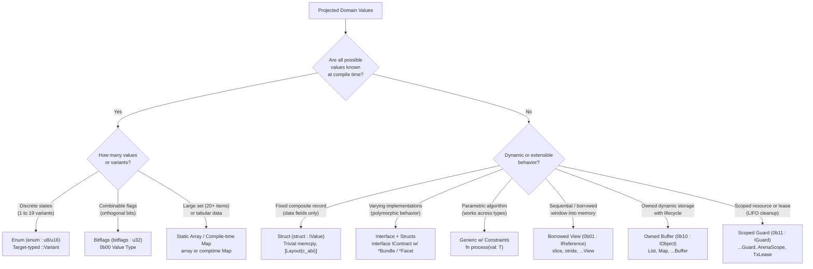

# Type Selection & Implementation Guide (`imp_type.md`)

This guide specifies how to select and implement types in Pilot based on projected values, cardinality, domain semantics, and hardware physics.

---

## 1. Core Typing Philosophy

Good typing obeys five foundational laws:

1. **Unambiguous Determinism:** If values and lifecycle are known at design time, the definition and type must be immediately obvious. Never leave semantics up to interpretation.
2. **Appropriate Constraining:** Constrain as tightly as the domain requires, but no tighter. Broad, open-ended types (`any`, bare `str`, bare `i64`) should only represent genuinely open-ended varieties of values.
3. **Generic Precision:** Never write unconstrained generics (`<T>`) when capabilities are required. Constrain with interfaces (`<T : IComparable<T>>`).
4. **Hardware Lattice Alignment:** Every type must clearly classify into the 2-bit hardware lattice (`0b00` Value, `0b01` Borrowed View, `0b10` Owned Object, `0b11` Scoped Guard).
5. **Single Source of Truth & Zero Duplication (Import-First Law):** Every type must have exactly one canonical definition in its owning module or package. Types must never be duplicated, re-declared, or shadowed across different files or subsystems; any file requiring a type must explicitly import it.



---

## 2. Decision Matrix: Selecting Types from Projected Values

| Projected Values & Characteristics | Recommended Pilot Type | Canonical Example | 2-Bit Lattice |
| :--- | :--- | :--- | :--- |
| **Small predefined set of discrete states ($< 20$)** | `enum` | `enum HttpMethod : u8 { ::Get, ::Post, ::Put, ::Delete }` | `0b00` (`IValue`) |
| **Orthogonal, combinable boolean flags ($< 64$)** | `bitflags` (`u32` / `u64`) | `bitflags FilePerms : u32 { ::Read = 1, ::Write = 2, ::Exec = 4 }` | `0b00` (`IValue`) |
| **Large predefined homogeneous set ($20+$ items)** | `array<T, N>` or `comptime Map<K, V>` | `static MIME_TABLE: array<MimeEntry, 128> = [...]` | `0b00` / `0b10` |
| **Fixed composite data record (pure state)** | `struct : IValue` | `[Layout(c_abi)] struct Point3D : IValue { x: f64, y: f64, z: f64 }` | `0b00` (`IValue`) |
| **Predefined list of composite records** | Table-driven `array<TStruct, N>` | `static OPCODES: array<OpcodeDef, 48> = [...]` | `0b00` (`IValue`) |
| **Composite with varying implementations / behaviors** | `interface` + concrete `struct`s | `interface ISerializer` implemented by `JsonSerializer`, `BinarySerializer` | Interface Contract |
| **Shared fields & methods across multiple structs** | `*Bundle` (fields + ops) & `*Facet` (ops) | `struct TcpSocket { *NetworkEndpointBundle, *SocketFacet }` | Composition |
| **Parametric behavior across unknown types** | Generic type `<T : IConstraint>` | `fn sort<T : IComparable<T>>(items: var ref slice<T>)` | Generic Contract |
| **Absence / optionality of a value** | `opt<T>` (`T?`) | `fn find_user(id: u64) -> User?` | `0b00` / `0b10` |
| **Expected fallible outcome with domain error** | `res<T, E>` (`T ! E`) | `fn read_file(path: str) -> slice<u8> ! IoError` | `0b00` / `0b10` |
| **Borrowed sub-window into contiguous buffer** | `slice<T>` (`T[]`) or `...View` | `fn parse_header(buf: slice<u8>) -> HeaderView` | `0b01` (`IReference`) |
| **Borrowed strided / non-contiguous window** | `stride<T>` (`T[..]`) or `...Lens` | `fn col_view(m: Matrix) -> stride<f64>` | `0b01` (`IReference`) |
| **Dynamically resizing owned collection** | `List<T>` or `...Buffer` | `var items = List<str>::new();` | `0b10` (`IObject`) |
| **Resource requiring mandatory LIFO cleanup** | `...Guard` / `...Scope` / `...Lease` | `struct MutexGuard<T> : IGuard { ~self() { release(); } }` | `0b11` (`IGuard`) |
| **Discrete typestate progression (e.g. state machine)** | `state` algebraic union (`A \| B`) | `type Connection = Disconnected \| Connecting \| Connected` | Linear State |
| **Physical quantities with dimensional units** | Dimensional Unit Types | `let timeout = 250[ms]; let buf_size = 64[KB];` | `0b00` (`IValue`) |

---

## 3. The 11 Invariant Rules of Good Typing

### Rule 1: Closed, Predefined Discrete Sets ($\le 19$) $\rightarrow$ `enum`
When the universe of discourse consists of a known, finite list of mutually exclusive states, use a strongly-typed `enum` backed by the smallest adequate scalar representation (`u8` or `u16`).
- **Do:** Use target-typed variants `::Active`, `::Inactive`.
- **Don't:** Use stringly-typed constants (`"ACTIVE"`, `"INACTIVE"`), magic integers (`0`, `1`, `2`), or booleans for 3+ states.

```pilot
// GOOD
pub enum ConnectionState : u8 {
    ::Idle,
    ::Connecting,
    ::Connected,
    ::Disconnected,
}

// BAD: Stringly typed or primitive obsession
pub fn check_status(status: str) -> bool => status == "CONNECTED";
```

### Rule 2: Large Predefined Sets ($20+$ Varieties) $\rightarrow$ Open-Registry / Table Array
When the predefined list exceeds ~20 variants (e.g., HTTP status codes, MIME types, syntax tokens, CPU opcodes, diagnostic catalogs):
- Do **not** build a massive, 60-arm `switch` or huge monolith `enum`.
- Store the definitions in a table-driven `array<T, N>` or `comptime Map<K, V>`.
- Use a lightweight `u16` ID handle or symbol index to query the open registry.

```pilot
// GOOD: Table-driven registry for 20+ known varieties
[Layout(c_abi)]
pub struct DiagCatalogEntry : IValue {
    pub code: str;
    pub title: str;
    pub default_severity: u8;
}

pub static DIAG_CATALOG: array<DiagCatalogEntry, 85> = [
    DiagCatalogEntry { code: "SYN001", title: "Missing semicolon", default_severity: 1 },
    DiagCatalogEntry { code: "SYN002", title: "Unclosed bracket",  default_severity: 1 },
    // ... scalable without editing core dispatchers
];
```

### Rule 3: Fixed Composite Records $\rightarrow$ `struct : IValue`
When a type is purely an aggregate of values without identity or external handles, declare it as a `0b00` value struct.
- Mark with `[Layout(c_abi)]` or `[Layout(optimal)]` so register allocation and cache-line packing are derived name-blindly.
- Ensure trivial `memcpy` and zero allocation overhead.

```pilot
[Layout(c_abi)]
pub struct SourceLocation : IValue {
    pub line:   u32;
    pub column: u32;
    pub offset: usize;
}
```

### Rule 4: Varying Implementations / Extensible Behaviors $\rightarrow$ `interface` + `struct`
When an entity has multiple implementations (e.g., File vs Network stream, Memory allocator vs Arena, AST Node variants):
- Define an `interface IName` specifying contracts, parameter types, and default methods.
- Implement the interface in concrete `struct`s.
- Never use base-class inheritance; compose fields using `*Bundle` and methods using `*Facet`.

```pilot
pub interface IByteStream {
    fn read(var ref self, dest: var ref slice<u8>) -> usize ! IoError;
    fn write(var ref self, src: slice<u8>) -> usize ! IoError;
    fn flush(var ref self) -> void ! IoError;
}

pub struct FileStream : IByteStream {
    pub handle: u64;
    pub fn read(var ref self, dest: var ref slice<u8>) -> usize ! IoError { ... }
    pub fn write(var ref self, src: slice<u8>) -> usize ! IoError { ... }
    pub fn flush(var ref self) -> void ! IoError { ... }
}
```

### Rule 5: Orthogonal Combinations $\rightarrow$ `bitflags`
When values represent independent attributes, capabilities, or permissions that can coexist:
- Use `bitflags : u32` or `bitflags : u64`.
- Never use arrays of strings (`["read", "write"]`) or multiple boolean struct fields (`is_read: bool, is_write: bool`).

```pilot
pub bitflags VmCapability : u32 {
    ::None           = 0,
    ::Clock          = 1 << 0,
    ::RandomSeeded   = 1 << 1,
    ::StdoutCapture  = 1 << 2,
    ::VirtualFs      = 1 << 3,
    ::HostFsRead     = 1 << 4,
}
```

### Rule 6: Absence & Uncertainty $\rightarrow$ `opt<T>` (`T?`) & `res<T, E>` (`T ! E`)
Never invent custom sentinel values (`-1`, `null`, `""`, `0xFFFFFFFF`) to convey failure or absence:
- Optional value: `opt<T>` / `T?` with postfix `?` or `guard some ... else`.
- Fallible result: `res<T, E>` / `T ! E` with descriptive domain error `E`.

```pilot
// GOOD
pub fn find_token(src: str, start: usize) -> Token?;
pub fn compile(source: str) -> IrModule ! List<Diagnostic>;

// BAD: Sentinels
pub fn find_token_bad(src: str, start: usize) -> Token; // Returns Token with kind = -1 on failure
```

### Rule 7: Borrowing vs. Owning Memory $\rightarrow$ The 2-Bit Boundary
- If a function only needs to read or inspect memory: take a borrowed view (`0b01` `slice<T>`, `stride<T>`, or `ref<T>`).
- If a function stores, resizes, or takes ownership: take or return an owned object (`0b10` `List<T>`, `...Buffer`, or `iso<T>`).
- If an operation acquires a lock, lease, or transaction: return a scoped guard (`0b11` `...Guard`).

```pilot
// 0b01 Reference: zero-allocation read
pub fn calculate_hash(bytes: slice<u8>) -> HashDigest;

// 0b10 Owned: caller takes ownership of new buffer
pub fn to_uppercase_owned(src: slice<u8>) -> SliceBuffer<u8>;

// 0b11 Scoped Guard: automatically releases on scope exit
pub fn acquire_tx(db: var ref Database) -> TxLease;
```

### Rule 8: Generic Specialization $\rightarrow$ Constrained Generics (`<T : ITrait>`)
Only use generic parameters `<T>` when:
1. The logic applies identically across multiple distinct types (algorithms, collections, math).
2. The requirements on `T` are explicitly stated as interface bounds (`<T : IAddOperator<T>>`).
- **Never** introduce `<T>` if only one concrete type will ever be used.
- **Never** write unconstrained `<T>` and then perform dynamic type-string checks inside the function body.

```pilot
// GOOD: Constrained generic algorithm
pub fn max<T : IComparable<T>>(a: T, b: T) -> T {
    return if a > b { a } else { b };
}

// BAD: Unconstrained generic with runtime reflection guesswork
pub fn max_bad<T>(a: T, b: T) -> T {
    if typename(T) == "i64" { ... } // ANTI-PATTERN
}
```

### Rule 9: Bounded State Machines $\rightarrow$ Typestate Pattern
When an object must transition through specific lifecycle stages and operations are invalid in earlier stages:
- Represent stages as distinct types or algebraic unions (`StateA | StateB`).
- Consume the predecessor state using `iso self` to prevent use-after-transition.

```pilot
pub struct UnauthenticatedSession : IObject {
    pub fn authenticate(iso self, token: str) -> AuthenticatedSession ! AuthError {
        // Consumes unauthenticated session, returning authenticated session
    }
}

pub struct AuthenticatedSession : IObject {
    pub fn query_data(ref self) -> slice<u8> { ... }
}
```

### Rule 10: Quantitative Invariants $\rightarrow$ Custom Types with Construction Validation
If a scalar has domain constraints (e.g., `PortNumber` $1..65535$, `Percentage` $0.0..1.0$, `NonEmptyString`):
- Wrap the primitive in a dedicated single-field value struct `: IValue`.
- Enforce invariant in the constructor `self(...)` returning `Self ! ValidationError`.

```pilot
[Layout(c_abi)]
pub struct Percentage : IValue {
    pub raw: f64;

    pub pure fn of(val: f64) -> Percentage ! RangeError {
        if val < 0.0 || val > 1.0 {
            return fail RangeError::OutOfBounds;
        }
        return Percentage { raw: val };
    }
}
```

### Rule 11: Single Canonical Definition & Zero Type Duplication (Import-First Law)
Every type (`enum`, `struct`, `interface`, `bitflags`, or `type` alias) must reside in exactly one canonical file within its owning package (`stdlib/core/`, `stdlib/std/`, `stdlib/pilot/`, or a dedicated `selfhost/` module).
- **Never** re-declare, duplicate, copy-paste, or redefine an existing type in another file.
- **Always** import the type from its canonical home via `use Canonical.Package.Module;` into any file that needs it (e.g. `use Pilot.Diagnostics.Model;`, `use std.sync;`).
- If multiple subsystems require a shared domain type (e.g. `Span`, `SourceLocation`, `Token`, `Diagnostic`, `LatticeBits`), place it once in a shared foundational module (such as `pilot.diag`, `pilot.cst`, or `core.*`) and import it everywhere it is referenced.
- Shadowing, diverging clones, or parallel duplicate structs violate compiler type safety, bloat binary metadata, and break polymorphism across module boundaries.

```pilot
// GOOD: Import the canonical type from its owning module
use Pilot.Diagnostics.Model; // Imports canonical SourceSpan, Diagnostic, DiagSeverity

pub fn format_error(span: SourceSpan, message: str) -> str {
    return f"{span.file}:{span.line}:{span.col}: {message}";
}

// BAD: Re-declaring a duplicate struct in a consumer file
// Duplicate declaration creates an incompatible type and breaks interoperability!
[Layout(c_abi)]
pub struct SourceSpan : IValue { // ANTI-PATTERN: Duplicate definition
    pub file: str;
    pub line: u32;
    pub col:  u32;
}
```

---

## 4. Anti-Patterns to Avoid

| Anti-Pattern | Description | Correct Replacement |
| :--- | :--- | :--- |
| **Type Duplication / Shadow Structs** | Re-declaring or copying an existing struct/enum across multiple files instead of importing it. | Place in a single canonical owning module and `use` import it wherever needed. |
| **Primitive Obsession** | Using bare `str` or `i64` for IDs, status codes, and units. | Domain Value Struct (`UserId(u64)`), `enum`, or Dimensional Unit. |
| **Stringly-Typed APIs** | Passing `"json"`, `"yaml"`, `"csv"` to select a format. | `enum DataFormat { ::Json, ::Yaml, ::Csv }` |
| **God Enum** | An enum with 30+ variants containing unrelated, asymmetric data payloads. | Split into sub-categories, or use table-driven structs with polymorphic interfaces. |
| **Boolean Blindness** | Multiple boolean flags (`is_admin: bool, is_active: bool, is_verified: bool`). | `bitflags UserFlags : u32` or distinct state types. |
| **Leaky Interpretation** | Leaving data validatable only at execution time deep in downstream callers. | Parse and validate at construction boundary (`res<T, E>`). |
| **Sentinel Pointers** | Returning `0` / null / `-1` to represent "not found" or "no error". | `opt<T>` (`T?`) or `res<T, E>` (`T ! E`). |

---

## 5. Summary Checklist Before Implementing Any Type

- [ ] **Does this type (or an equivalent) already exist in the codebase?**
  - **Never redeclare or duplicate** existing types.
  - Always import the canonical type from its owning package (`use ...;`).
  - If creating a newly shared concept, place it in a canonical module accessible to all consumers.
- [ ] **Are all possible values known at compile time?**
  - If $\le 19$: Use `enum` with `::Variant`.
  - If orthogonal combinations: Use `bitflags`.
  - If $20+$: Use `array<T, N>` / compile-time table registry.
- [ ] **Is it a composite type?**
  - If pure state/fixed layout: Use `struct : IValue` with `[Layout(c_abi)]`.
  - If behavior varies across implementations: Use `interface` + concrete `struct`s.
  - If sharing state across multiple structs: Splice via `*Bundle`.
  - If sharing methods across multiple structs: Splice via `*Facet`.
- [ ] **What is its memory and lifecycle model?**
  - Read-only borrow window: `0b01` `...View` / `slice<T>`.
  - Dynamic heap allocation: `0b10` `...Buffer` / `List<T>`.
  - Scope-bound cleanup (RAII): `0b11` `...Guard` with `~self()`.
- [ ] **Are errors and absence made explicit?**
  - Optional: `T?` (`opt<T>`).
  - Fallible: `T ! E` (`res<T, E>`).
