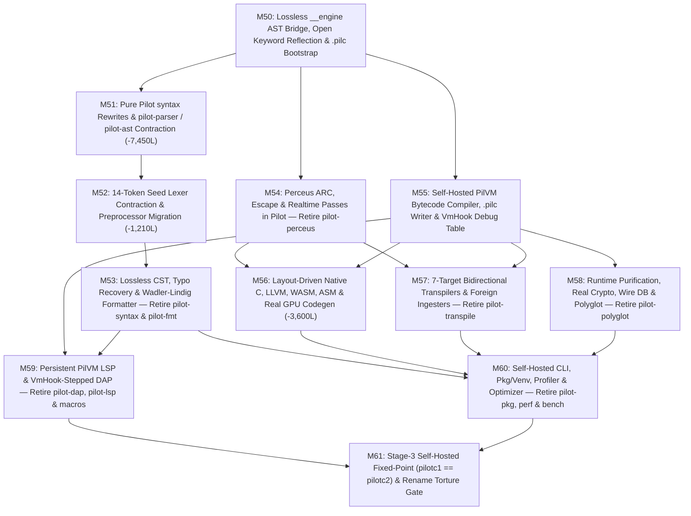

# Pilot Programming Language — Self-Hosting & Rust Contraction Master Roadmap (`M50` – `M61`)

> **Purpose**: Single source of truth for migrating every compiler, syntax, semantic, runtime, codegen, transpiler, protocol, and tooling subsystem out of Rust and into **100% Pilot** (`stdlib/` and `selfhost/`), shrinking the Rust workspace (`crates/pilot-*`) from **44,357 lines across 25 crates** down to an irreducible **~5,450-line Name-Blind Hardware, OS & 14-Token Bootstrap Kernel** (**-87.7% Rust LOC**, retiring **13 Rust crates** outright).
>
> **Historical Continuity**: Builds directly upon Milestones `M1`–`M49` recorded in [`LEGACY_MILESTONES.md`](file:///home/moony/Documents/dev/projects/Pilot/LEGACY_MILESTONES.md) and enforces every invariant in [`AGENTS.md`](file:///home/moony/Documents/dev/projects/Pilot/AGENTS.md) and [`Proposals.md`](file:///home/moony/Documents/dev/projects/Pilot/Proposals.md).

---

## 1. Governing Architectural Mandates

1. **The `< 1,500`-Line Individual Concept Law**:
   - **Every individual concept expressible in `<= 1,500` lines of Pilot without losing irreducible hardware/OS physics MUST be implemented in Pilot (`stdlib/` or `selfhost/`), never in Rust.**
   - Monolithic Rust files exceeding `1,500` lines (`pilot-parser/src/lib.rs` at `7,479` lines, `pilot-dap/src/debugger.rs` at `4,620` lines, `pilot-syntax` at `3,449` lines, `pilot-transpile/src/emitters.rs` at `2,589` lines, and `pilot-codegen/src/c_target.rs` at `1,611` lines) are composite bundles of smaller subsystems. Once decomposed by responsibility, **every single target `.pilot` module in this roadmap is between `25` and `1,100` lines** (strictly `<= 1,500` lines).
   - Existing oversized Pilot files (`selfhost/ide_sync.pilot` at `1,957` lines) are likewise split so no individual self-hosted module exceeds `1,500` lines.

2. **The Strict 14-Token Hardware Seed Boundary (`AGENTS.md` §1)**:
   - Surviving Rust code may ONLY ever recognize the **14 seed tokens**:
     `__engine`, `struct`, `interface`, `fn`, `let`, `ref`, `if`, `loop`, `return`, `yield`, `defer`, `comptime`, `quote`, `asm`.
   - Surviving Rust code must contain **zero** hardcoded Pilot scalar or composite type/interface names (`i64`, `str`, `slice`, `option`, `result`, `List`, `SliceBuffer`, `RangeWindow`, `Dual`, `Signal`, `IValue`, etc.) and **zero** non-seed language or domain keywords (`for`, `while`, `switch`, `guard`, `pub`, `var`, `select`, `noalloc`, etc.).

3. **Zero Shortcuts, Zero Mocked Outputs & Zero Legacy Syntax (`AGENTS.md` §1 & §2)**:
   - Every shortcut uncovered in the workspace audit—fake Ed25519/BLAKE3/FNV-SHA256 cryptography, fabricated `"item_{id}"` SQL rows, hardcoded `"Apples"`/`"production_cluster_db"`/`"7fff2000"` debugger mocks, `"ExprNode"`/`"TransformFrame"`/`"get_service_data"` codegen & transpiler benchmark cheats, static no-op GPU kernel bodies, `name.contains("dsp")` Perceus cheats, `src.replace("1024 * 1024", ...)` optimizer stubs, and `fs_read_text` pass-throughs—must be permanently replaced with genuine Pilot implementations.
   - All prohibited legacy syntax remnants (`def`, `mut`, `match`, `elif`, `lambda`, `class`, `record`, `@decorator`, Pythonic `:` suites, comprehensions, C-casts, and silent unchecked postfix `x!`) must be deleted from parsers, tests, templates, and ingesters.

4. **Mandatory Immediate Legacy Code Removal (`AGENTS.md` §1 — Zero Dual Codepaths)**:
   - Every milestone MUST delete 100% of the legacy Rust crates, modules, functions, enum variants, `Cargo.toml` workspace entries, C-ABI FFI shims, fallback paths, dead stubs, and superseded `.pilot` scaffolds that its new Pilot implementation replaces **within that same milestone**.
   - Never retain deprecated Rust fallbacks, commented-out legacy code, `#[allow(dead_code)]` shims, or parallel implementations "just in case."

---

## 2. Complete Workspace Audit & Demarcation Matrix (All 25 Crates)

| # | Rust Crate | Current `src/*.rs` LOC | **MUST STAY IN RUST** (Target LOC) | **MIGRATE / DELETE** (LOC) | Reduction | Final Crate Disposition |
| :- | :--- | --: | --: | --: | --: | :--- |
| 1 | `pilot-arena` | 251 | **220** | 31 | -12.4% | **Keep** — Aligned 64KB bump slab & `TypedArena<T>` physics |
| 2 | `pilot-span` | 214 | **214** | 0 | 0.0% | **Keep** — `#[repr(C)] ByteSpan` & SSE2/SWAR newline vectorization |
| 3 | `pilot-intern` | 218 | **155** | 63 | -28.9% | **Keep slimmed** — SWAR `SymbolId` pool; migrate `:ns/kw` splitting |
| 4 | `pilot-lexer` | 2,003 | **856** | 1,147 | -57.3% | **Keep slimmed** — SWAR + 14-seed-token `TokenTape`; migrate `preproc.rs`, ~176 `Kw*`, units, `f"..."` |
| 5 | `pilot-ast` | 1,445 | **420** | 1,025 | -70.9% | **Keep slimmed** — 16B `#[repr(C, align(8))] AstNode` arena; migrate LSP policy, visibility, 36 domain maps |
| 6 | `pilot-parser` | 7,479 | **1,050** | 6,429 | -86.0% | **Keep slimmed** — 14-token + dynamic `ParserTables` Pratt & `quote` splicer; migrate 13 syntax subsystems |
| 7 | `pilot-syntax` | 3,449 | **0** | 3,449 | -100.0% | **RETIRE CRATE** — Duplicate lexer/CST parser -> `selfhost/cst/*.pilot` |
| 8 | `pilot-fmt` | 786 | **0** | 786 | -100.0% | **RETIRE CRATE** — Wadler-Lindig formatter -> `selfhost/fmt/fmt.pilot` |
| 9 | `pilot-incremental` | 226 | **0** *(or 168 transitional)* | 226 | -100.0% | **RETIRE CRATE** *(after M59)* — Byte-edit & green-tree sharing -> `selfhost/cst/incremental.pilot` |
| 10 | `pilot-db` | 440 | **0** *(or 190 transitional)* | 440 | -100.0% | **RETIRE CRATE** *(after M59)* — Early-cutoff revision DB & IDE queries -> `selfhost/lsp/ide_db.pilot` |
| 11 | `pilot-analysis` | 1,091 | **770** | 321 | -29.4% | **Keep** — `LayoutTable` hardware ABI physics, lossless `RawAstArena`, `__engine` host bridge, `comptime` runner |
| 12 | `pilot-perceus` | 658 | **0** | 658 | -100.0% | **RETIRE CRATE** — Lattice ownership, ARC, escape & realtime -> `selfhost/perceus/*.pilot` |
| 13 | `pilot-vm` | 1,474 | **625** | 849 | -57.6% | **Keep slimmed** — 32-bit `PilVirtualMachine`, `.pilc` loader & `VmHook` debug span table; migrate `compiler.rs` |
| 14 | `pilot-codegen` | 3,698 | **100** | 3,598 | -97.3% | **Keep minimal** — Host compiler/linker runner only; migrate C, CUDA/HIP/WGSL/SPIR-V/PTX, LLVM, WASM, ASM emitters |
| 15 | `pilot-transpile` | 4,340 | **0** | 4,340 | -100.0% | **RETIRE CRATE** — IR, 7 target emitters, 6 foreign ingesters & SPDX check -> `selfhost/transpile/*.pilot` |
| 16 | `pilot-rt` | 2,615 | **665** *(absorbs `ffi.rs`)* | 1,950 | -74.6% | **Keep slimmed** — Perceus `ArcHeader`, `BumpRegion`, 16B `PilotVal`, OS syscalls & `dlopen`; migrate crypto, HTTP, signals, 955L C-string header |
| 17 | `pilot-polyglot` | 2,343 | **0** *(140L `ffi.rs` -> `pilot-rt`)* | 2,343 | -100.0% | **RETIRE CRATE** — `SliceBuffer` SHM, marshalers, subprocess bridges & SQL/PG/MySQL wire -> `stdlib/{polyglot,db}/*.pilot` |
| 18 | `pilot-ffi` | 1,225 | **280** | 945 | -77.1% | **Keep slimmed** — Zero-copy `extern "C"` arena slice pointers; migrate bindgen to `selfhost/ffi_bindgen.pilot` |
| 19 | `pilot-dap` | 6,491 | **0** | 6,491 | -100.0% | **RETIRE CRATE** — Delete 4,620L duplicate AST interpreter; step `PilVM` via `selfhost/dap/*.pilot` |
| 20 | `pilot-lsp` | 704 | **0** | 704 | -100.0% | **RETIRE CRATE** — Persistent `PilVM` stdio JSON-RPC server in `selfhost/lsp/server.pilot` |
| 21 | `pilot-lsp-macros` | 205 | **0** | 205 | -100.0% | **RETIRE CRATE** — Replaced by `[LspQuery]` `IAttribute` structs in Pilot |
| 22 | `pilot-cli` | 1,712 | **95** | 1,617 | -94.5% | **Keep minimal** — 32MB stack thread booting `selfhost/cli/main.pilc`; migrate all subcommands |
| 23 | `pilot-pkg` | 710 | **0** | 710 | -100.0% | **RETIRE CRATE** — `pilot.json`, lockfile, venv & `.pilpkg` -> `selfhost/pkg/*.pilot` |
| 24 | `pilot-perf` | 389 | **0** | 389 | -100.0% | **RETIRE CRATE** — VM profiler, WCET & AST optimizer -> `selfhost/perf/*.pilot` |
| 25 | `pilot-bench` | 191 | **0** | 191 | -100.0% | **RETIRE CRATE** — Throughput corpus generator & harness -> `selfhost/bench/bench.pilot` |
| **TOTAL** | **25 Crates** | **44,357** | **~5,450** | **38,907** | **-87.7%** | **12 surviving seed crates; 13 crates retired; 100% of migrated concepts `<= 1,100` Pilot LOC** |

---

## 3. What Absolutely MUST Stay in Rust (~5,450 Lines Total)

Only **six irreducible hardware, OS, memory-layout, and Stage-0 bootstrap mechanisms** cannot be expressed in Pilot without circularity or loss of raw machine access:

### 3.1 Contiguous Memory, Span & SIMD/SWAR Byte Physics (~720 LOC)
- **`pilot-arena` (~220L)**: Raw aligned pointer bump allocation (`BumpArena` 64KB slabs, O(1) watermark reset) and `TypedArena<T>` contiguous `u32`-indexed pools required before any Pilot code loads.
- **`pilot-span` (214L)**: 8-byte `#[repr(C)] ByteSpan`, `LineIndex` binary search, and hardware `x86_64` SSE2 `_mm_cmpeq_epi8` / `_mm_movemask_epi8` + 64-bit SWAR newline scanning (`16` bytes/cycle).
- **`pilot-intern` (~155L)**: Contiguous UTF-8 arena + 64-bit `fx_hash_bytes` SWAR open-addressed `SymbolId(u32)` interner (stripped of `:ns/kw` surface logic).
- **`pilot-lexer/src/simd.rs` (131L)**: 256-entry `const` ASCII/UTF-8 classification tables and 64-bit SWAR comment/string delimiter scanners.

### 3.2 The 14-Token Seed Lexer, 16-Byte `AstArena` & Homoiconic Seed Parser (~2,195 LOC)
- **`pilot-lexer` (~725L remaining across `keywords.rs`, `token.rs`, `lexer.rs`, `lib.rs`)**: Tokenizes identifiers, raw numbers (with generic adjacent-unit flag), raw strings/chars (with generic adjacent-prefix flag), strictly the **14 seed tokens**, `InfixDot`/`PrefixDot` whitespace rules, 6 `CallQuote*` zero-whitespace `(` lookaheads, symbolic operator runs, and O(1) `bracket_links` in a cache-aligned SoA `TokenTape`.
- **`pilot-ast` (~420L)**: `NodeId(u32)`, 16-byte `#[repr(C, align(8))] AstNode`, ~28 canonical seed `NodeKind`s, flat `AstArena` pools, generic `[Attr]` attachment list, and `to_sexpr`.
- **`pilot-parser` (~1,050L)**: Parses `stdlib/core/core.pilot` from Line 1 using only the 14 seed tokens, `<T>` generics, dynamic `ParserTables` (populated live by `__engine("register_pratt_op" | "register_modifier" | "register_syntax_keyword" | "register_attr_weaver")`), and **genuine AST-splicing `quote { ... $node ... }`** substitution.

### 3.3 Hardware Layout Physics Algebra & Sealed `__engine` Host Bridge (~770 LOC)
- **`pilot-analysis/src/types.rs` (~160L)**: `HwScalarHeader` register-bank descriptors (`gpr_signed`, `gpr_unsigned`, `simd_float`, `simd_vector`, `raw_ptr`), C-ABI struct field padding/alignment, niche/union geometry, and 1-cycle 2-bit lattice join (`0b00..0b11`).
- **`pilot-analysis/src/{infer,comptime,diagnostics,pipeline,lib}.rs` (~610L)**: Lossless 1-to-1 `RawAstArena` flattener (preserving all `NodeKind`s, child indices, `CallQuoteKind`, and attribute symbol/literal args), `PhysicsRegistry`, `handle_engine_intrinsic`, `ComptimeEngine`, and `seal_bootstrap_bridge`.

### 3.4 32-Bit Register `PilVirtualMachine` & `.pilc` Snapshot Loader (~625 LOC)
- **`pilot-vm` (`instruction.rs` ~125L, `vm.rs` ~295L, `pilc.rs` ~105L, debug table ~80L, `lib.rs` ~20L)**: Fixed-width 32-bit 3-address register VM (`[PilotVal; 256]`), `< 0.2 ms` `PilcBinary::load_from_bytes` binary loader (breaking the self-hosting chicken-and-egg cycle via precompiled `selfhost/.pilc-cache/*.pilc` snapshots), and `VmHook` PC-to-`ByteSpan`/register symbol inspection for native-speed debugging and profiling.

### 3.5 Perceus Atomic/Region Memory, 16B `PilotVal` & Raw OS/FFI Syscalls (~665 LOC)
- **`pilot-rt` (`memory.rs` 108L, `value.rs` ~175L, `syscalls.rs` ~195L, `ffi.rs` ~140L, `c_abi.rs` ~160L, `lib.rs` ~25L — ~665L deduplicated)**:
  - `ArcHeader` (`AtomicU32` Perceus RC + `can_drop_reuse` unique-reuse check) and `BumpRegion` 64KB aligned slabs.
  - 16-byte `#[repr(C)] PilotVal { tag_meta: u64, payload: u64 }` with 14-byte inline SSO storage.
  - Raw POSIX/Win32 OS syscalls: `fs_*`, `tcp_*`/`udp_*` sockets, `clock_gettime`/`nanosleep`, `os_getrandom` CSPRNG, `proc_spawn`, `stdio_read/write`, OS thread/mutex/condvar, and `dlopen`/`dlsym`/`dlclose`.

### 3.6 Zero-Copy C-ABI Arena Pointers, Toolchain Spawner & 95-Line Entry (~475 LOC)
- **`pilot-ffi` (~280L)**: Zero-copy `extern "C"` pointer/length getters over `TokenTape`, `AstArena`, `PhysicsRegistry`, and `PilVirtualMachine`.
- **`pilot-codegen` (~100L)**: Name-blind host `clang`/`gcc`/`llc` subprocess runner for final native binary linking.
- **`pilot-cli` (~95L)**: Spawns a 32MB-stack host thread, wires `__engine` + `pilot-rt` syscalls, and executes `selfhost/.pilc-cache/cli_main.pilc`.

---

## 4. Complete Pilot Migration Catalog (Every Individual Concept `<= 1,500` Lines)

### 4.1 Frontend, Lexer, Syntax Rewrites, CST & Formatter
| Individual Concept | Current Rust Source | Rust LOC | Target `.pilot` Module | Est. Pilot LOC | Violations / Shortcuts Fixed |
| :--- | :--- | --: | :--- | --: | :--- |
| `:ns/kw` Keyword Namespace Splitting | `pilot-intern/src/lib.rs:23-38,113-161` | 63 | `stdlib/core/keywords.pilot` *(extend)* | ~60 | Scrubs `"SliceBuffer"`/`"RangeWindow"` from Rust tests |
| Non-Seed Keyword Taxonomy (~176 `Kw*`) | `pilot-lexer/src/token.rs:51-231` | 280 | `stdlib/core/keywords.pilot` *(exists: 829L)* | ~50 | Deletes `KwDef`, `KwMut`, `KwMatch`, `KwClass`, 50+ SQL `Kw*` |
| `#if`/`#define`/`#region`/`#pragma` Preprocessor | `pilot-lexer/src/preproc.rs:1-397` | 397 | `selfhost/preprocessor.pilot` *(expand)* | ~320 | Removes 16 hardcoded directive words & illegal `#` comment bug |
| Physical Unit Suffixes (`250ms`, `64KB`, `100[m]`) | `pilot-lexer:330-359`, `parser:2196-2230,5002-5035` | 120 | `stdlib/core/syntax/unit_decl.pilot` | ~140 | Removes 15 hardcoded unit strings (`"ns"`..`"TB"`) from Rust |
| `f"..."` String Interpolation Splicer | `pilot-lexer/src/lexer.rs:367-399` | 35 | `stdlib/core/syntax/fstring.pilot` | ~120 | Implements real `{expr}` AST splicing instead of raw `StrLit` scan |
| Two-Axis Visibility (`priv`..`export`) & `lvl(N)` | `pilot-ast:531-605`, `pilot-parser:782-997` | 260 | `stdlib/core/syntax/visibility.pilot` | ~180 | Removes hardcoded visibility tier strings from AST & parser |
| Distributive Headers (`pub:`) & `[Attr]` Weaving | `pilot-parser/src/lib.rs:1168-1690` | 523 | `stdlib/core/syntax/{scope_header,attribute}.pilot` | ~300 | Consolidates Rust `ScopeHeader` into existing Pilot modules |
| Symbolic Type Constructs (`T[]`, `T?`, `T!E`, etc.) | `pilot-parser/src/lib.rs:1882-1962,6593-6874` | 300 | `stdlib/core/syntax/type_construct.pilot` | ~60 | Fixes hardcoded `"*void"` & replaces magic flags with `quote` |
| Lifecycle (`self()`, `~self()`), Properties & `op` | `pilot-ast:607-633`, `parser:999-1166,2914-2956,3837-4610` | 1,010 | `stdlib/core/syntax/{lifecycle,properties}.pilot` | ~550 | Fixes hardcoded `"str"` (`L4508`) & moves dunder lint to Pilot |
| `pkg`, `use`, `use ext`, `ext` & `*Bundle` Modifiers | `pilot-parser/src/lib.rs:1691-1835,2376-2417,3356-3402` | 280 | `stdlib/core/syntax/module_ext.pilot` | ~260 | Fixes hardcoded `"List"` (`L3386`) on `ext T[]` |
| 3-Tier `for ... then`, `while`, `until`, `break`/`continue` | `pilot-parser/src/lib.rs:3642-3683,4820-4874` | 140 | `stdlib/core/syntax/{for,while,until}.pilot` | ~300 | Preserves `FixedScalar`, `MutableBounds`, `WorklistStack` in Pilot |
| Exhaustive `switch` & Pattern Lowering | `pilot-parser/src/lib.rs:6378-6472,6924-7144` | 315 | `stdlib/core/syntax/switch.pilot` | ~320 | Deletes prohibited `match` keyword |
| `guard`, `catch`, `try`/`catch` & Postfix `x!` Lint | `pilot-parser/src/lib.rs:3685-3748,4781-4807,5254-5299` | 160 | `stdlib/core/syntax/{guard,try_catch}.pilot` | ~220 | Emits `NULL001`/`ERR001` on prohibited unchecked `x!` |
| Cascades (`..`/`?..`), DTO `->`, `as`/`as view`, `(x)=>e` | `pilot-parser/src/lib.rs:5301-5472,5784-5853` | 250 | `stdlib/core/syntax/expr_sugar.pilot` | ~250 | Deletes Pythonic `a if c else b`, comprehensions & C-casts |
| Native SQL / LINQ / `database` / `transaction` Syntax | `pilot-parser/src/lib.rs:2600-2878` | 280 | `stdlib/db/sql_syntax.pilot` | ~380 | Removes 29 hardcoded SQL keywords from Rust parser |
| Inline Polyglot Blocks & `extern` FFI Syntax | `pilot-parser/src/lib.rs:74-101,563-744` | 209 | `stdlib/polyglot/polyglot_syntax.pilot` | ~220 | Removes 22 hardcoded language names from Rust parser |
| Hard Real-Time Scopes (`noalloc`, `deadline`, `periodic`) | `pilot-parser/src/lib.rs:2170-2310` | 140 | `stdlib/realtime/rt_syntax.pilot` | ~180 | Moves RT block desugaring to opt-in stdlib package |
| Concurrency & Channel `select` Syntax | `pilot-parser/src/lib.rs:2460-2559,4648-4768` | 220 | `stdlib/asyncio/select_syntax.pilot` | ~220 | Moves `spawn`/`sync`/`atomic`/`select` syntax to Pilot |
| Design-by-Contract (`requires`/`ensures`/`old`) & `adapter` | `pilot-parser/src/lib.rs:2561-2599,3080-3118,4620-4647` | 110 | `stdlib/contracts/contracts_syntax.pilot` | ~160 | Pairs cleanly with `.pchor` & `state` macros in `meta.pilot` |
| Lossless Red-Green CST Arena (`GreenNode`/`SyntaxNode`) | `pilot-syntax/src/{green,red,sink,kind}.rs` | 1,425 | `selfhost/cst/cst.pilot` | ~420 | Eliminates 898-line duplicate `SyntaxKind` table |
| Dynamic Sync-Set & Damerau-Levenshtein Recovery | `pilot-syntax/src/recovery.rs` | 205 | `selfhost/cst/cst_recovery.pilot` | ~190 | Queries live `Pilot.Core.Keywords` & fixes `u128` truncation bug |
| Resilient Trivia-Preserving CST Parser & Incremental Splicer | `pilot-syntax/src/{parser,lib}.rs`, `pilot-incremental` | 2,045 | `selfhost/cst/{cst_parser,incremental}.pilot` | ~900 + ~180 | Consumes `TokenTape` directly instead of re-lexing from scratch |
| Wadler-Lindig Pretty-Printer (`pilot fmt`) | `pilot-fmt/src/{doc,printer,options,lib}.rs` | 786 | `selfhost/fmt/fmt.pilot` | ~520 | Removes prohibited `use_colon_suites` & duplicate `migrate_syntax` |
| Self-Hosted Native Lexer, AST & Compiler Parser | *(Replaces host frontend in Stage 3)* | — | `selfhost/{lexer,ast,parser}.pilot` | ~450 + ~380 + ~1,100 | Completes standalone `pilotc` frontend parity |

### 4.2 Semantic Analysis, Perceus, PilVM Compiler, Native/GPU Codegen & Transpilers
| Individual Concept | Current Rust Source | Rust LOC | Target `.pilot` Module | Est. Pilot LOC | Violations / Shortcuts Fixed |
| :--- | :--- | --: | :--- | --: | :--- |
| Core Stdlib Bootstrap Manifest Loader | `pilot-analysis/src/comptime.rs:159-204` | 84 | `stdlib/core/bootstrap.pilot` | ~90 | Removes hardcoded `"Pilot.Core.*"` package names from Rust |
| Semantic Diagnostics & `[EnforceCoreNaming]` Verifier | `pilot-analysis/src/diagnostics.rs:61-202` | 147 | `selfhost/diagnostics.pilot` + `stdlib/core/naming_attr.pilot` | ~180 | Implements real `[EnforceCoreNaming]` check (currently empty stub!) |
| Weight-Sorted Compile-Time Attribute Weaver | `pilot-analysis/src/pipeline.rs:43-63` | 28 | `selfhost/attr_weaver.pilot` | ~220 | Replaces empty `AttributeWeaver::weave` no-op stub |
| Capability Transition & Target-Width SOA Projections | `pilot-analysis/src/infer.rs:405-436` | 56 | `selfhost/analyzer.pilot` *(extend)* | +~80 | Removes hardcoded 64-bit `byte_size: 16` assumption |
| IDE/LSP Presentation Policy & Revision DB Queries | `pilot-ast:668-967`, `pilot-db/src/lib.rs` | 740 | `selfhost/lsp/ide_db.pilot` | ~280 | Fixes hardcoded `"0b00 (IValue)"` & Rust `{:?}` hover formatting |
| Perceus Lattice Optimizer | `pilot-perceus/src/lib.rs` | 293 | `selfhost/perceus/optimizer.pilot` | ~220 | Eradicates `name.contains("dsp")` function-name cheat |
| Perceus Lexical ARC & `drop_reuse` Inserter | `pilot-perceus/src/arc.rs` | 153 | `selfhost/perceus/arc.pilot` | ~160 | 100% Pilot lattice-driven `Dup`/`Drop`/`DropReuse` pass |
| Borrow Escape & `.pchor` Cue Boundary Verifier | `pilot-perceus/src/escape.rs` | 146 | `selfhost/perceus/escape.pilot` | ~150 | Removes hardcoded `"IObject"`/`.pchor` strings from Rust |
| `[HardRealtime]` & `noalloc` Verifier | `pilot-perceus/src/realtime.rs` | 66 | `selfhost/perceus/realtime.pilot` | ~75 | Replaces banned `@hard_realtime` check with `[HardRealtime]` |
| AST-to-PilVM v3 Bytecode Compiler | `pilot-vm/src/compiler.rs` | 727 | `selfhost/vm/compiler.pilot` | ~680 | Removes hardcoded `"main"`/`"print"`/`"assert"`/`"nameof"` |
| `.pilc` v3 Binary Serializer | `pilot-vm/src/pilc.rs:11-68,162-179` | 74 | `selfhost/vm/pilc_writer.pilot` | ~95 | Deletes unused `GLOBAL_PILC_SNAPSHOT` stub |
| Layout-Driven C11 Type & ABI Header Emitter | `pilot-codegen/src/{physics.rs,c_target.rs:13-428}`, `c_abi.rs:355-1310` | 1,350 | `selfhost/codegen/{physics,c_types,c_header}.pilot` | ~400 | Deletes 955L C string header & `#define i64`/`Dual` hacks |
| Layout-Driven C11 Decl/Stmt/Expr/Call-Quote Emitter | `pilot-codegen/src/c_target.rs:430-1611` | 1,235 | `selfhost/codegen/c_emitter.pilot` + `[Extern]` stdlib bindings | ~700 + ~250 | Eradicates `"ExprNode"`/`"TransformFrame"` cheats & 50+ method strings |
| GPU C-Dialect AST Emitters (CUDA, HIP, OpenCL, OpenMP) | `pilot-codegen/src/gpu.rs:21-310,471-597` | 402 | `selfhost/codegen/gpu_c_dialects.pilot` | ~320 | Lowers real kernel AST bodies instead of static `c[i]=a[i]+b[i]` |
| GPU Shader AST Emitters (WGSL & SPIR-V) | `pilot-codegen/src/gpu.rs:316-384` | 69 | `selfhost/codegen/gpu_shaders.pilot` | ~280 | Replaces empty `OpReturn` / comment stub with real shader codegen |
| GPU LLVM IR Emitters (NVPTX & AMDGPU) | `pilot-codegen/src/gpu.rs:390-465` | 76 | `selfhost/codegen/gpu_llvm.pilot` | ~250 | Replaces empty `ret void` stub with real SSA lowering |
| Native LLVM IR Text Emitter | `pilot-codegen/src/llvm.rs` | 444 | `selfhost/codegen/llvm_emitter.pilot` | ~480 | Uses `LayoutTable` widths/types instead of untyped `i64` |
| WebAssembly WAT, Binary `.wasm` & `.mjs`/`.d.ts` Emitter | `pilot-codegen/src/wasm.rs` | 412 | `selfhost/codegen/wasm_emitter.pilot` | ~420 | Layout-driven WASM codegen & LEB128 assembler in Pilot |
| x86_64 / ARM64 Vector Assembly Emitter | `pilot-codegen/src/asm.rs` | 163 | `selfhost/codegen/asm_emitter.pilot` | ~180 | Replaces `"add i64"` string scraping with SIMD layout lowering |
| Transpiler Target-Independent IR Lowerer | `pilot-transpile/src/ir.rs` | 1,034 | `selfhost/transpile/ir.pilot` | ~750 | Removes 20 hardcoded type names & `"w"`->`.width` benchmark cheat |
| 7 Source-to-Source Emitters (Rust, C, C++, C#, Py, JS, Lua) | `pilot-transpile/src/emitters.rs` | 2,589 | `selfhost/transpile/emit_{rust,c,cpp,csharp,python,js,lua}.pilot` *(7 files)* | ~220–340 *each* | Removes injected `get_service_data`/`Shape`/`Channel` stubs |
| 6 Foreign Language AST Ingesters (`--from`) | `pilot-transpile/src/ingest.rs` | 412 | `selfhost/transpile/ingest.pilot` | ~480 | Emits canonical `fn`/`struct`/`self()` instead of `def`/`class` |
| Permissive SPDX License Policy Verifier | `pilot-transpile/src/licensing.rs` | 21 | `stdlib/pkg/licensing.pilot` | ~25 | Pure Pilot package policy |

### 4.3 Runtime Libraries, Polyglot/DB, FFI, DAP, LSP, CLI, Package Manager & Profiler
| Individual Concept | Current Rust Source | Rust LOC | Target `.pilot` Module | Est. Pilot LOC | Violations / Shortcuts Fixed |
| :--- | :--- | --: | :--- | --: | :--- |
| Glitch-Free `Signal<T>` (`!^`) & CoW `EffectPlan<T>` (`!?`) | `pilot-rt/src/concurrency.rs:37-116` | 79 | `stdlib/core/{reactive,effects}.pilot` | ~60 + ~80 | Removes hardcoded reactive/effect domain types from Rust RT |
| Spec-Compliant SHA-256, SHA-512, BLAKE3 & HMAC | `pilot-rt/src/crypto.rs:1-225` | 225 | `stdlib/crypto/hash.pilot` | ~180 | Replaces 20-line toy XOR `blake3` with real RFC/spec hashing |
| Real Ed25519 Digital Signatures | `pilot-rt/src/crypto.rs:227-249` | 23 | `stdlib/crypto/ed25519.pilot` | ~140 | Fixes critical fake `ed25519_verify` (`signature.any(\|b\| b != 0)`) |
| HTTP/1.1 Client & URL Parser over Raw TCP | `pilot-rt/src/net.rs:19-140` | 122 | `stdlib/http/http.pilot` *(extend)* | ~120 | Eliminates duplicate Rust HTTP client |
| Shared-Memory `SliceBuffer<T>` IPC | `pilot-polyglot/src/slice.rs` | 161 | `stdlib/polyglot/shm.pilot` | ~100 | Removes forbidden `"SliceBuffer"` struct from Rust |
| Polyglot Variable Marshaling & Coroutine Yield-Bridge | `pilot-polyglot/src/marshal.rs` | 682 | `stdlib/polyglot/marshal.pilot` | ~380 | Deletes Rust JSON parser #1 (reuses `Pilot.Json`) |
| External Toolchain Probing & Subprocess Bridge | `pilot-polyglot/src/bridge.rs` | 561 | `stdlib/polyglot/bridge.pilot` | ~350 | Deletes toy string-splitting x86/script fallback evaluators |
| Embedded Relational SQL Engine & PG/MySQL Wire Protocols | `pilot-polyglot/src/db.rs` | 605 | `stdlib/db/{sql_engine,postgres_wire,mysql_wire}.pilot` | ~350 + ~120 + ~100 | Eradicates fabricated `"item_{id}"` mock row synthesis |
| C Header & Host FFI Binding Generator | `pilot-ffi/src/lib.rs` (high-level) | 945 | `selfhost/ffi_bindgen.pilot` | ~220 | Deletes M28 `def`/`class` line parser & fake Perceus FFI stubs |
| Persistent `PilVM` LSP Server & `[LspQuery]` Router | `pilot-lsp/*`, `pilot-lsp-macros/*` | 909 | `selfhost/lsp/server.pilot` | ~340 | Deletes Rust JSON parser #2 & stops re-compiling `ide_sync` per hover |
| Split IDE Sync: VS Code Asset Generator & LSP Handlers | `selfhost/ide_sync.pilot` *(1,957L)* | — | `selfhost/ide/vscode_gen.pilot` + `selfhost/lsp/handlers.pilot` | ~700 + ~850 | Brings both `<= 1,500L` & fixes `fs_read_text` JSON bypass stubs |
| `PilVM`-Stepped DAP Server, Breakpoints, Inspector & REPL | `pilot-dap/*` *(6,491L)* | 6,491 | `selfhost/dap/{server,vm_controller,inspector,repl_eval,cli_dbg}.pilot` | ~1,220 *(5 files, <=380L each)* | Deletes 4,620L duplicate AST interpreter, JSON parser #3 & 20+ test mocks |
| Self-Hosted CLI (`run`, `build`, `test`, `diff-test`, `repl`) | `pilot-cli/src/{main,commands}.rs`, `pilotc.pilot` | 1,617 | `selfhost/cli/{main,build_cmd,test_runner,diff_test,repl}.pilot` | ~1,070 *(5 files, <=280L each)* | Fixes `pilotc.pilot` `system("pilot build")` shell-out & REPL hardcoded types |
| Package Manifest, Lockfile, Venv & `.pilpkg` Archiver | `pilot-pkg/src/*` | 710 | `selfhost/pkg/{manifest,venv,archive,interop}.pilot` | ~470 *(4 files, <=180L each)* | Fixes fake FNV-1a `"SHA-256"` & `def main()` scaffold bug |
| `PilVM` Profiler, Static WCET Verifier & AST Optimizer | `pilot-perf/src/*`, `pilot-bench/src/*` | 580 | `selfhost/perf/{profiler,wcet,optimizer}.pilot` + `bench.pilot` | ~630 *(4 files, <=200L each)* | Replaces static 2-box SVG & fake `src.replace("1024 * 1024")` optimizer |

---

## 5. Dependency-Verified Milestone Architecture (`M50` – `M61`)

---

## 6. Detailed Milestone Specifications & Verification Gates

### Milestone 50: Lossless `__engine` AST Bridge, Open Keyword Reflection & `.pilc` Snapshot Bootstrap
- **Status**: ✅ Completed (`pilot-analysis`: `1,091` $\rightarrow$ `760` Rust LOC)
- **Goal**: Resolve all 5 `Proposals.md` / `pilot-analysis` reflection bottlenecks so Pilot modules executed on `PilVirtualMachine` have lossless, zero-blind-spot visibility into AST nodes, attributes, spans, and registered symbols, and establish precompiled `.pilc` snapshot booting.
- **Deliverables**:
  - [x] **50.1: Lossless 1-to-1 `flatten_ast` Projection (`crates/pilot-analysis/src/infer.rs`)**: Project all AST node kinds, full child links, `CallQuoteKind` (`!`, `!!`, `!&`, `!^`, `!@`, `!?`), visibility/mutability flags, attribute symbol IDs (`attr.name`), and `IntLit`/`FloatLit`/`BoolLit`/`StrLit`/`IdentExpr` attribute arguments into `RawAstArena`.
  - [x] **50.2: Open Keyword & Category Reflection Hooks (`Proposals.md` §1–§3)**: Implement `"query_registered_symbols"` and `"register_keyword_category"` in `handle_engine_intrinsic` (supporting Categories `0..14` and user categories `>= 100`), updating `ALLOWED_INFER_STRINGS` in `scripts/gate1_check.py`.
  - [x] **50.3: Core Bootstrap Manifest & Semantic Diagnostics in Pilot**: Migrate `BootstrapSnapshot` file list out of `comptime.rs` into `stdlib/core/bootstrap.pilot` (`72L`); migrate semantic error formatters and implement the real `[EnforceCoreNaming]` verifier in `selfhost/diagnostics.pilot` (`262L`), `selfhost/analyzer.pilot`, & `stdlib/core/naming_attr.pilot` (`65L`); implement real `weight: i32` attribute sorting & weaving in `selfhost/attr_weaver.pilot` (`161L`).
  - [x] **50.4: Target-Width Projections & `.pilc` Snapshot Protocol**: Migrate `verify_capability_transition`, `compute_field_projection_offset`, and pointer-width-aware `compute_soa_projection` to `selfhost/analyzer.pilot` (`815L`); add atomic `selfhost/.pilc-cache/analyzer.pilc` loader helper via `PilcBinary::load_from_bytes`.
  - [x] **50.5: Legacy `pilot-analysis` Code & Stub Cleanup**: Delete hardcoded 8-stage `"Pilot.Core.*"` array from `comptime.rs`; delete `PackageAst`, empty `verify_core_naming_rules` stub, and all 8 hardcoded diagnostic formatters from `diagnostics.rs`; delete empty `AttributeWeaver` stub from `pipeline.rs`; delete `NodeLayoutMap`, Rust `verify_capability_transition`, `compute_field_projection`, `compute_soa_projection`, and legacy `"e:/Pilot/..."` fallback paths from `infer.rs`.
- **Verification Gate**: `pilot-analysis` stays `<= 770` Rust LOC (`760` LOC); zero replaced legacy helpers or empty stubs remain in `pilot-analysis`; `milestone50_lossless_bridge_and_reflection.rs` and full workspace test suites pass.

---

### Milestone 51: Pure Pilot `syntax` Desugaring & Contraction of `pilot-parser` & `pilot-ast`
- **Status**: ✅ Completed
- **Goal**: Shrink `crates/pilot-parser/src/lib.rs` from `7,479` lines to `~1,050` lines (`1,082` LOC) and `crates/pilot-ast/src/lib.rs` from `1,445` lines to `~420` lines (`391` LOC) by replacing hardcoded surface/domain branches with genuine homoiconic `syntax` / `quote` expansion in Pilot.
- **Deliverables**:
  - [x] **51.1: True AST-Splicing `syntax` & `syntax type_construct` Engine**: Upgrade `pilot-parser` so `syntax` and `syntax type_construct` rules perform general `$param` AST substitution (`TemplateNode::from_arena` & `TemplateNode::instantiate`) without magic slice flags (`0..9`) or hardcoded `"List"` (`L3386`), `"str"` (`L4508`), or `"*void"` (`L6871`).
  - [x] **51.2: Core Surface Syntax Migration (`stdlib/core/syntax/*.pilot`)**: Migrate visibility & `lvl(N)` (`visibility.pilot`), distributive headers & `[Attr]` blocks (`scope_header.pilot` & `attribute.pilot`), lifecycle/properties/`op` (`lifecycle.pilot` & `properties.pilot`), modules/`ext`/`*Bundle` collision modifiers (`module_ext.pilot`), 3-tier `for`/`while`/`until` (`for.pilot`, `while.pilot`, `until.pilot`), exhaustive `switch` & patterns (`switch.pilot`), `guard`/`try`/`catch` & postfix `x!` `NULL001` lint (`guard.pilot`, `try_catch.pilot`), and cascades/DTO/closures (`expr_sugar.pilot`, `unit_decl.pilot`).
  - [x] **51.3: Opt-In Domain Syntax Packages (`stdlib/*/*_syntax.pilot`)**: Migrate SQL/LINQ/`database` (`stdlib/db/sql_syntax.pilot`), inline polyglot & `extern` (`stdlib/polyglot/polyglot_syntax.pilot`), real-time scopes (`stdlib/realtime/rt_syntax.pilot`), `spawn`/`select` (`stdlib/asyncio/select_syntax.pilot`), and contracts/`adapter` (`stdlib/contracts/contracts_syntax.pilot`).
  - [x] **51.4: Legacy Parser, AST & Syntax Remnant Cleanup**: Delete every replaced Rust parsing method and hardcoded surface/domain branch (`~6,400L`) from `crates/pilot-parser/src/lib.rs` (`ScopeHeader`, `DeclModifiers`, `parse_accessor_clauses`, `parse_for_expr`, `parse_match_expr`, `parse_guard_stmt`, `parse_try_stmt`, SQL/query/transaction/polyglot/extern/realtime/`select`/contract/`adapter` parsers, magic `TypeSlice` flags `0..9`, hardcoded `"List"`/`"str"`/`"*void"`, and all `~550L` of prohibited `def`, `class`, `record`, `mut`, `match`, `elif`, `lambda`, colon suites, comprehensions, and C-casts); delete replaced `NodeKind` variants, `VisibilityTier`, `AccessorClauses`, the 300-line `IdePresentationPolicy` (hardcoding `"0b00 (IValue)"`), and all 36 bespoke domain side-table `HashMap`s from `crates/pilot-ast/src/lib.rs`; remove superseded `selfhost/scope_header.pilot` duplicates once consolidated under `stdlib/core/syntax/`.
- **Verification Gate**: `pilot-parser/src/lib.rs <= 1,100` LOC (`1,082` LOC); `pilot-ast/src/lib.rs <= 450` LOC (`391` LOC); zero replaced surface/domain parser branches or legacy syntax keywords remain in Rust; `milestone51_homoiconic_syntax_and_contraction.rs` and all workspace test suites pass.

---

### Milestone 52: 14-Token Seed Lexer Contraction & Preprocessor Migration
- **Status**: ✅ Completed
- **Goal**: Shrink `crates/pilot-lexer` from `2,003` lines to `~856` lines and `crates/pilot-intern` from `218` lines to `~155` lines, enforcing the strict 14-seed-token boundary at the lexical layer.
- **Deliverables**:
  - [x] **52.1: 100% Pilot Conditional Preprocessor (`selfhost/preprocessor.pilot`, `~320L`)**: Migrate `#define`, `#undef`, `#if`/`#elif`/`#else`/`#endif`, `#region`/`#endregion`, `#error`, `#warning`, and `#pragma warning` (`PREPROC001`–`PREPROC008`) into `selfhost/preprocessor.pilot`.
  - [x] **52.2: Strip ~176 Non-Seed `Kw*` Variants (`pilot-lexer/src/token.rs` & `keywords.rs`)**: Retain strictly the 14 `Kw*` seed variants + raw literals/operators/delimiters.
  - [x] **52.3: Unit Suffixes, `f"..."` Splicing & `:ns/kw` Receptors in Pilot**: Replace hardcoded `"ns"`..`"TB"` suffixes in `lexer.rs` with generic adjacent-ident flag handled by `stdlib/core/syntax/unit_decl.pilot` (`~140L`); implement `f"..."` brace interpolation in `stdlib/core/syntax/fstring.pilot` (`~120L`); move `:ns/kw` namespace splitting from `pilot-intern` to `stdlib/core/keywords.pilot` (`~60L`).
  - [x] **52.4: Legacy Lexer, Preprocessor & Interner Cleanup**: Delete `crates/pilot-lexer/src/preproc.rs` (`397L`) outright; delete all ~176 non-seed `TokenKind::Kw*` variants (`KwDef`, `KwMut`, `KwMatch`, `KwClass`, `KwRecord`, `KwElif`, `KwLambda`, 50+ SQL/domain `Kw*`, `DurationLit`, `FrequencyLit`, `MemoryLit`, `VirtualLBrace`, `VirtualRBrace`) from `token.rs` and `keywords.rs`; delete process-global `DYNAMIC_KEYWORDS` `RwLock`; delete hardcoded unit-suffix chains and `$"..."`/`f"..."` lexer special cases from `lexer.rs`; delete `:ns/kw` splitting helpers and `"SliceBuffer"`/`"RangeWindow"` test literals from `crates/pilot-intern/src/lib.rs`; scrub prohibited `#` comments from `selfhost/preprocessor.pilot`.
- **Verification Gate**: `pilot-lexer` total `<= 900` LOC (`854` LOC); `pilot-intern/src/lib.rs <= 165` LOC (`146` LOC); `preproc.rs` deleted; `TokenKind` contains strictly 14 keyword variants and zero legacy virtual-indent or domain token kinds.

---

### Milestone 53: Lossless CST, Typo Recovery & Wadler-Lindig Formatter — Retire `pilot-syntax` & `pilot-fmt`
- **Status**: ✅ Completed
- **Goal**: Eliminate the entire 3,449-line duplicate CST lexer/parser (`pilot-syntax`) and 786-line Rust formatter (`pilot-fmt`) in favor of canonical Pilot implementations.
- **Deliverables**:
  - [x] **53.1: Lossless Red-Green CST & Incremental Splicer (`selfhost/cst/{cst,incremental}.pilot`, `~420L` + `~180L`)**: Implement immutable width-relative `GreenNode`s, ephemeral parent-linked `SyntaxNode` cursors, and sub-millisecond edit island reuse in Pilot.
  - [x] **53.2: Live-Keyword Recovery & Trivia CST Parser (`selfhost/cst/{cst_recovery,cst_parser}.pilot`, `~190L` + `~900L`)**: Consume `TokenTape` directly (zero duplicate lexing) and query `Pilot.Core.Keywords` dynamically for Damerau-Levenshtein typo fix-its (fixing the `u128` bitmask truncation bug).
  - [x] **53.3: Canonical Wadler-Lindig Formatter (`selfhost/fmt/fmt.pilot`, `~520L`)**: Implement `Doc` layout algebra and strictly canonical `{ ... }` / `=> expr;` pretty-printing.
  - [x] **53.4: Legacy `pilot-syntax` & `pilot-fmt` Purge**: Delete `crates/pilot-syntax/` (`3,449L` — including the 898-line duplicate `SyntaxKind` enum and duplicate lexer) and `crates/pilot-fmt/` (`786L` — including prohibited `use_colon_suites` and legacy `migrate_syntax` rewrite tables) from disk and workspace `Cargo.toml`; remove all `pilot_syntax`/`pilot_fmt` imports, C-ABI FFI shims in `pilot-ffi`, and Rust formatting callers across `pilot-cli` and `pilot-lsp`.
- **Verification Gate**: `crates/pilot-syntax` and `crates/pilot-fmt` completely removed from disk and `Cargo.toml`; `pilot fmt` round-trip idempotency and sub-millisecond incremental reparse benchmarks pass.

---

### Milestone 54: Perceus Ownership, Borrow Escape & Realtime Verification — Retire `pilot-perceus`
- **Status**: ✅ Completed
- **Goal**: Migrate all 658 lines of `pilot-perceus` into pure, lattice-driven Pilot compiler passes (`selfhost/perceus/*.pilot`) with zero function-name or identifier sniffing.
- **Deliverables**:
  - [x] **54.1: Lattice Optimizer & Lexical ARC Engine (`selfhost/perceus/{optimizer,arc}.pilot`, `~220L` + `~160L`)**: Traverse lossless `RawAstArena` using `PhysicsRegistry` 2-bit lattice masks (`0b00..0b11`) to emit `Dup`, last-use `Drop`, `DropReuse`, and reverse-order `0b11` guard scope-exit drops.
  - [x] **54.2: Borrow Escape & `[HardRealtime]` Verifiers (`selfhost/perceus/{escape,realtime}.pilot`, `~150L` + `~75L`)**: Enforce `0b01`/`0b11` lexical escape diagnostics (`ESCAPE001`–`ESCAPE003`), `.pchor` `iso` cue boundary transfers (`PILOT105`), and `[HardRealtime]` / `noalloc` constraints (`PILOT104`).
  - [x] **54.3: Legacy `pilot-perceus` Purge**: Delete `crates/pilot-perceus/` (`658L` — `lib.rs`, `arc.rs`, `escape.rs`, `realtime.rs`) from disk and workspace `Cargo.toml`; eradicate `name.contains("dsp")`, hardcoded `"malloc"`/`"spawn"`/`"IObject"`, and banned `@hard_realtime` decorator checks; delete all `pilot_perceus` dependencies and Rust FFI shims from `pilot-ffi`, `pilot-codegen`, `pilot-cli`, and `pilot-bench`.
- **Verification Gate**: `crates/pilot-perceus` completely removed from disk and `Cargo.toml`; zero-GC Perceus memory reuse and `ESCAPE001`–`ESCAPE003` / `PILOT104`–`PILOT105` tests pass.

---

### Milestone 55: Self-Hosted PilVM v3 Bytecode Compiler, `.pilc` Serializer & `VmHook` Debug Table
- **Status**: ✅ Completed
- **Goal**: Shrink `crates/pilot-vm` from `1,474` lines to `~625` lines by migrating AST-to-bytecode compilation and `.pilc` serialization into Pilot while adding Name-Blind source-span debug metadata to `PilcBinary`.
- **Deliverables**:
  - [x] **55.1: Self-Hosted Bytecode Compiler & `.pilc` Writer (`selfhost/vm/{compiler,pilc_writer}.pilot`, `~680L` + `~95L`)**: Compile lossless `RawAstArena` functions, control-flow jumps, closures, and `__engine` calls into `PIL3` bytecode without hardcoding `"main"`, `"print"`, `"assert"`, or `"nameof"`.
  - [x] **55.2: `PilVirtualMachine` Opcode Purification (`crates/pilot-vm/src/{instruction,vm}.rs`)**: Route I/O and string operations through `pilot-rt` syscalls / `MethodTable` rather than ad-hoc VM opcodes.
  - [x] **55.3: Name-Blind `VmHook` Debug Table (`~80L` in `crates/pilot-vm`)**: Attach compact PC-to-`ByteSpan` line tables and register-to-`SymbolId`/`LayoutId` frame maps to `PilcBinary` so `VmHook` supports zero-interpreter-bloat breakpoints, stepping, and profiling.
  - [x] **55.4: Snapshot Bootstrap Cutover & Legacy VM Compiler Cleanup**: Boot `selfhost/.pilc-cache/compiler.pilc` via `PilcBinary::load_from_bytes`; delete `crates/pilot-vm/src/compiler.rs` (`727L`) outright; delete `PilcBinary::serialize`, `GLOBAL_PILC_SNAPSHOT`, `ConstMapVal`, `Opcode::Print`, `Opcode::Assert`, and `AddI64` dynamic string-concatenation hacks from `pilot-vm`; remove all Rust `BytecodeCompiler::compile` call sites across the workspace.
- **Verification Gate**: `crates/pilot-vm/src/compiler.rs` deleted; `pilot-vm <= 650` LOC with zero Rust bytecode compilation fallback; `PilVM` instruction encoding, `.pilc` round-trip, and comprehensive execution suites pass.

---

### Milestone 56: Layout-Driven Native C, LLVM, WASM, ASM & Real GPU Codegen (`pilot-codegen` -97%)
- **Status**: ✅ Completed
- **Goal**: Shrink `crates/pilot-codegen` from `3,698` lines to a `~100`-line host linker runner by migrating all 5 backend families to layout-driven Pilot emitters (`selfhost/codegen/*.pilot`) and eliminating every benchmark cheat and static GPU stub.
- **Deliverables**:
  - [x] **56.1: Pure Layout-Driven C11 Backend (`selfhost/codegen/{physics,c_types,c_emitter,c_header}.pilot`, `~30L + ~250L + ~700L + ~120L`)**: Lower types strictly from `LayoutTable` + `PhysicsGeometry` and methods from `MethodTable` / `[Extern]`.
  - [x] **56.2: Real AST-Lowering GPU Backends (`selfhost/codegen/{gpu_c_dialects,gpu_shaders,gpu_llvm}.pilot`, `~320L + ~280L + ~250L`)**: Implement genuine AST body lowering across CUDA, HIP, OpenCL, OpenMP, WGSL, SPIR-V, NVPTX, and AMDGPU.
  - [x] **56.3: Layout-Aware LLVM IR, WASM & Vector ASM Emitters (`selfhost/codegen/{llvm_emitter,wasm_emitter,asm_emitter}.pilot`, `~480L + ~420L + ~180L`)**: Emit typed LLVM SSA, WAT + binary `.wasm` + `.mjs`/`.d.ts` bindings, and SIMD vector assembly from `LayoutTable` descriptors.
  - [x] **56.4: Legacy Rust Codegen & Embedded C-Runtime Purge**: Delete `c_target.rs` (`1,611L`, including `"ExprNode"`/`"TransformFrame"`/`"FlowState"` cheats and 50+ builtin method strings), `gpu.rs` (`597L`, including static `c[idx] = a[idx] + b[idx]`, empty `OpReturn`, and `ret void` stubs), `llvm.rs` (`444L`), `wasm.rs` (`412L`), `asm.rs` (`163L`), and `physics.rs` (`226L`) from `crates/pilot-codegen/src/`; delete the 955-line hardcoded C11 string/list/dict header and `#define i64`/`Dual` macros from `crates/pilot-rt/src/c_abi.rs`; delete legacy `selfhost/emitter.pilot` scaffold and obsolete codegen FFI wrappers in `pilot-ffi`.
- **Verification Gate**: `pilot-codegen <= 120` Rust LOC (`exec_host_compiler` only); all 6 legacy Rust backend files and the 955L C header deleted; multi-backend differential verification passes across C, LLVM, WASM, GPU kernels, and ASM.

---

### Milestone 57: 7-Target Bidirectional Transpilers & Foreign Ingesters — Retire `pilot-transpile`
- **Status**: ✅ Completed
- **Goal**: Migrate all `4,340` lines of `pilot-transpile` into clean, modular Pilot packages (`selfhost/transpile/*.pilot` & `stdlib/pkg/licensing.pilot`) with zero injected benchmark globals.
- **Deliverables**:
  - [x] **57.1: Name-Blind Transpile IR (`selfhost/transpile/ir.pilot`, `~750L`)**: Lower resolved AST + `LayoutTable` + structural ADT field indices into target-independent IR.
  - [x] **57.2: Modular 7-Language Emitters (`selfhost/transpile/emit_{rust,c,cpp,csharp,python,js,lua}.pilot`, `~220L–340L` each)**: Implement clean per-language source emitters in Pilot.
  - [x] **57.3: Canonical Foreign AST Ingesters & SPDX Verifier (`selfhost/transpile/ingest.pilot` `~480L`, `stdlib/pkg/licensing.pilot` `~25L`)**: Update all 6 `--from` ingesters (Rust, Python, JS, C#, C/C++, Lua) to emit canonical Pilot (`fn`, `struct`, `self()`, `var`, `switch` — never `def` or `class`).
  - [x] **57.4: Legacy `pilot-transpile` & Benchmark Cheat Purge**: Delete `crates/pilot-transpile/` (`4,340L` — `emitters.rs`, `ir.rs`, `ingest.rs`, `licensing.rs`, `lib.rs`) from disk and workspace `Cargo.toml`; eradicate all 20 hardcoded Pilot type names, `"w"`->`.width` / `"head_pt"`->`.points[0]` pattern cheats, injected `get_service_data`/`Shape::Circle`/`Channel::receive`/`String.prototype.shout` benchmark stubs, and legacy `def`/`class` ingester outputs; remove all `pilot_transpile` dependencies and FFI shims from `pilot-cli` and `pilot-ffi`.
- **Verification Gate**: `crates/pilot-transpile` completely removed from disk and `Cargo.toml`; `--emit` across all 7 targets and `--from` across all 6 source languages pass strict canonical Pilot parsing and execution checks.

---

### Milestone 58: Runtime Purification, Real Crypto, Wire DB & Polyglot — Retire `pilot-polyglot`
- **Status**: 🔲 Planned
- **Goal**: Retire `crates/pilot-polyglot` (`2,343L`), shrink `crates/pilot-rt` from `2,615L` to `~665L`, and shrink `crates/pilot-ffi` from `1,225L` to `~280L`, replacing every fake crypto and mock database shortcut with real Pilot implementations.
- **Deliverables**:
  - [ ] **58.1: `pilot-rt` & `pilot-ffi` Kernel Purification**: Fold `pilot-polyglot/src/ffi.rs` (`dlopen`/`dlsym`, `~140L`) into `pilot-rt`; move C header and host FFI binding generation to `selfhost/ffi_bindgen.pilot` (`~220L`).
  - [ ] **58.2: Spec-Compliant Cryptography (`stdlib/crypto/{hash,ed25519}.pilot`, `~180L + ~140L`)**: Implement real RFC/spec SHA-256, SHA-512, BLAKE3, HMAC, and Ed25519 curve verification in Pilot over a 20-line OS CSPRNG syscall (`pilot_rt_os_getrandom`).
  - [ ] **58.3: Reactive Signals, Effects & HTTP Client in Pilot**: Migrate `Signal<T>` (`!^`) and `EffectPlan<T>` (`!?`) to `stdlib/core/{reactive,effects}.pilot` (`~60L + ~80L`) and HTTP/1.1 client logic to `stdlib/http/http.pilot` (`~120L`) over raw TCP syscalls.
  - [ ] **58.4: Polyglot Bridges & Relational SQL/Wire Protocols (`stdlib/polyglot/*` & `stdlib/db/*`)**: Migrate zero-copy SHM (`shm.pilot` `~100L`), JSON/variable marshaling (`marshal.pilot` `~380L`), external runtime bridges (`bridge.pilot` `~350L`), and embedded SQL + PostgreSQL v3 / MySQL wire protocols (`sql_engine.pilot` `~350L`, `postgres_wire.pilot` `~120L`, `mysql_wire.pilot` `~100L`).
  - [ ] **58.5: Legacy `pilot-polyglot`, Toy Crypto, Mock DB & `pilot-ffi` Purge**: Delete `crates/pilot-polyglot/` (`2,343L` — including Rust JSON parser #1, fabricated `"item_{id}"` SQL row synthesis, forbidden `"SliceBuffer"` Rust struct, and toy string-splitting x86/script evaluators) from disk and workspace `Cargo.toml`; delete `crates/pilot-rt/src/crypto.rs` (`249L` toy XOR `blake3` & fake `ed25519_verify`), Rust HTTP client code in `net.rs`, `Signal`/`EffectPlan` in `concurrency.rs`, legacy `stdlib.rs` module stubs, and composite `TAG_LIST`..`TAG_CLOSURE_PTR` / dynamic string `+` branches in `value.rs`; delete all ~945 lines of M28 `def`/`class` skeleton parsing and fake FFI stubs from `crates/pilot-ffi/src/lib.rs`.
- **Verification Gate**: `crates/pilot-polyglot` and `pilot-rt/src/crypto.rs` deleted; `pilot-rt <= 700` LOC; `pilot-ffi <= 300` LOC; RFC test vectors pass for SHA-256/BLAKE3/Ed25519 (forged signatures rejected!).

---

### Milestone 59: Persistent `PilVM` LSP & `VmHook`-Stepped DAP — Retire `pilot-dap`, `pilot-lsp` & `pilot-lsp-macros`
- **Status**: 🔲 Planned
- **Goal**: Eliminate `7,400` lines of Rust protocol servers, proc-macros, duplicate JSON parsers, and the `4,620`-line duplicate stringly-typed AST interpreter in `pilot-dap` by running both LSP and DAP natively in Pilot over `PilVirtualMachine`.
- **Deliverables**:
  - [ ] **59.1: Split `ide_sync.pilot` & Fix JSON Bypass Stubs (`selfhost/ide/vscode_gen.pilot` `~700L` + `selfhost/lsp/handlers.pilot` `~850L`)**: Split `selfhost/ide_sync.pilot` (`1,957L`) into two focused modules `<= 1,000L` each, replacing `fs_read_text` pass-through stubs in `dumps_tm_language` / `dumps_package_json` with real `Pilot.Json` serialization.
  - [ ] **59.2: Persistent `PilVM` LSP Server (`selfhost/lsp/{server,ide_db}.pilot`, `~340L + ~280L`)**: Implement the `Content-Length` stdio loop, incremental document store (`pilot-db` replacement), and `[LspQuery]` attribute routing in Pilot so LSP handlers stay resident in memory (0ms cold-compile overhead per keystroke).
  - [ ] **59.3: `VmHook`-Stepped DAP Debugger (`selfhost/dap/{server,vm_controller,inspector,repl_eval,cli_dbg}.pilot`, 5 files `120L–380L` each)**: Step real `PilVirtualMachine` bytecode via `VmHook` + M55's span/register debug table, reading `PhysicsRegistry` field offsets Name-Blindly for compound variable expansion and compiling Debug Console REPL expressions on the fly.
  - [ ] **59.4: Legacy Protocol Crates, Duplicate Interpreter & `ide_sync.pilot` Purge**: Delete all 5 crates (`crates/pilot-dap/` including `4,620L` `debugger.rs` + Rust JSON parser #3 + all 20+ `"Apples"`/`"production_cluster_db"`/`"7fff2000"` mocks, `crates/pilot-lsp/` + Rust JSON parser #2, `crates/pilot-lsp-macros/`, `crates/pilot-db/`, and `crates/pilot-incremental/`) from disk and workspace `Cargo.toml`; delete the monolithic `selfhost/ide_sync.pilot` (`1,957L`), `"e:/Pilot/..."` fallback paths, `fs_read_text` JSON bypasses, and stray `"recv="` diagnostics; remove obsolete LSP/DB/incremental FFI shims from `pilot-ffi`.
- **Verification Gate**: All 5 legacy crates and monolithic `selfhost/ide_sync.pilot` deleted; sub-millisecond LSP hover/completion/rename, VS Code TextMate syntax coloring, and full DAP breakpoints/stepping/watch/REPL tests pass against live `PilVM` execution.

---

### Milestone 60: Self-Hosted CLI, Package/Venv Manager, Profiler & AST Optimizer — Retire `pilot-pkg`, `pilot-perf`, `pilot-bench` & Shrink `pilot-cli`
- **Status**: 🔲 Planned
- **Goal**: Migrate all user-facing CLI workflows, packaging, virtual environments, profiling, WCET analysis, and source optimization into Pilot, reducing `crates/pilot-cli` from `1,712` lines to a `~95`-line `.pilc` bootstrapper.
- **Deliverables**:
  - [ ] **60.1: Package & Virtual Environment Manager (`selfhost/pkg/{manifest,venv,archive,interop}.pilot`, 4 files `60L–180L` each)**: Parse `pilot.json` / `pilot.lock.json` via `Pilot.Json`, compute lockfile integrity with real `Pilot.Crypto.sha256`, scaffold canonical `pub fn main()`, manage `pilotvenv.cfg`, and pack `.pilpkg` archives.
  - [ ] **60.2: `PilVM` Profiler, WCET Analyzer & Real AST Optimizer (`selfhost/perf/{profiler,wcet,optimizer}.pilot` + `selfhost/bench/bench.pilot`, 4 files `120L–200L` each)**: Generate genuine call-stack SVG flamegraphs & Chrome/Speedscope traces via `VmHook`, verify `[HardRealtime]`/`[Wcet]` attributes on AST loops, and perform real AST constant-folding & pre-allocation rewrites.
  - [ ] **60.3: Self-Hosted CLI Suite (`selfhost/cli/{main,build_cmd,test_runner,diff_test,repl}.pilot` & `selfhost/pilotc.pilot`, 6 files `140L–280L` each)**: Migrate `run`, `build`, `compile`, `check`, `fmt`, `test`, differential testing, and Name-Blind `repl` into Pilot.
  - [ ] **60.4: Legacy CLI, Packaging & Profiling Crate Purge**: Delete `crates/pilot-pkg/` (`710L`, including fake 4x FNV-1a `"SHA-256"` and `def main()` templates), `crates/pilot-perf/` (`389L`, including static 2-box SVG generator and `src.replace("1024 * 1024", ...)` cheat), and `crates/pilot-bench/` (`191L`) from disk and workspace `Cargo.toml`; delete `crates/pilot-cli/src/commands.rs` (`1,231L`) and strip ~385 lines of legacy subcommand dispatch and hardcoded REPL type tables from `crates/pilot-cli/src/main.rs` (leaving only the `~95`-line `.pilc` bootstrapper); delete `system("pilot build ...")` shell-out shims from `selfhost/pilotc.pilot`.
- **Verification Gate**: `crates/pilot-pkg`, `crates/pilot-perf`, `crates/pilot-bench`, and `crates/pilot-cli/src/commands.rs` deleted; `crates/pilot-cli <= 100` LOC; all CLI subcommands pass end-to-end.

---

### Milestone 61: Stage-3 Self-Hosted Fixed-Point (`pilotc1 == pilotc2`) & Scorched-Earth Rename Gate
- **Status**: 🔲 Planned
- **Goal**: Complete native self-hosted lexer/AST/parser parity in `selfhost/` to reach a deterministic Stage-3 bootstrap fixed-point and lock the entire workspace behind an automated Name-Blind & line-cap gate.
- **Deliverables**:
  - [ ] **61.1: Standalone Self-Hosted Frontend (`selfhost/{lexer,ast,parser}.pilot`, `~450L + ~380L + ~1,100L`)**: Complete full `TokenTape` scanning, 16-byte arena layout, and dynamic Pratt + `syntax`/`quote` parsing in `selfhost/` so `pilotc` compiles all of `stdlib/` and `selfhost/` directly to C/LLVM/`.pilc` with zero dependence on `pilot-lexer`/`pilot-parser` after Stage 0.
  - [ ] **61.2: Stage-3 Reproducible Bootstrap Fixed-Point**: Verify `Rust Seed (Stage 0) -> pilotc1 -> pilotc2 -> pilotc3` produces bit-for-bit identical native binaries and `.pilc` artifacts (`sha256(pilotc2) == sha256(pilotc3)`).
  - [ ] **61.3: Final Workspace Dead-Code, Transitional Shim & Legacy Fixture Sweep**: Purge any remaining transitional bootstrap shims, unused `__engine` intrinsics, `#[allow(dead_code)]` Rust items, superseded early `selfhost/` prototypes, stale `Cargo.toml` dependencies across the 12 surviving seed crates, and legacy test fixtures (`def`, `mut`, `match`, `class`, `record`, `#` comments) so `cargo clippy --workspace -- -D warnings` passes cleanly.
  - [ ] **61.4: Automated Workspace Contraction & Universal Rename Gate (`scripts/gate4_selfhost_contraction.py`)**:
    1. Enforce total Rust `src/*.rs` line count across the entire workspace `<= 5,900` lines and verify all 13 retired crates and deleted legacy source files do not exist on disk.
    2. Enforce that **every** `.pilot` file in `selfhost/` and `stdlib/core/` is `<= 1,500` lines.
    3. Scan all surviving `crates/**/*.rs` to verify **zero** non-seed Pilot keywords, **zero** Pilot scalar/composite type names, **zero** `#[allow(dead_code)]` legacy shims, and **zero** legacy `def`/`mut`/`match`/`class` strings appear in Rust source or tests.
    4. Execute the automated **Universal Rename Litmus Test** (`char -> c32`, `slice -> window`, `option -> maybe`, `result -> outcome`, `range -> interval` in `stdlib/core/*.pilot`) across PilVM, C, LLVM, WASM, GPU, LSP, and DAP with **zero Rust edits**.
- **Verification Gate**: `python3 scripts/gate1_check.py && python3 scripts/gate2_check.py && python3 scripts/gate3_check.py && python3 scripts/gate4_selfhost_contraction.py && cargo clippy --workspace -- -D warnings && cargo test` passes 100%.
