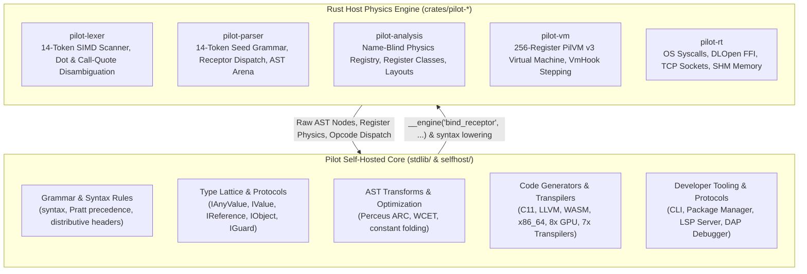
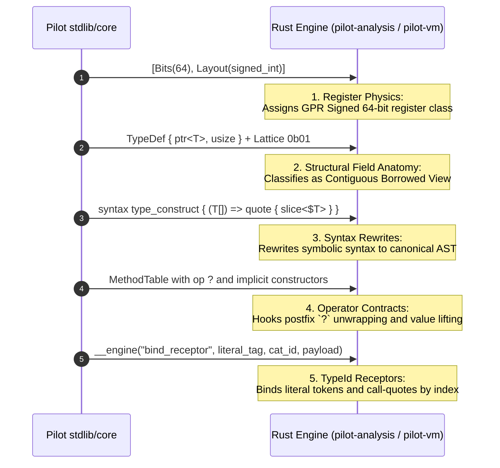
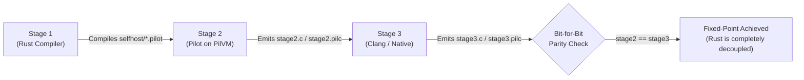

# Programming Responsibilities: Pilot vs. Rust

This document defines the architectural division of labor between the **Rust Host Engine** (`crates/pilot-*`) and the **Self-Hosted Pilot Core** (`stdlib/` and `selfhost/`).

---

## 1. Executive Architectural Philosophy

Pilot operates under a strict **Universal Name-Blind Contract**:

> **The Rust Engine is a Name-Blind Hardware & Structural Physics Engine.**  
> It manages register allocation, memory layouts, bytecode dispatch, and raw hardware access.  
> **Pilot is the Language.**  
> It defines its own grammar, types, syntax sugar, borrow/escape checks, transpilers, standard library, and multi-target code generators.



---

## 2. The Strict 14-Token Boundary

The Rust compiler hardcodes **strictly 14 seed keywords**:

```text
__engine   struct   interface   fn   let   ref   if   loop   return   yield   defer   comptime   quote   asm
```

### Zero Hardcoded Types or Symbols
Rust **never** contains string literals or enum variants for:
- **Scalar Primitives:** `i64`, `u8`, `f64`, `char`, `bool`, `usize`, `str`, etc.
- **Algebraic / Composite Types:** `slice<T>`, `array<T, N>`, `stride<T>`, `option<T>`, `result<T, E>`, `map<K, V>`, `range<T>`, etc.
- **Standard Library Functions / Names:** `main`, `print`, `len`, `drop`, `dup`, etc.

If any type name in `stdlib/core/*.pilot` is renamed (e.g. `char` $\rightarrow$ `c32`, `slice<T>` $\rightarrow$ `window<T>`, `option<T>` $\rightarrow$ `maybe<T>`), the Rust engine compiles, type-checks, and runs with **zero Rust changes**.

---

## 3. Division of Responsibilities Matrix

| Domain | Rust Host Engine (`crates/`) | Pilot Self-Host (`stdlib/` & `selfhost/`) |
| :--- | :--- | :--- |
| **Lexing & Scanning** | SIMD byte scanner, identifier boundaries, two-way dot disambiguation (`obj.field` vs `.field`), call-quote sigils (`!(`, `!!(`, etc.). | Preprocessor (`#if`, `#define`, `#pragma`), token tagging, diagnostics formatting (`PREPROC001`–`PREPROC008`). |
| **Parsing** | 14-token seed grammar, Pratt binding power engine, recursive bracket matching, lossless flat AST node allocation. | Full CST parser (`parse_lossless_cst`), GreenNode incremental reuse, Damerau-Levenshtein keyword typo recovery, Wadler-Lindig code formatter. |
| **Type System** | 2-bit hardware lattice bits (`0b00`..`0b11`), byte layout sizing/offsets, CPU register classification (`gpr_signed`, `simd_float`, `raw_ptr`, etc.). | High-level types (`i8`..`i128`, `f16`..`f128`, `str`, `map`, `range`), protocol inheritance (`IValue`, `IObject`), algebraic unions (`T1 \| T2`). |
| **Syntax Expansion** | Template node substitution for `quote { ... }` blocks; receptor table lookup. | Homoiconic `syntax` macros (`while`, `for`, `try/catch`, `switch`, `guard`, `raw`, `splice`, `splat`), distributive headers (`Header:`, `Header { ... }`). |
| **Memory & Lifetime** | Register frame lifecycle, drop-reuse slot reservation. | Perceus ARC pass (`perceus_schedule_fn` emitting `Dup`, `Drop`, `DropReuse`, `ScopeExitDrop`), escape analysis (`ESCAPE001`–`003`), realtime arena checks. |
| **Code Generation** | Basic bytecode emission for the 14 seed forms; binary `.pilc` container writing. | Layout-driven C11, LLVM IR, WASM binary & WAT, x86_64 ASM, 8 GPU backends (`cuda`, `hip`, `opencl`, `openmp`, `wgsl`, `spirv`, `nvptx`, `amdgpu`), 7 transpilers (`rust`, `c`, `cpp`, `csharp`, `python`, `js`, `lua`), 6 ingesters. |
| **Execution** | 256-register virtual machine (`PilVirtualMachine`), opcode fetch-decode-execute loop, `VmHook` debug breakpoints. | Dynamic REPL, test runner, differential testing harness, flamegraph SVG profiler, AST WCET analysis, constant folding. |
| **Runtime & I/O** | Raw OS primitives: `dlopen`, `dlsym`, `mmap`, `socket`, `bind`, `connect`, `read`, `write`. | RFC-compliant SHA-256/512, BLAKE3, HMAC, Ed25519, HTTP/1.1 parser & TCP server, PostgreSQL/MySQL binary wire frames, SQL engine, shared memory bridges. |
| **Tooling & IDE** | None (purely headless). | Persistent LSP server, VS Code syntax/snippet generator, DAP debugger controller, package/venv manager. |

---

## 4. How Rust Derives Pilot Types (The 5 Name-Blind Mechanisms)

Rust never matches on type names. Instead, it inspects metadata communicated by Pilot:



1. **Register & Layout Physics (`[Bits]` & `[Layout]`):**  
   Deduces CPU register classes (`gpr_signed`, `gpr_unsigned`, `simd_float`, `simd_vector`, `raw_ptr`, `unit`, `noreturn`), bit widths, array repetition (`repeat`), and niche packing (`niche`) from numeric descriptors.
2. **Structural Field Anatomy (`TypeDef.fields` & `LatticeBits`):**  
   Deduces views (`{ ptr<T>, usize }` + `0b01`), strided lenses (`{ ptr<T>, usize, isize }` + `0b01`), owned buffers (`{ ptr<T>, usize, usize }` + `0b10`), and bounds pairs (`{ T, T }` + `0b00`) from byte offsets and lattice bits.
3. **Pure Pilot Syntax Rewrites (`syntax type_construct`):**  
   Symbolic types (`T[]`, `T[N]`, `T[..]`, `T@N`, `T?`, `T!E`, `(A) => R`) are lowered to canonical AST representations in `stdlib/core/syntax/type_construct.pilot`—never by hardcoded tables in the Rust parser.
4. **Operator & Protocol Contracts (`MethodTable`):**  
   Behaviors for postfix `expr?` (types implementing `op ?`), `for` loops (types implementing `get_enumerator()`), and value lifting are resolved from the type's `MethodTable`.
5. **`TypeId` Receptor Slots (`__engine("bind_receptor", ...)`):**  
   Binds lexed literals (`42`, `3.14`, `'a'`, `"hi"`, `true`) and call-quote sigils (`!`, `!!`, `!&`, `!^`, `!@`, `!?`) to integer receptor slots, populating composite fields by positional index rather than field names.

---

## 5. Compile-Time vs. Runtime Communication: The Complete `__engine(...)` Mapping

Communication between Pilot and Rust host physics happens strictly across a single irreducible intrinsic interface:
```pilot
extern "rust" lib "libphysics" {
    pub fn __engine(hook_name: str, ...) -> any;
}
```

The Rust host implements this intrinsic in two places:
1. **At Parse/Bootstrap Time (`crates/pilot-parser/src/lib.rs`):** Ingests syntax modifiers, operator bindings, module keywords, receptors, and attribute macros into `ParserTables`.
2. **At VM Execution Time (`crates/pilot-vm/src/vm.rs` & `crates/pilot-analysis/src/infer.rs`):** Executes heap map operations, string primitives, physical layout computations, AST arena traversal, LSP handlers, and OS syscalls.

Below is the complete mapping of every `__engine(...)` hook across the Pilot language and compiler infrastructure, categorized by architectural subsystem.

---

### 5.1 Grammar Genesis, Parser Receptors & Operator Precedence

These hooks are executed in [`stdlib/core/core.pilot`](file:///home/moony/Documents/dev/projects/Pilot/stdlib/core/core.pilot) during Stage 1 compiler bootstrap to establish the language's grammar and syntax without any hardcoded names in Rust.

| Hook Name | Caller Function & Location | Full Signature & Parameters | Return | Subsystem Responsibility & Division of Labor |
| :--- | :--- | :--- | :--- | :--- |
| `register_modifier` | `comptime` genesis block in [`stdlib/core/core.pilot`](file:///home/moony/Documents/dev/projects/Pilot/stdlib/core/core.pilot#L383) | `__engine("register_modifier", token: str, action: i64 \| str)` | `void` | **Pilot** provides keyword name and visibility level (`priv`=0..`export`=9) or declaration action (`pure`, `static`, `const`, `var`, `iso`, `partial`, `ext`).<br/>**Rust** populates `ParserTables.modifiers` map for name-blind token classification. |
| `register_parametric_modifier` | `comptime` genesis block in [`stdlib/core/core.pilot`](file:///home/moony/Documents/dev/projects/Pilot/stdlib/core/core.pilot#L402) | `__engine("register_parametric_modifier", token: str, action: str)` | `void` | **Pilot** registers parameter-bearing modifiers (e.g. `lvl` with `set_clearance_ring`).<br/>**Rust** marks token in `ParserTables.param_modifiers` to parse following parenthesized arguments `(N)`. |
| `register_module_kw` | `comptime` genesis block in [`stdlib/core/core.pilot`](file:///home/moony/Documents/dev/projects/Pilot/stdlib/core/core.pilot#L403) | `__engine("register_module_kw", token: str, action: str)` | `void` | **Pilot** registers `pkg` (`declare_package_scope`) and `use` (`import_symbol_path`).<br/>**Rust** registers them in `ParserTables.module_kws` to control module and namespace scoping. |
| `bind_receiver_ident` | `comptime` genesis block in [`stdlib/core/core.pilot`](file:///home/moony/Documents/dev/projects/Pilot/stdlib/core/core.pilot#L405) | `__engine("bind_receiver_ident", self_ident: str, field_ident: str, val_ident: str)` | `void` | **Pilot** registers `self`, `field`, and `value`.<br/>**Rust** binds these identifier strings in `ParserTables.receiver_ident` so getters, setters, and method receivers resolve correctly. |
| `bind_receptor` | `comptime` genesis block in [`stdlib/core/core.pilot`](file:///home/moony/Documents/dev/projects/Pilot/stdlib/core/core.pilot#L406) and [`stdlib/polyglot/polyglot_syntax.pilot`](file:///home/moony/Documents/dev/projects/Pilot/stdlib/polyglot/polyglot_syntax.pilot#L10) | `__engine("bind_receptor", token: str, category_id: u8, payload_id: u8)` | `void` | **Pilot** binds literal tokens (`true`, `false`, `none`), keywords (`syntax`, `type_construct`, `extern`, `break`, `continue`, `get`, `set`, `op`, `as`, `view`), and polyglot tags (`c`, `cpp`, `rust`, `python`, `js`, `sql`, etc.) to integer receptor categories.<br/>**Rust** stores them in `ParserTables.receptors` to dispatch tokens directly to AST nodes by category ID. |
| `register_pratt_op` | `comptime fn Operator(target_fn, fixity, prec, assoc)` in [`stdlib/core/core.pilot`](file:///home/moony/Documents/dev/projects/Pilot/stdlib/core/core.pilot#L343) | `__engine("register_pratt_op", symbol: str, fixity: str, prec: u8, assoc: str)` | `void` | **Pilot** registers operator symbols (`??`, `\|\|`, `&&`, `\|`, `^`, `&`, `..`, `==`, `+`, `-`, `*`, `/`, `!`, `?`, etc.) with fixity (`prefix`, `infix`, `postfix`), binding power, and associativity (`left`, `right`, `none`).<br/>**Rust** stores them in `prefix_ops`, `postfix_ops`, and `infix_ops` Pratt parser tables. |
| `register_bracket_attribute` | `comptime` genesis block in [`stdlib/core/core.pilot`](file:///home/moony/Documents/dev/projects/Pilot/stdlib/core/core.pilot#L359) | `__engine("register_bracket_attribute", name: str, handler_fn: fn)` | `void` | **Pilot** registers attribute handlers (`Lang`, `Bits`, `Layout`, `Operator`, `Inline`, `Lattice`, `EnforceCoreNaming`, `SyntaxMacro`).<br/>**Rust** binds these names to dispatch `[...]` attribute pipelines during compilation. |
| `bind_lang_item` | `comptime fn Lang(target_decl, item_name)` in [`stdlib/core/core.pilot`](file:///home/moony/Documents/dev/projects/Pilot/stdlib/core/core.pilot#L334) | `__engine("bind_lang_item", target_decl: ast, item_name: str)` | `void` | **Pilot** associates an AST declaration with a compiler language item slot (e.g. `bool_t`, `usize_t`).<br/>**Rust** tracks language items without hardcoded type names. |
| `register_syntax_keyword` | `comptime fn SyntaxMacro(transformer_fn, kw_token)` in [`stdlib/core/core.pilot`](file:///home/moony/Documents/dev/projects/Pilot/stdlib/core/core.pilot#L355) | `__engine("register_syntax_keyword", kw_token: str, transformer_fn: fn)` | `void` | **Pilot** registers AST transformer functions for syntax macros (`while`, `for`, `switch`, `guard`, etc.).<br/>**Rust** dispatches matching keywords to the registered Pilot syntax transformer. |
| `seal_bootstrap_bridge` | `comptime` step 6 in [`stdlib/core/core.pilot`](file:///home/moony/Documents/dev/projects/Pilot/stdlib/core/core.pilot#L566) | `__engine("seal_bootstrap_bridge")` | `void` | **Pilot** signals that genesis bootstrap is complete.<br/>**Rust** permanently seals `ParserTables` against any subsequent mutation, locking grammar invariants. |

---

### 5.2 Control Flow & SSA Intrinsic Emitters

These hooks provide low-level control flow jumps and SSA intermediate representation emission for self-hosted compilers and core types.

| Hook Name | Caller Function & Location | Full Signature & Parameters | Return | Subsystem Responsibility & Division of Labor |
| :--- | :--- | :--- | :--- | :--- |
| `cfg_jump_loop_exit` | `break()` syntax macro in [`stdlib/core/core.pilot`](file:///home/moony/Documents/dev/projects/Pilot/stdlib/core/core.pilot#L485) | `__engine("cfg_jump_loop_exit")` | `void` | **Pilot** invokes on `break;`.<br/>**Rust** emits a control-flow jump to the current loop's exit break label in bytecode/SSA. |
| `cfg_jump_loop_head` | `continue()` syntax macro in [`stdlib/core/core.pilot`](file:///home/moony/Documents/dev/projects/Pilot/stdlib/core/core.pilot#L486) | `__engine("cfg_jump_loop_head")` | `void` | **Pilot** invokes on `continue;`.<br/>**Rust** emits a control-flow jump to the current loop's loop-header / increment step in bytecode/SSA. |
| `decl_operator_fn` | `op(sig, body)` syntax macro in [`stdlib/core/core.pilot`](file:///home/moony/Documents/dev/projects/Pilot/stdlib/core/core.pilot#L487) | `__engine("decl_operator_fn", sig: ast, body: ast)` | `void` | **Pilot** declares an operator overload method.<br/>**Rust** attaches the method to the target type's `MethodTable` under its operator protocol. |
| `emit_ssa_binop` | `__ssa(opcode, lhs, rhs)` in [`stdlib/core/core.pilot`](file:///home/moony/Documents/dev/projects/Pilot/stdlib/core/core.pilot#L497) | `__engine("emit_ssa_binop", opcode: str, lhs: any, rhs: any)` | `any` | **Pilot** emits primitive arithmetic/bitwise operations (`add`, `sub`, `mul`, `sdiv`, `and`, `or`, `xor`, `eq`, `ne`, etc.).<br/>**Rust** generates raw SSA virtual registers or bytecode instructions. |
| `emit_ssa_unop` | `__ssa_unary(opcode, val)` in [`stdlib/core/core.pilot`](file:///home/moony/Documents/dev/projects/Pilot/stdlib/core/core.pilot#L498) | `__engine("emit_ssa_unop", opcode: str, val: any)` | `any` | **Pilot** emits unary negation or bitwise complement.<br/>**Rust** generates unary SSA instructions. |
| `emit_ssa_cast` | `__ssa_cast(opcode, val, T)` in [`stdlib/core/core.pilot`](file:///home/moony/Documents/dev/projects/Pilot/stdlib/core/core.pilot#L499) | `__engine("emit_ssa_cast", opcode: str, val: any, target_type: type)` | `any` | **Pilot** requests numeric/bitcast conversions (`trunc`, `zext`, `sext`, `bitcast`).<br/>**Rust** validates bit widths and emits SSA conversion instructions. |
| `emit_ssa_load` | `__ssa_load(ptr_val)` in [`stdlib/core/core.pilot`](file:///home/moony/Documents/dev/projects/Pilot/stdlib/core/core.pilot#L500) | `__engine("emit_ssa_load", ptr_val: any)` | `any` | **Pilot** requests dereference of a pointer.<br/>**Rust** emits SSA memory load instruction with proper alignment. |
| `emit_ssa_store` | `__ssa_store(ptr_val, val)` in [`stdlib/core/core.pilot`](file:///home/moony/Documents/dev/projects/Pilot/stdlib/core/core.pilot#L501) | `__engine("emit_ssa_store", ptr_val: any, val: any)` | `void` | **Pilot** requests writing a value to memory.<br/>**Rust** emits SSA memory store instruction. |
| `emit_ssa_gep` | `__ssa_gep(base_ptr, elem_idx)` in [`stdlib/core/core.pilot`](file:///home/moony/Documents/dev/projects/Pilot/stdlib/core/core.pilot#L502) | `__engine("emit_ssa_gep", base_ptr: any, elem_idx: any)` | `any` | **Pilot** computes field or element address offset.<br/>**Rust** computes SSA GetElementPtr byte offset using physical layout metrics. |

---

### 5.3 Type Reflection & Structural Lattice Introspection

These hooks provide compile-time type reflection, size/alignment queries, and lattice inspection.

| Hook Name | Caller Function & Location | Full Signature & Parameters | Return | Subsystem Responsibility & Division of Labor |
| :--- | :--- | :--- | :--- | :--- |
| `query_is_comptime_vm` | `__is_comptime()` in [`stdlib/core/core.pilot`](file:///home/moony/Documents/dev/projects/Pilot/stdlib/core/core.pilot#L508) | `__engine("query_is_comptime_vm")` | `bool` | **Pilot** checks if execution is occurring during compile-time evaluation.<br/>**Rust** returns `true` in PilVM compile-time evaluation context. |
| `type_sizeof` | `sizeof(T)` in [`stdlib/core/core.pilot`](file:///home/moony/Documents/dev/projects/Pilot/stdlib/core/core.pilot#L509) | `__engine("type_sizeof", target_type: type)` | `usize` | **Pilot** queries byte footprint of type `T`.<br/>**Rust** looks up `LayoutId` in `PhysicsRegistry` and returns `byte_size`. |
| `type_alignof` | `alignof(T)` in [`stdlib/core/core.pilot`](file:///home/moony/Documents/dev/projects/Pilot/stdlib/core/core.pilot#L510) | `__engine("type_alignof", target_type: type)` | `usize` | **Pilot** queries alignment requirement of type `T`.<br/>**Rust** looks up `LayoutId` and returns `byte_align`. |
| `type_offsetof` | `offsetof(T, field_sym)` in [`stdlib/core/core.pilot`](file:///home/moony/Documents/dev/projects/Pilot/stdlib/core/core.pilot#L511) | `__engine("type_offsetof", target_type: type, field_sym: sym)` | `usize` | **Pilot** queries byte offset of struct field.<br/>**Rust** inspects aggregate layout field geometry and returns offset. |
| `type_fields_of` | `fields_of(T)` in [`stdlib/core/core.pilot`](file:///home/moony/Documents/dev/projects/Pilot/stdlib/core/core.pilot#L512) | `__engine("type_fields_of", target_type: type)` | `any` | **Pilot** requests field metadata for reflection.<br/>**Rust** extracts field descriptors from the physical type layout. |
| `type_name_of` | `type_name_of(T)` in [`stdlib/core/core.pilot`](file:///home/moony/Documents/dev/projects/Pilot/stdlib/core/core.pilot#L515) | `__engine("type_name_of", target_type: type)` | `str` | **Pilot** requests canonical name of type `T`.<br/>**Rust** returns resolved symbol string for type's declaration node. |
| `get_lattice_bits` | `lattice_bits_of(T)` in [`stdlib/core/core.pilot`](file:///home/moony/Documents/dev/projects/Pilot/stdlib/core/core.pilot#L514) | `__engine("get_lattice_bits", target_type: type)` | `u8` | **Pilot** requests 2-bit lifecycle lattice bits (`0b00` Value, `0b01` Reference, `0b10` Object, `0b11` Guard).<br/>**Rust** computes bitwise-OR of field layouts and destructor metadata. |
| `bind_lattice_kind` | `comptime fn Lattice(target_iface, mask)` in [`stdlib/core/core.pilot`](file:///home/moony/Documents/dev/projects/Pilot/stdlib/core/core.pilot#L349) | `__engine("bind_lattice_kind", target_iface: ast, mask: u8)` | `void` | **Pilot** declares the 2-bit lattice mask for an interface.<br/>**Rust** records interface lifecycle contract. |
| `enforce_core_naming_lint` | `comptime fn EnforceCoreNaming(target_pkg)` in [`stdlib/core/core.pilot`](file:///home/moony/Documents/dev/projects/Pilot/stdlib/core/core.pilot#L352) | `__engine("enforce_core_naming_lint", target_pkg: ast)` | `void` | **Pilot** enables strict naming taxonomy linting.<br/>**Rust** verifies all types in package match Table 3 naming rules. |
| `emit_diagnostic_error` | `compile_error(msg)` in [`stdlib/core/core.pilot`](file:///home/moony/Documents/dev/projects/Pilot/stdlib/core/core.pilot#L513) | `__engine("emit_diagnostic_error", msg: str)` | `void` | **Pilot** triggers compile-time error reporting.<br/>**Rust** halts compilation with formatted error diagnostic. |
| `ast_source_lines` | `__ast_lines(target_fn, part_kind)` in [`stdlib/core/core.pilot`](file:///home/moony/Documents/dev/projects/Pilot/stdlib/core/core.pilot#L516) | `__engine("ast_source_lines", target_fn: ast, part_kind: i64)` | `i64` | **Pilot** queries line count / span bounds of an AST declaration.<br/>**Rust** computes line delta from source spans. |
| `parse_ast_fragment` | `__parse_ast(source_str)` in [`stdlib/core/core.pilot`](file:///home/moony/Documents/dev/projects/Pilot/stdlib/core/core.pilot#L517) | `__engine("parse_ast_fragment", source_str: str)` | `ast` | **Pilot** dynamically parses a source snippet into an AST subtree.<br/>**Rust** parses snippet using active `ParserTables` and returns `NodeId`. |
| `replace_ast_pattern` | `__replace_ast(root, pat, rep)` in [`stdlib/core/core.pilot`](file:///home/moony/Documents/dev/projects/Pilot/stdlib/core/core.pilot#L518) | `__engine("replace_ast_pattern", root: ast, pat: ast, rep: ast)` | `ast` | **Pilot** executes homoiconic AST pattern replacement.<br/>**Rust** performs structural tree substitution in the arena. |
| `register_attr_weaver` | `__bind_weaver(iface_decl, fn_ref)` in [`stdlib/core/core.pilot`](file:///home/moony/Documents/dev/projects/Pilot/stdlib/core/core.pilot#L519) | `__engine("register_attr_weaver", iface_decl: ast, fn_ref: fn)` | `void` | **Pilot** registers attribute weaving callbacks for AOP and reactive attributes.<br/>**Rust** invokes callback during AST pass passes. |
| `set_inline_hint` | `comptime fn Inline(target_fn, mode)` in [`stdlib/core/core.pilot`](file:///home/moony/Documents/dev/projects/Pilot/stdlib/core/core.pilot#L346) | `__engine("set_inline_hint", target_fn: ast, mode: str)` | `void` | **Pilot** sets inlining behavior (`always`, `never`, `hint`).<br/>**Rust** attaches inline metadata to function declaration in codegen. |

---

### 5.4 Flat AST Navigation & Arena Inspection (`RawAstArena`)

These hooks allow self-hosted analyzers, Perceus ARC passes, code generators, and LSP handlers to traverse the flat, lossless AST arena stored in `PhysicsRegistry`.

| Hook Name | Caller Functions & Files | Full Signature & Parameters | Return | Subsystem Responsibility & Division of Labor |
| :--- | :--- | :--- | :--- | :--- |
| `ast_node_count` | `selfhost/analyzer.pilot`, `selfhost/ast_bridge.pilot`, `selfhost/diagnostics.pilot`, `selfhost/attr_weaver.pilot`, `selfhost/ffi_bindgen.pilot`, `selfhost/transpile/ir.pilot` | `__engine("ast_node_count")` | `i64` | **Pilot** queries node count to bound AST traversal loops.<br/>**Rust** returns `registry.arena.nodes.len()`. |
| `ast_node_kind` | `selfhost/analyzer.pilot`, `selfhost/diagnostics.pilot`, `selfhost/attr_weaver.pilot`, `selfhost/lsp/handlers.pilot`, etc. (127+ sites) | `__engine("ast_node_kind", nid: i64)` | `i64` | **Pilot** inspects node category tag.<br/>**Rust** returns compact `kind_tag` (0=Program, 1=Ident, 3=FnDecl, 8=StructDecl, etc.). |
| `ast_orig_kind` | `selfhost/ast_bridge.pilot`, `selfhost/analyzer.pilot`, `selfhost/diagnostics.pilot` | `__engine("ast_orig_kind", nid: i64)` | `i64` | **Pilot** requests original unlowered parser `NodeKind` enum value.<br/>**Rust** returns `node.orig_kind`. |
| `ast_node_flags` | `selfhost/ast_bridge.pilot`, `selfhost/transpile/emit_*.pilot` | `__engine("ast_node_flags", nid: i64)` | `i64` | **Pilot** checks semantic flags (mutability, static, async).<br/>**Rust** returns `node.node_flags`. |
| `ast_decl_flags` | `selfhost/analyzer.pilot`, `selfhost/diagnostics.pilot`, `selfhost/perceus/arc.pilot`, `selfhost/ffi_bindgen.pilot`, `selfhost/codegen/c_emitter.pilot` | `__engine("ast_decl_flags", nid: i64)` | `i64` | **Pilot** checks declaration modifiers (e.g. `1024` for partial struct, visibility bits).<br/>**Rust** returns `node.decl_flags`. |
| `ast_parent` | `selfhost/analyzer.pilot`, `selfhost/transpile/ir.pilot` | `__engine("ast_parent", nid: i64)` | `i64` | **Pilot** traverses up the AST hierarchy.<br/>**Rust** returns `node.parent_id` (or `u32::MAX` if root). |
| `ast_node_sym` | `selfhost/analyzer.pilot`, `selfhost/ast_bridge.pilot`, `selfhost/diagnostics.pilot`, `selfhost/attr_weaver.pilot`, `selfhost/lsp/handlers.pilot` | `__engine("ast_node_sym", nid: i64)` | `i64` | **Pilot** queries symbol ID for identifier or declaration name.<br/>**Rust** returns `node.sym_id`. |
| `ast_node_lit_kind` | `selfhost/analyzer.pilot`, `selfhost/ast_bridge.pilot` | `__engine("ast_node_lit_kind", nid: i64)` | `i64` | **Pilot** inspects literal variant.<br/>**Rust** returns `literal_kind` (int, float, char, str, bool). |
| `ast_node_raw_bits` | `selfhost/analyzer.pilot`, `selfhost/ast_bridge.pilot`, `selfhost/codegen/*.pilot` (44+ sites) | `__engine("ast_node_raw_bits", nid: i64)` | `i64` | **Pilot** extracts raw constant bits (numeric values or symbol indexes).<br/>**Rust** returns `node.raw_bits`. |
| `ast_child_count` | Extensively across `selfhost/` (99+ functions, 194+ sites) | `__engine("ast_child_count", nid: i64)` | `i64` | **Pilot** bounds child node iteration.<br/>**Rust** returns `node.child_count`. |
| `ast_child_at` | Extensively across `selfhost/` (103+ functions, 469+ sites) | `__engine("ast_child_at", nid: i64, index: i64)` | `i64` | **Pilot** retrieves child `NodeId`.<br/>**Rust** indexes `registry.arena.child_links[node.first_child + index]`. |
| `ast_span_start` | `selfhost/analyzer.pilot`, `selfhost/ast_bridge.pilot`, `selfhost/lsp/handlers.pilot` | `__engine("ast_span_start", nid: i64)` | `i64` | **Pilot** queries source byte start offset for diagnostics and LSP cursor checks.<br/>**Rust** returns `node.span_start`. |
| `ast_span_end` | `selfhost/analyzer.pilot`, `selfhost/ast_bridge.pilot`, `selfhost/lsp/handlers.pilot` | `__engine("ast_span_end", nid: i64)` | `i64` | **Pilot** queries source byte end offset.<br/>**Rust** returns `node.span_end`. |
| `source_slice` | `selfhost/analyzer.pilot`, `selfhost/lsp/handlers.pilot`, `selfhost/ide/vscode_gen.pilot` | `__engine("source_slice", start: i64, end: i64)` | `str` | **Pilot** extracts exact source text between character boundaries.<br/>**Rust** slices `registry.source_text` clamped safely to UTF-8 boundaries. |
| `sym_str` | Extensively across `selfhost/` (112+ functions, 203+ sites) | `__engine("sym_str", sym_id: i64)` | `str` | **Pilot** converts integer `SymbolId` into its string representation.<br/>**Rust** looks up `registry.symbol_strings.get(&sym_id)`. |
| `ast_emit_diag` | `selfhost/analyzer.pilot`, `selfhost/diagnostics.pilot`, `selfhost/attr_weaver.pilot`, `selfhost/perceus/escape.pilot` | `__engine("ast_emit_diag", nid: i64, severity: i64, msg: str)` | `void` | **Pilot** records error/warning diagnostics (e.g. `ESCAPE001`, `ATTR001`).<br/>**Rust** appends to `registry.diagnostics`. |
| `mount_unit` | `selfhost/analyzer.pilot`, `selfhost/lsp/handlers.pilot` | `__engine("mount_unit", file_path: str)` | `i64` | **Pilot** mounts an external module or dependency into the active arena.<br/>**Rust** parses file, remaps symbol offsets, splices into arena, and returns new node count. |

---

### 5.5 Attributes & Interface Inheritance Reflection

These hooks inspect `[...]` attribute declarations and `: IBase` inheritance clauses attached to structs, functions, and interfaces.

| Hook Name | Caller Functions & Files | Full Signature & Parameters | Return | Subsystem Responsibility & Division of Labor |
| :--- | :--- | :--- | :--- | :--- |
| `ast_attr_count` | `selfhost/analyzer.pilot`, `selfhost/ffi_bindgen.pilot`, `selfhost/transpile/ir.pilot`, `selfhost/codegen/physics.pilot` | `__engine("ast_attr_count", nid: i64)` | `i64` | **Pilot** counts total attribute argument values on node.<br/>**Rust** returns `node.attr_arg_count`. |
| `ast_attr_arg` | `selfhost/analyzer.pilot`, `selfhost/ffi_bindgen.pilot` | `__engine("ast_attr_arg", nid: i64, idx: i64)` | `i64` | **Pilot** reads attribute argument by index.<br/>**Rust** indexes `registry.arena.attr_args[node.first_attr_arg + idx]`. |
| `ast_attr_decl_count` | `selfhost/analyzer.pilot`, `selfhost/attr_weaver.pilot`, `selfhost/diagnostics.pilot`, `selfhost/ffi_bindgen.pilot` | `__engine("ast_attr_decl_count", nid: i64)` | `i64` | **Pilot** queries number of distinct attribute blocks decorating node.<br/>**Rust** returns `node.attr_count`. |
| `ast_attr_name` | `selfhost/analyzer.pilot`, `selfhost/attr_weaver.pilot`, `selfhost/diagnostics.pilot`, `selfhost/cli/test_runner.pilot` | `__engine("ast_attr_name", nid: i64, attr_idx: i64)` | `i64` | **Pilot** queries symbol ID of an attribute's name.<br/>**Rust** returns `registry.arena.attrs[first_attr + attr_idx].name_sym`. |
| `ast_attr_decl_arg_count` | `selfhost/analyzer.pilot`, `selfhost/attr_weaver.pilot`, `selfhost/ffi_bindgen.pilot` | `__engine("ast_attr_decl_arg_count", nid: i64, attr_idx: i64)` | `i64` | **Pilot** queries number of arguments for specific attribute.<br/>**Rust** returns `attr.arg_count`. |
| `ast_attr_decl_arg` | `selfhost/analyzer.pilot`, `selfhost/attr_weaver.pilot`, `selfhost/ffi_bindgen.pilot` | `__engine("ast_attr_decl_arg", nid: i64, attr_idx: i64, arg_idx: i64)` | `i64` | **Pilot** reads value of specific attribute argument.<br/>**Rust** indexes `registry.arena.attr_args[attr.first_arg + arg_idx]`. |
| `ast_base_count` | `selfhost/analyzer.pilot`, `selfhost/attr_weaver.pilot`, `selfhost/perceus/arc.pilot`, `selfhost/diagnostics.pilot` | `__engine("ast_base_count", nid: i64)` | `i64` | **Pilot** queries number of base interfaces in `: IBase1, IBase2`.<br/>**Rust** returns `node.base_count`. |
| `ast_base_at` | `selfhost/analyzer.pilot`, `selfhost/attr_weaver.pilot`, `selfhost/perceus/arc.pilot`, `selfhost/diagnostics.pilot` | `__engine("ast_base_at", nid: i64, idx: i64)` | `i64` | **Pilot** queries symbol ID of $i$-th base interface.<br/>**Rust** returns `registry.arena.base_syms[node.first_base + idx]`. |

---

### 5.6 Hardware Register Layouts & Memory Physics (`PhysicsRegistry`)

These hooks construct, compute, and query physical memory layouts and register assignments without any type names.

| Hook Name | Caller Functions & Files | Full Signature & Parameters | Return | Subsystem Responsibility & Division of Labor |
| :--- | :--- | :--- | :--- | :--- |
| `set_register_layout` | `comptime fn Bits(target_type, width, reg_class)` in [`stdlib/core/core.pilot`](file:///home/moony/Documents/dev/projects/Pilot/stdlib/core/core.pilot#L337) | `__engine("set_register_layout", target_type: ast, width: i64, reg_class: str)` | `void` | **Pilot** specifies bit width and register class (`gpr_signed`, `gpr_unsigned`, `simd_float`, `raw_ptr`).<br/>**Rust** configures CPU register classification. |
| `set_memory_layout` | `comptime fn Layout(target_type, mode)` in [`stdlib/core/core.pilot`](file:///home/moony/Documents/dev/projects/Pilot/stdlib/core/core.pilot#L340) | `__engine("set_memory_layout", target_type: ast, mode: str)` | `void` | **Pilot** sets memory alignment and packing mode.<br/>**Rust** configures memory layout physics. |
| `layout_hw_header` | `selfhost/analyzer.pilot` | `__engine("layout_hw_header", hdr_tag: i64)` | `i64` | **Pilot** registers standard scalar header (`Unit0`..`RawPtr64`).<br/>**Rust** calls `layouts.register_hw_header` and returns `LayoutId`. |
| `layout_scalar` | `selfhost/analyzer.pilot` | `__engine("layout_scalar", size_bytes: i64, align_bytes: i64, reg_class: i64)` | `i64` | **Pilot** registers custom scalar layout.<br/>**Rust** computes scalar layout metrics and returns `LayoutId`. |
| `layout_ptr` | `selfhost/analyzer.pilot` | `__engine("layout_ptr", pointee_lid: i64, caps: i64, depth: i64)` | `i64` | **Pilot** registers pointer layout referencing pointee `LayoutId` with capability bits.<br/>**Rust** registers pointer layout and returns `LayoutId`. |
| `layout_aggregate` | `selfhost/analyzer.pilot` | `__engine("layout_aggregate", ...field_lids: i64)` | `i64` | **Pilot** passes field `LayoutId`s for struct or tuple.<br/>**Rust** computes packing, alignment padding, field offsets, and returns aggregate `LayoutId`. |
| `layout_union` | `selfhost/analyzer.pilot` | `__engine("layout_union", tag_bytes: i64, ...payload_lids: i64)` | `i64` | **Pilot** passes discriminant tag size and variant `LayoutId`s.<br/>**Rust** computes max payload size/alignment and returns union `LayoutId`. |
| `layout_fn_abi` | `selfhost/analyzer.pilot` | `__engine("layout_fn_abi", ...param_lids: i64, ret_lid: i64)` | `i64` | **Pilot** registers C-ABI function call frame.<br/>**Rust** calculates parameter stack offsets and returns call frame `LayoutId`. |
| `layout_metrics` | `selfhost/analyzer.pilot`, `selfhost/codegen/*.pilot` | `__engine("layout_metrics", lid: i64)` | `i64` | **Pilot** queries byte size of `LayoutId`.<br/>**Rust** returns `layout.byte_size`. |
| `layout_field_offset` | `selfhost/analyzer.pilot`, `selfhost/codegen/c_emitter.pilot` | `__engine("layout_field_offset", aggregate_lid: i64, field_idx: i64)` | `i64` | **Pilot** queries byte offset of field $i$ in struct.<br/>**Rust** looks up aggregate field geometry and returns byte offset. |
| `layout_physically_equal` | `selfhost/analyzer.pilot` | `__engine("layout_physically_equal", lid_a: i64, lid_b: i64)` | `bool` | **Pilot** tests layout equivalence for safe zero-cost casting.<br/>**Rust** compares byte sizes, alignments, and geometry descriptors. |
| `ast_bind_layout` | `selfhost/analyzer.pilot` | `__engine("ast_bind_layout", nid: i64, lid: i64)` | `void` | **Pilot** binds resolved `LayoutId` to an AST node.<br/>**Rust** records layout association in `registry.node_layouts[nid]`. |
| `ast_get_bound_layout` | `selfhost/analyzer.pilot`, `selfhost/perceus/arc.pilot`, `selfhost/codegen/physics.pilot` | `__engine("ast_get_bound_layout", nid: i64)` | `i64` | **Pilot** queries previously bound `LayoutId` for AST node.<br/>**Rust** returns `registry.node_layouts[nid]` (or `u32::MAX`). |
| `ast_bind_target` | `selfhost/analyzer.pilot` | `__engine("ast_bind_target", nid: i64, target_sym: i64)` | `void` | **Pilot** binds target type `SymbolId` to an AST node.<br/>**Rust** records type binding in `registry.node_targets[nid]`. |
| `ast_get_bound_target` | `selfhost/analyzer.pilot` | `__engine("ast_get_bound_target", nid: i64)` | `i64` | **Pilot** queries target type `SymbolId` for AST node.<br/>**Rust** returns `registry.node_targets[nid]`. |

---

### 5.7 Keyword & Symbol Registry (LSP, TextMate & Typo Recovery)

These hooks maintain the dynamic symbol database used by typo recovery, syntax highlighters, and auto-completion.

| Hook Name | Caller Functions & Files | Full Signature & Parameters | Return | Subsystem Responsibility & Division of Labor |
| :--- | :--- | :--- | :--- | :--- |
| `register_keyword_category` | `stdlib/core/keywords.pilot` | `__engine("register_keyword_category", cat_id: i64, scope: str, badge: str, lsp_kind: i64)` | `i64` | **Pilot** defines keyword category with TextMate scope, hover badge, and LSP item kind.<br/>**Rust** inserts record into `registry.categories`. |
| `register_keyword` | `stdlib/core/keywords.pilot` | `__engine("register_keyword", cat_id: i64, word: str, doc: str)` | `i64` | **Pilot** registers keyword under category with markdown documentation.<br/>**Rust** appends `(cat_id, word, doc)` to `registry.registered_symbols`. |
| `query_registered_symbols` | `selfhost/cst/cst_recovery.pilot`, `selfhost/lsp/handlers.pilot`, `selfhost/ide/vscode_gen.pilot`, `stdlib/core/core.pilot` | `__engine("query_registered_symbols", cat_id: i64, mode: i64, target: str)` | `str` | **Pilot** queries symbol strings for typo recovery, scopes for VS Code syntax generation, or docs for LSP hovers.<br/>**Rust** returns pipe-delimited words (`mode 0`), scope (`mode 1`), badge (`mode 2`), or documentation (`mode 3`). |
| `keyword_category_count` | `selfhost/ide/vscode_gen.pilot` | `__engine("keyword_category_count")` | `i64` | **Pilot** queries category count for VS Code extension packaging.<br/>**Rust** returns `registry.categories.len()`. |
| `keyword_category_at` | `selfhost/ide/vscode_gen.pilot` | `__engine("keyword_category_at", idx: i64)` | `i64` | **Pilot** iterates category IDs.<br/>**Rust** returns `registry.categories[idx].id`. |
| `keyword_category_scope` | `selfhost/ide/vscode_gen.pilot` | `__engine("keyword_category_scope", cat_id: i64)` | `str` | **Pilot** queries TextMate grammar scope for category.<br/>**Rust** looks up category and returns scope string. |
| `query_category_keywords` | `selfhost/ide/vscode_gen.pilot` | `__engine("query_category_keywords", cat_id: i64)` | `str` | **Pilot** fetches pipe-delimited keywords for regex generation.<br/>**Rust** collects words in category and returns formatted pipe-string. |
| `query_keyword_doc` | `selfhost/lsp/handlers.pilot` | `__engine("query_keyword_doc", word: str)` | `str` | **Pilot** fetches documentation for hovered keyword.<br/>**Rust** returns markdown doc string from symbol registry. |
| `query_keyword_badge` | `selfhost/lsp/handlers.pilot` | `__engine("query_keyword_badge", word: str)` | `str` | **Pilot** fetches UI badge descriptor for hovered symbol.<br/>**Rust** returns category badge string. |

---

### 5.8 Language Server Protocol (LSP) Engine Hooks

These hooks bridge the persistent JSON-RPC language server running inside PilVM to IDE client requests.

| Hook Name | Caller Functions & Files | Full Signature & Parameters | Return | Subsystem Responsibility & Division of Labor |
| :--- | :--- | :--- | :--- | :--- |
| `lsp_query_method` | `selfhost/lsp/server.pilot`, `selfhost/lsp/handlers.pilot` | `__engine("lsp_query_method")` | `str` | **Pilot** checks incoming LSP method name (e.g. `textDocument/hover`, `textDocument/definition`).<br/>**Rust** returns `registry.lsp_method`. |
| `lsp_query_offset` | `selfhost/lsp/server.pilot`, `selfhost/lsp/handlers.pilot` | `__engine("lsp_query_offset")` | `i64` | **Pilot** checks 0-indexed byte offset of user cursor.<br/>**Rust** returns `registry.lsp_offset`. |
| `lsp_set_result` | `selfhost/lsp/server.pilot`, `selfhost/lsp/handlers.pilot` | `__engine("lsp_set_result", json_payload: str)` | `void` | **Pilot** produces formatted JSON-RPC response payload.<br/>**Rust** stores string in `registry.lsp_result` and transmits to client. |

---

### 5.9 PilVM Runtime Virtual Machine Primitives (Heap Maps & Fast Strings)

These hooks provide low-level virtual machine operations for compiler self-hosting inside `PilVirtualMachine`.

| Hook Name | Caller Functions & Files | Full Signature & Parameters | Return | Subsystem Responsibility & Division of Labor |
| :--- | :--- | :--- | :--- | :--- |
| `map_new` | Extensively across `selfhost/` (`ast.pilot`, `parser.pilot`, `analyzer.pilot`, `ir.pilot`, etc.) and `stdlib/polyglot/marshal.pilot` (57+ caller locations) | `__engine("map_new")` | `i64` | **Pilot** allocates a fast heap map.<br/>**Rust** creates a new `HashMap<String, PilotVal>` in `self.heap_maps` and returns integer index handle. |
| `map_set` | Extensively across `selfhost/` and `stdlib/` (173+ caller locations, 801+ call sites) | `__engine("map_set", map_id: i64, key: str, value: any)` | `i64` | **Pilot** writes key-value entry.<br/>**Rust** inserts entry into `self.heap_maps[map_id]` and returns `map_id`. |
| `map_get` | Extensively across `selfhost/` and `stdlib/` (200+ caller locations, 683+ call sites) | `__engine("map_get", map_id: i64, key: str)` | `any` | **Pilot** reads value for key.<br/>**Rust** looks up entry in `self.heap_maps[map_id]` (returns `PilotVal::NULL` if absent). |
| `str_len` | Extensively across `selfhost/` and `stdlib/` (144+ caller locations, 171+ call sites) | `__engine("str_len", s: str)` | `i64` | **Pilot** requests byte length.<br/>**Rust** returns `s.len() as i64` in $O(1)$. |
| `str_byte_at` | Extensively across `selfhost/` and `stdlib/` (58+ caller locations, 116+ call sites) | `__engine("str_byte_at", s: str, index: i64)` | `i64` | **Pilot** reads ASCII byte at index.<br/>**Rust** returns `s.as_bytes()[index] as i64` (or `0` if out of bounds). |
| `str_slice` | Extensively across `selfhost/` and `stdlib/` (70+ caller locations, 155+ call sites) | `__engine("str_slice", s: str, start: i64, end: i64)` | `str` | **Pilot** requests substring.<br/>**Rust** extracts safe substring with automatic bounds clamping. |
| `rt_print` | Runtime execution print intrinsics | `__engine("rt_print", val: any)` | `void` | **Pilot** outputs formatted text.<br/>**Rust** writes string representation to standard output. |
| `rt_assert` | Assertion expressions | `__engine("rt_assert", cond: any)` | `void` | **Pilot** validates condition.<br/>**Rust** verifies condition is truthy, panicking if false or zero. |

---

### 5.10 Host OS Syscalls, Polyglot Bridges & File I/O

These hooks execute operating system syscalls and external process bridges via `pilot-rt`.

| Hook Name | Caller Functions & Files | Full Signature & Parameters | Return | Subsystem Responsibility & Division of Labor |
| :--- | :--- | :--- | :--- | :--- |
| `tcp_connect` | `http_get`, `http_post` in [`stdlib/http/http.pilot`](file:///home/moony/Documents/dev/projects/Pilot/stdlib/http/http.pilot) | `__engine("tcp_connect", addr: str)` | `i64` | **Pilot** requests connection to `"host:port"`.<br/>**Rust** calls `pilot_rt::tcp_connect` and returns socket descriptor `fd` (or `-1` on error). |
| `tcp_send` | `http_get`, `http_post` in [`stdlib/http/http.pilot`](file:///home/moony/Documents/dev/projects/Pilot/stdlib/http/http.pilot) | `__engine("tcp_send", fd: i64, data: str)` | `i64` | **Pilot** transmits HTTP request wire bytes.<br/>**Rust** writes bytes to socket stream and returns written byte count. |
| `tcp_recv` | `http_get`, `http_post` in [`stdlib/http/http.pilot`](file:///home/moony/Documents/dev/projects/Pilot/stdlib/http/http.pilot) | `__engine("tcp_recv", fd: i64, max_len: i64)` | `str` | **Pilot** reads HTTP response wire frame.<br/>**Rust** reads up to `max_len` bytes from socket stream into string. |
| `tcp_close` | `http_get`, `http_post` in [`stdlib/http/http.pilot`](file:///home/moony/Documents/dev/projects/Pilot/stdlib/http/http.pilot) | `__engine("tcp_close", fd: i64)` | `i64` | **Pilot** terminates socket session.<br/>**Rust** closes OS stream handle and frees descriptor. |
| `host_spawn_eval` | `eval_python_bridge`, `eval_node_bridge` in [`stdlib/polyglot/bridge.pilot`](file:///home/moony/Documents/dev/projects/Pilot/stdlib/polyglot/bridge.pilot) | `__engine("host_spawn_eval", runtime_bin: str, code: str)` | `str` | **Pilot** evaluates polyglot script block (`python3 -c` or `node -e`).<br/>**Rust** spawns sub-process, pipes code, waits for exit, and returns trimmed stdout string. |
| `rt_dlopen` | FFI dynamic loading in [`stdlib/polyglot/bridge.pilot`](file:///home/moony/Documents/dev/projects/Pilot/stdlib/polyglot/bridge.pilot) | `__engine("rt_dlopen", path: str)` | `i64` | **Pilot** requests shared library dynamic loading.<br/>**Rust** calls OS `dlopen` and returns pointer handle. |
| `rt_dlsym` | FFI dynamic symbol lookup in [`stdlib/polyglot/bridge.pilot`](file:///home/moony/Documents/dev/projects/Pilot/stdlib/polyglot/bridge.pilot) | `__engine("rt_dlsym", handle: i64, symbol: str)` | `i64` | **Pilot** requests function pointer by name.<br/>**Rust** calls OS `dlsym` and returns function address. |
| `rt_socket_tcp` | Low-level socket runtime | `__engine("rt_socket_tcp")` | `i64` | **Pilot** creates raw streaming socket.<br/>**Rust** invokes OS `socket(AF_INET, SOCK_STREAM, 0)`. |
| `rt_getrandom` | Cryptographic entropy access | `__engine("rt_getrandom", buf: i64, len: i64)` | `i64` | **Pilot** requests cryptographically secure random bytes.<br/>**Rust** invokes kernel `getrandom` syscall. |
| `shm_open` | Shared memory bridge in [`stdlib/polyglot/bridge.pilot`](file:///home/moony/Documents/dev/projects/Pilot/stdlib/polyglot/bridge.pilot) | `__engine("shm_open", name: str, size: i64)` | `i64` | **Pilot** opens named POSIX shared memory buffer for zero-copy polyglot data sharing.<br/>**Rust** calls `shm_open` / `mmap`. |
| `fs_write_text` | `dumps_tm_language` in [`selfhost/ide/vscode_gen.pilot`](file:///home/moony/Documents/dev/projects/Pilot/selfhost/ide/vscode_gen.pilot#L619) and [`stdlib/io/fs.pilot`](file:///home/moony/Documents/dev/projects/Pilot/stdlib/io/fs.pilot) | `__engine("fs_write_text", path: str, content: str)` | `i64` | **Pilot** writes UTF-8 text directly to disk.<br/>**Rust** writes buffer to file system and returns status code. |

---

### 5.11 Grouped Obsolete Engine Hooks (Implemented in Pure Pilot)

The following `__engine` calls are **obsolete bootstrap shims**. They have full, native implementations in pure Pilot and are bypassed during native Stage 2/3 execution:

#### Group A: String Inspection & View Operations
| Obsolete Engine Hook | Pure Pilot Replacement | Location in Codebase |
| :--- | :--- | :--- |
| `__engine("str_len", s)` | `s.len` or `str_len_pure(s)` | [`stdlib/core/primitives/str.pilot`](file:///home/moony/Documents/dev/projects/Pilot/stdlib/core/primitives/str.pilot#L15) |
| `__engine("str_byte_at", s, i)` | `s.byte_at(i)` or `s[i]` | [`stdlib/core/primitives/str.pilot`](file:///home/moony/Documents/dev/projects/Pilot/stdlib/core/primitives/str.pilot#L23) |
| `__engine("str_slice", s, a, b)` | `s.slice(a, b)` or `s[a..b]` | [`stdlib/core/primitives/str.pilot`](file:///home/moony/Documents/dev/projects/Pilot/stdlib/core/primitives/str.pilot#L26) |
| `__engine("source_slice", a, b)` | `source_text.slice(a, b)` | [`stdlib/core/primitives/str.pilot`](file:///home/moony/Documents/dev/projects/Pilot/stdlib/core/primitives/str.pilot#L33) |

#### Group B: Hash Maps & Dynamic Dictionaries
| Obsolete Engine Hook | Pure Pilot Replacement | Location in Codebase |
| :--- | :--- | :--- |
| `__engine("map_new")` | `MapBuffer<K, V>()` or `OrderedMap()` | [`stdlib/core/primitives/map.pilot`](file:///home/moony/Documents/dev/projects/Pilot/stdlib/core/primitives/map.pilot#L43) |
| `__engine("map_set", m, k, v)` | `m.set(k, v)` or `m[k] = v` | [`stdlib/core/primitives/map.pilot`](file:///home/moony/Documents/dev/projects/Pilot/stdlib/core/primitives/map.pilot#L73) |
| `__engine("map_get", m, k)` | `m.get(k)` or `m[k]` | [`stdlib/core/primitives/map.pilot`](file:///home/moony/Documents/dev/projects/Pilot/stdlib/core/primitives/map.pilot#L67) |

#### Group C: Keyword Metadata, Scopes, Badges & Typo Recovery
| Obsolete Engine Hook | Pure Pilot Replacement | Location in Codebase |
| :--- | :--- | :--- |
| `__engine("query_keyword_doc", w)` | `query_keyword_doc_pure(w)` | [`stdlib/core/keywords.pilot`](file:///home/moony/Documents/dev/projects/Pilot/stdlib/core/keywords.pilot#L983) |
| `__engine("query_keyword_badge", c)` | `query_category_badge_pure(c)` | [`stdlib/core/keywords.pilot`](file:///home/moony/Documents/dev/projects/Pilot/stdlib/core/keywords.pilot#L941) |
| `__engine("keyword_category_scope", c)` | `query_category_scope_pure(c)` | [`stdlib/core/keywords.pilot`](file:///home/moony/Documents/dev/projects/Pilot/stdlib/core/keywords.pilot#L899) |
| `__engine("query_category_keywords", c)` | `query_registered_symbols_pure(c, 0, "")` | [`stdlib/core/keywords.pilot`](file:///home/moony/Documents/dev/projects/Pilot/stdlib/core/keywords.pilot#L1016) |
| `__engine("query_registered_symbols", c, m, t)` | `query_registered_symbols_pure(c, m, t)` | [`stdlib/core/keywords.pilot`](file:///home/moony/Documents/dev/projects/Pilot/stdlib/core/keywords.pilot#L1016) |

#### Group D: Line Span & Source Metrics
| Obsolete Engine Hook | Pure Pilot Replacement | Location in Codebase |
| :--- | :--- | :--- |
| `__engine("ast_source_lines", ...)` | `count_source_lines(src, start, end)` | [`stdlib/core/source_lines.pilot`](file:///home/moony/Documents/dev/projects/Pilot/stdlib/core/source_lines.pilot#L11) |

#### Group E: Runtime Diagnostics & Formatting
| Obsolete Engine Hook | Pure Pilot Replacement | Location in Codebase |
| :--- | :--- | :--- |
| `__engine("rt_print", v)` | Native `stdout` buffer write (`write(1, ...)`) | [`stdlib/io/fs.pilot`](file:///home/moony/Documents/dev/projects/Pilot/stdlib/io/fs.pilot) |
| `__engine("rt_assert", c)` | `if !cond { panic(...) }` inline branch | [`stdlib/core/builtins/builtins.pilot`](file:///home/moony/Documents/dev/projects/Pilot/stdlib/core/builtins/builtins.pilot) |

---

## 6. The 3-Stage Self-Hosting Pipeline

The responsibilities shift completely as Pilot bootstraps itself:



1. **Stage 1 (Host Seed):**  
   The Rust compiler parses and compiles `selfhost/*.pilot` into executable PilVM bytecode.
2. **Stage 2 (Self-Hosted Execution):**  
   The compiled Pilot compiler runs on the PilVM virtual machine and compiles its own source tree into C11 (`stage2.c`) and `.pilc` (`stage2.pilc`).
3. **Stage 3 (Fixed-Point Verification):**  
   The C11 output is compiled by native `clang` and run. It compiles the source tree again to produce `stage3.c` and `stage3.pilc`.
   The SHA-256 digests of `stage2` and `stage3` are compared:
   $$\text{SHA-256}(\text{stage2.c}) \equiv \text{SHA-256}(\text{stage3.c})$$
   Once parity is verified, the language has proven full self-hosting and Rust acts purely as an optional host runtime.
