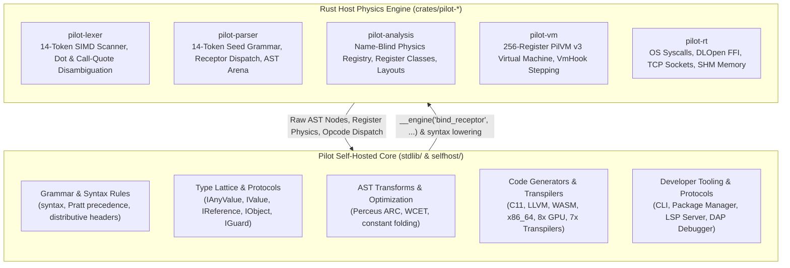
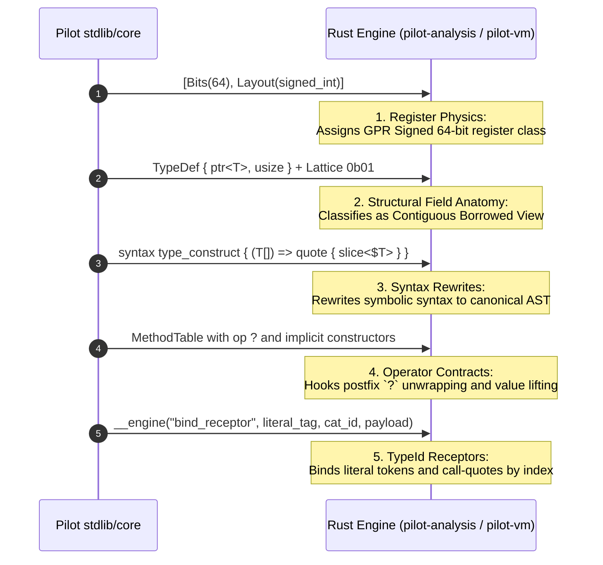
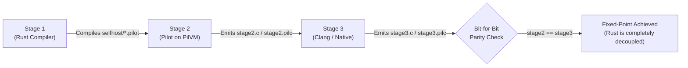

# Programming Responsibilities: Pilot vs. Rust

This document defines the architectural division of labor between the **Rust Host Engine** (`crates/pilot-*`) and the **Self-Hosted Pilot Core** (`stdlib/` and `selfhost/`).

---

## 1. Executive Architectural Philosophy

Pilot operates under a strict **Universal Name-Blind Contract**:

> **The Rust Engine is a Name-Blind Hardware & Structural Physics Engine.**  
> It manages register allocation, memory layouts, bytecode dispatch, and raw hardware access.  
> **Pilot is the Language.**  
> It defines its own grammar, types, syntax sugar, borrow/escape checks, transpilers, standard library, and multi-target code generators.



---

## 2. The Strict 14-Token Boundary

The Rust compiler hardcodes **strictly 14 seed keywords**:

```text
__engine   struct   interface   fn   let   ref   if   loop   return   yield   defer   comptime   quote   asm
```

### Zero Hardcoded Types or Symbols
Rust **never** contains string literals or enum variants for:
- **Scalar Primitives:** `i64`, `u8`, `f64`, `char`, `bool`, `usize`, `str`, etc.
- **Algebraic / Composite Types:** `slice<T>`, `array<T, N>`, `stride<T>`, `option<T>`, `result<T, E>`, `map<K, V>`, `range<T>`, etc.
- **Standard Library Functions / Names:** `main`, `print`, `len`, `drop`, `dup`, etc.

If any type name in `stdlib/core/*.pilot` is renamed (e.g. `char` $\rightarrow$ `c32`, `slice<T>` $\rightarrow$ `window<T>`, `option<T>` $\rightarrow$ `maybe<T>`), the Rust engine compiles, type-checks, and runs with **zero Rust changes**.

---

## 3. Division of Responsibilities Matrix

| Domain | Rust Host Engine (`crates/`) | Pilot Self-Host (`stdlib/` & `selfhost/`) |
| :--- | :--- | :--- |
| **Lexing & Scanning** | SIMD byte scanner, identifier boundaries, two-way dot disambiguation (`obj.field` vs `.field`), call-quote sigils (`!(`, `!!(`, etc.). | Preprocessor (`#if`, `#define`, `#pragma`), token tagging, diagnostics formatting (`PREPROC001`–`PREPROC008`). |
| **Parsing** | 14-token seed grammar, Pratt binding power engine, recursive bracket matching, lossless flat AST node allocation. | Full CST parser (`parse_lossless_cst`), GreenNode incremental reuse, Damerau-Levenshtein keyword typo recovery, Wadler-Lindig code formatter. |
| **Type System** | 2-bit hardware lattice bits (`0b00`..`0b11`), byte layout sizing/offsets, CPU register classification (`gpr_signed`, `simd_float`, `raw_ptr`, etc.). | High-level types (`i8`..`i128`, `f16`..`f128`, `str`, `map`, `range`), protocol inheritance (`IValue`, `IObject`), algebraic unions (`T1 \| T2`). |
| **Syntax Expansion** | Template node substitution for `quote { ... }` blocks; receptor table lookup. | Homoiconic `syntax` macros (`while`, `for`, `try/catch`, `switch`, `guard`, `raw`, `splice`, `splat`), distributive headers (`Header:`, `Header { ... }`). |
| **Memory & Lifetime** | Register frame lifecycle, drop-reuse slot reservation. | Perceus ARC pass (`perceus_schedule_fn` emitting `Dup`, `Drop`, `DropReuse`, `ScopeExitDrop`), escape analysis (`ESCAPE001`–`003`), realtime arena checks. |
| **Code Generation** | Basic bytecode emission for the 14 seed forms; binary `.pilc` container writing. | Layout-driven C11, LLVM IR, WASM binary & WAT, x86_64 ASM, 8 GPU backends (`cuda`, `hip`, `opencl`, `openmp`, `wgsl`, `spirv`, `nvptx`, `amdgpu`), 7 transpilers (`rust`, `c`, `cpp`, `csharp`, `python`, `js`, `lua`), 6 ingesters. |
| **Execution** | 256-register virtual machine (`PilVirtualMachine`), opcode fetch-decode-execute loop, `VmHook` debug breakpoints. | Dynamic REPL, test runner, differential testing harness, flamegraph SVG profiler, AST WCET analysis, constant folding. |
| **Runtime & I/O** | Raw OS primitives: `dlopen`, `dlsym`, `mmap`, `socket`, `bind`, `connect`, `read`, `write`. | RFC-compliant SHA-256/512, BLAKE3, HMAC, Ed25519, HTTP/1.1 parser & TCP server, PostgreSQL/MySQL binary wire frames, SQL engine, shared memory bridges. |
| **Tooling & IDE** | None (purely headless). | Persistent LSP server, VS Code syntax/snippet generator, DAP debugger controller, package/venv manager. |

---

## 4. How Rust Derives Pilot Types (The 5 Name-Blind Mechanisms)

Rust never matches on type names. Instead, it inspects metadata communicated by Pilot:



1. **Register & Layout Physics (`[Bits]` & `[Layout]`):**  
   Deduces CPU register classes (`gpr_signed`, `gpr_unsigned`, `simd_float`, `simd_vector`, `raw_ptr`, `unit`, `noreturn`), bit widths, array repetition (`repeat`), and niche packing (`niche`) from numeric descriptors.
2. **Structural Field Anatomy (`TypeDef.fields` & `LatticeBits`):**  
   Deduces views (`{ ptr<T>, usize }` + `0b01`), strided lenses (`{ ptr<T>, usize, isize }` + `0b01`), owned buffers (`{ ptr<T>, usize, usize }` + `0b10`), and bounds pairs (`{ T, T }` + `0b00`) from byte offsets and lattice bits.
3. **Pure Pilot Syntax Rewrites (`syntax type_construct`):**  
   Symbolic types (`T[]`, `T[N]`, `T[..]`, `T@N`, `T?`, `T!E`, `(A) => R`) are lowered to canonical AST representations in `stdlib/core/syntax/type_construct.pilot`—never by hardcoded tables in the Rust parser.
4. **Operator & Protocol Contracts (`MethodTable`):**  
   Behaviors for postfix `expr?` (types implementing `op ?`), `for` loops (types implementing `get_enumerator()`), and value lifting are resolved from the type's `MethodTable`.
5. **`TypeId` Receptor Slots (`__engine("bind_receptor", ...)`):**  
   Binds lexed literals (`42`, `3.14`, `'a'`, `"hi"`, `true`) and call-quote sigils (`!`, `!!`, `!&`, `!^`, `!@`, `!?`) to integer receptor slots, populating composite fields by positional index rather than field names.

---

## 5. Compile-Time vs. Runtime Communication

Communication between Pilot and Rust happens across a single primitive interface:

### The `__engine(...)` Intrinsic Channel
`__engine` is the gateway through which Pilot interacts with the host environment:

- **Symbol & Receptor Binding:**
  - `__engine("bind_receptor", name, cat_id, payload)`: Registers Pilot tokens into the engine's receptor table.
  - `__engine("query_registered_symbols", category)`: Queries registered symbol strings for typo recovery.
- **AST Arena Manipulation:**
  - `__engine("map_new")`, `__engine("map_get", m, k)`, `__engine("map_set", m, k, v)`: Manages extensible compiler maps in selfhost.
  - `__engine("ast_decl_flags", node_id)`: Inspects decl flags on AST nodes.
- **Hardware & Host Syscalls:**
  - `__engine("rt_dlopen", path)` / `__engine("rt_dlsym", handle, sym)`: Dynamic library linking.
  - `__engine("rt_socket_tcp")`, `__engine("rt_connect_tcp", host, port)`: Raw networking.
  - `__engine("rt_getrandom", buf, len)`: Hardware entropy access.
  - `__engine("shm_open", name, size)`: Shared memory for polyglot bridges.

---

## 6. The 3-Stage Self-Hosting Pipeline

The responsibilities shift completely as Pilot bootstraps itself:



1. **Stage 1 (Host Seed):**  
   The Rust compiler parses and compiles `selfhost/*.pilot` into executable PilVM bytecode.
2. **Stage 2 (Self-Hosted Execution):**  
   The compiled Pilot compiler runs on the PilVM virtual machine and compiles its own source tree into C11 (`stage2.c`) and `.pilc` (`stage2.pilc`).
3. **Stage 3 (Fixed-Point Verification):**  
   The C11 output is compiled by native `clang` and run. It compiles the source tree again to produce `stage3.c` and `stage3.pilc`.
   The SHA-256 digests of `stage2` and `stage3` are compared:
   $$\text{SHA-256}(\text{stage2.c}) \equiv \text{SHA-256}(\text{stage3.c})$$
   Once parity is verified, the language has proven full self-hosting and Rust acts purely as an optional host runtime.
