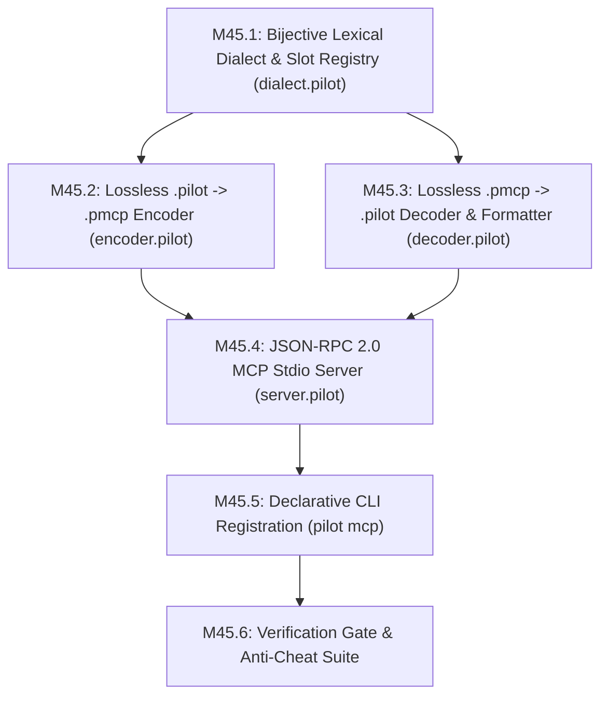

# Pilot-MCP (`.pmcp`) Wire Codec & Native MCP Server — Implementation Submilestones

> **Parent Roadmap Reference:** [`MILESTONES_100.md`](file:///home/moony/Documents/dev/projects/Pilot/MILESTONES_100.md) § M45 (`pilot mcp` Compiler-in-the-Loop AI Engine)  
> **Master Guidelines:** [`VISION.md`](file:///home/moony/Documents/dev/projects/Pilot/VISION.md), [`AGENTS.md`](file:///home/moony/Documents/dev/projects/Pilot/AGENTS.md), [`imp_type.md`](file:///home/moony/Documents/dev/projects/Pilot/imp_type.md)  
> **Module Scope:** `selfhost/mcp/` (Isolated wire codec & stdio server)

---

## 1. Core Architectural Mandate & Invariants

**Pilot-MCP (`.pmcp`) is strictly an external AI wire-compression codec for the MCP server. It has ZERO presence in the Pilot programming language, compiler, parser, standard library, or `.pilot` source files.**

| Invariant | In Standard Pilot (`.pilot`) | In MCP Wire Format (`.pmcp`) |
| :--- | :--- | :--- |
| **1. Zero `.pmcp` Presence in Pilot** | 100% pure Standard Pilot.<br>Compiler, parser, stdlib, and LSP have **ZERO** knowledge of `.pmcp` short codes. | Exists **ONLY** inside the MCP read/write transport layer between the AI and the filesystem.<br>Never saved to `.pilot` files or parsed by Pilot. |
| **2. Zero User Identifiers in `.pmcp` Body** | Uses normal human-readable names (`Account`, `balance`, `i`, `x`, `rt`). | 100% of identifiers (including 1–2 char names like `i`, `x`, `rt`) are replaced by `a0..z9` / `a00..z99` slots via the `@d` header. |
| **3. Zero Keyword/Identifier Collisions** | A user can freely name a variable `st`, `rt`, `bl`, `in`, or `a0`. | That variable becomes `a0` in `.pmcp`, so it **NEVER** collides with `.pmcp` keywords (`st`, `rt`). |
| **4. Explicit String & Char Preservation** | Strings (`"..."`) and characters (`'...'`) are literal values. | All string literals and char literals maintain their exact characters verbatim in both directions. |

---

## 2. MCP Translation Pipeline Architecture

```text
[Filesystem: Standard .pilot]
       │
       ├── MCP Read (`pilot_read_pmcp`) ──► Lexes .pilot -> Replaces ALL keywords/types with 2-char/symbol codes
       │                                    -> Replaces ALL identifiers with a0..z9 / a00..z99 -> Emits @d header + body
       ▼
[AI Agent: Reads & Writes .pmcp]
       │
       ├── MCP Write (`pilot_write_pmcp`) ─► Parses @d header -> Expands all a0..z99 slots to identifiers
       │                                    -> Expands all 2-char/symbol codes to Standard Pilot -> Formats & saves .pilot
       ▼
[Filesystem: Standard .pilot] ──► Verified by normal Pilot compiler (`AnalysisPipeline::analyze`)
```

---

## 3. Complete 1-to-1 Bijective Lexical Roster (334 Codes)

Every token in the `.pmcp` body (outside `"..."` strings, `'...'` chars, and numbers) is:
1. A placeholder slot matching `^[a-z][0-9]{1,2}$` (`a0..z9` for indices `0..259`, `a00..z99` for indices `260..2859`);
2. A punctuation/operator symbol; or
3. One of the exact `.pmcp` keyword/type/intrinsic codes below:

```text
# 1. HARDWARE SEED KEYWORDS (14)
__engine @e | struct st | interface it | fn fn | let lt | ref rf | if ?
loop lp | return rt | yield yd | defer df | comptime ct | quote qt | asm as

# 2. VISIBILITY RINGS & DECLARATION MODIFIERS (27)
priv - | private -p | file ~f | fileprivate ~v | pkg ~p | package ~k
int ~i | internal ~n | prot ~t | protected ~d | pub + | public +u
open oe | export ++ | var vr | mut mt | const cn | immut im | pure pr
static sc | iso io | partial pt | ext ex | lvl lv | steal sl | extern xn | unsafe uf

# 3. SYNTAX BLOCK CATEGORIES, FRAGMENT SPECS & CONTEXTUAL RECEIVERS (16)
syntax sx | modifier md | module mo | receiver rc | type_construct tc
expr eq | block bc | ident id | decl dk | stmt su | pat pz
self sf | this ts | field fi | value vl | it ti

# 4. CONTROL FLOW, LOOPS, PATTERN MATCHING & ERRORS (28)
else : | elif :? | then tn | while wh | until un | for fr | in in | each ea
repeat rp | break bk | continue co | pass ps | do do | guard gd
switch sw | match mh | case cs | default dl | when wn | is is | as az | view vw
try tr | catch ch | finally fy | throw th | raise rs | fail fl

# 5. DECLARATIONS, OOP, LIFECYCLE, MODULES & SPLICING (33)
def de | lambda lm | class cl | record rd | protocol pc | trait tt | type ty
enum en | unit ut | domain dm | state sa | property pp | get gt | set se
op op | operator oo | scope sp | enter et | exit xt | with wi | without wo
coalesce ce | use us | using ug | import ip | from fm | lib lb | global gl
delegate dg | adapter ad | converter cv | context cx | where wr

# 6. LITERALS & WORD LOGIC OPERATORS (11)
true tu | false fa | null nl | none nn | some sm | ok ok | err er
and an | or ow | not nx | xor xr

# 7. CONTRACTS, REFLECTION & METAPROGRAMMING (23)
requires rq | pre pe | ensures es | post po | invariant iv | contracts cr
assert at | old od | nameof no | sizeof sz | sizeof_type za | alignof ag
offsetof of | typeof to | type_of tf | macro mc | defmacro @m | defkeyword @k
dsl ds | quasiquote qq | splice sb | unquote ~q | unquote_splicing ~s

# 8. CONCURRENCY, CHOREOGRAPHY (.pchor) & REAL-TIME (33)
async ac | await aw | spawn sn | parallel pl | actor ar | chan ca | channel @h
select sk | timeout tm | atomic am | sync sy | lock lk | isolate lo
blueprint bp | role rl | cue cu | route ro
realtime rm | hard_rt hr | soft_rt sr | deadline dd | within wt | on_missed om
fallback fb | period pd | periodic pi | priority py | jitter jt | wcet wc
bounded bd | noalloc na | stackalloc so | region rg

# 9. RELATIONAL QUERIES, SQL & TRANSACTIONS (45)
table tb | schema sh | model ml | database db | connect cc | join jn | inner ir
left lf | right rh | full fu | cross xo | outer ou | on on | group gp | by by
having hv | order ob | asc up | ascending ua | desc dn | descending da
limit li | offset os | into nt | distinct dt | all al | intersect ic | except ec
difference di | index ix | indexed ik | lookup lu | insert @i | update @u | delete @x
returning rn | conflict cf | nothing nh | over ov | partition pn | window wd
transaction tx | commit cm | rollback rb | savepoint sv

# 10. POLYGLOT ENGINE BLOCKS (16)
python @p | rust @r | c @c | cpp @P | csharp @C | js @j | lua @l | java @J
go @g | zig @z | ruby @b | sql @s | postgres @q | postgresql @Q | mysql @y | sqlite @t

# 11. PRIMITIVES, BUILT-IN TYPES & LATTICE INTERFACES (55)
void vd | never nv | bool bl | char kr | str sg | string zs
i8 ib | i16 ih | i32 ii | i64 il | i128 iq | isize iz
u8 ub | byte bz | u16 uh | u32 ui | u64 ul | uint uu | u128 uq | usize uz
f16 fh | f32 ff | f64 fd | float ft | f128 fq | decimal dc
ptr px | slice si | stride sd | array ay | grid gr | tuple tp | option ot
result re | union uo | frame fe | range ra | span sq | step ep | after af
splat zt | pairs pa | expand xp | map mp | ast ax | simd vx | ring ri
pin pk | signal zq | quantity qy | any ny
IAnyValue @A | IValue @V | IReference @R | IObject @O | IGuard @G

# 12. ENGINE INTRINSIC CALL ALIASES (33)
# Syntax: `__engine("<hook>", args...)` <-> `@e.<alias>(args...)`
ast_node_count       nc | ast_node_kind        nk | ast_node_sym           ns
ast_node_lit_kind    nl | ast_node_raw_bits    nb | ast_child_count        cc
ast_child_at         ca | ast_attr_count       ac | ast_attr_arg           aa
ast_span_start       ss | ast_span_end         se | source_slice           sl
sym_str              sy | mount_unit           mu | layout_hw_header       lh
layout_scalar        ls | layout_ptr           lp | layout_aggregate       la
layout_union         lu | layout_fn_abi        lf | layout_metrics         lm
layout_field_offset  lo | layout_physically_equal le | ast_bind_layout     bl
ast_get_bound_layout gl | ast_bind_target      bt | ast_get_bound_target   gt
ast_emit_diag        ed | lsp_query_method     qm | lsp_query_offset       qo
lsp_set_result       sr | fs_read_text         fr | fs_write_text          fw
```

---

## 4. Contextual Disambiguation Rules for Symbol Keywords (`+`, `-`, `?`, `:`)

Because 100% of identifiers in `.pmcp` are replaced with `a0..z99` slots, disambiguating `+`, `-`, `?`, and `:` is 100% deterministic and structural:

1. **`+` (`pub` vs Binary `+`) & `-` (`priv` vs Binary/Unary `-`):**
   - Lower to `pub` / `priv` when at the start of the file OR immediately preceded by `{`, `}`, `;`, `\n`, or `]` **AND** followed by a declaration/modifier keyword (`st`, `it`, `fn`, `lt`, `vr`, `cn`, `pr`, `sc`, `io`, `pt`, `ex`, `lv`, `sx`, `ty`, `en`, `cl`, `rd`, `pp`, `op`, `oo`, `ut`, `bp`, `rl`, `cu`, `de`, `ac`, `~p`) **OR** a struct field slot `a0..z99` followed by `:`.
   - Otherwise, preserve `+` and `-` as arithmetic/operator symbols.

2. **`?` (`if` vs Postfix `?`):**
   - Lower to `if` when in prefix position (start of file, or preceded by `{`, `}`, `;`, `\n`, `(`, `[`, `,`, `=`, `=>`, `:`, `:?`, `rt`, `yd`, `df`).
   - Lower to postfix `?` (`ITryOperator`) when immediately preceded by a slot `a0..z99`, primitive type code, literal, `)`, `]`, or `>`.

3. **`:` (`else` vs Colon `:`):**
   - Lower to `else` when preceded by `}` (closing a block) or inside a `gd` / `sx` rule after `)`.
   - Otherwise, preserve `:` as a type annotation, switch arm, range step, or namespace separator.

---

## 5. Submilestone Breakdown (M45.1 – M45.6)



---

### M45.1 — Bijective Lexical Dialect & Slot Registry
* **Target File:** `selfhost/mcp/dialect.pilot` (`<= 800` LOC, strictly `MOD001`)
* **Objective:** Implement the complete isolated `.pmcp` keyword registry, slot sequence generator, and bijective lookup tables.
* **Key Components:**
  1. `PmcpKeywordRegistry`:
     - Table of all 334 bijective mappings partitioned across the 12 categories.
     - Dual lookup: `pilot_to_pmcp(ident: str) -> str` and `pmcp_to_pilot(code: str) -> str`.
     - Intrinsic alias sub-registry: `@e.<alias>` $\leftrightarrow$ `__engine("<hook>", ...)`.
  2. Slot Encoding & Decoding (`a0..z9` / `a00..z99`):
     - `encode_slot(idx: i64) -> str`:
       - Indices `0..259`: `26 * 10` combinations $\rightarrow$ `a0..z9`.
       - Indices `260..2859`: `26 * 100` combinations $\rightarrow$ `a00..z99`.
     - `decode_slot(s: str) -> i64`: Reverse lookup returning numeric index, or `-1` if not a valid slot.
  3. Bijective Invariant Assertion:
     - `verify_bijective_table() -> bool`: Verifies at startup/comptime that:
       - All 334 `.pmcp` short codes are unique (zero duplicate target codes).
       - Zero `.pmcp` short codes match the slot pattern `^[a-z][0-9]{1,2}$`.
       - Zero `.pmcp` codes exist in `stdlib/` or `crates/pilot-parser`.

---

### M45.2 — Lossless `.pilot` $\rightarrow$ `.pmcp` Wire Encoder
* **Target File:** `selfhost/mcp/encoder.pilot` (`<= 1,200` LOC, strictly `MOD001`)
* **Objective:** Ingest any valid Standard Pilot source string and emit compressed `.pmcp` wire text with a `@d` dictionary header.
* **Key Components:**
  1. Lexer & Literal Isolator:
     - Scans Standard Pilot source code.
     - Preserves `"..."` string literals and `'...'` char literals verbatim.
     - Detects and tokenizes `{...}` interpolation holes inside `f"..."` strings.
  2. Identifier Harvester & Slot Allocator:
     - Collects 100% of user identifiers (variables, functions, types, fields, modules).
     - Assigns sequential slots (`a0`, `a1`, ..., `z9`, `a00`, ...) in first-encountered order.
     - Deduplicates repeat occurrences so all uses of an identifier map to the identical slot.
  3. Keyword & Intrinsic Transformer:
     - Translates all keywords, modifiers, type names, and operator words into their 2-character / symbol `.pmcp` codes.
     - Transforms `__engine("<hook>", ...)` into `@e.<alias>(...)`.
  4. Header & Payload Formatter:
     - Generates header `@d a0:<id0> a1:<id1> ... aN:<idN>\n---\n`.
     - Appends encoded `.pmcp` body text.

---

### M45.3 — Lossless `.pmcp` $\rightarrow$ `.pilot` Wire Decoder & Canonical Formatter
* **Target File:** `selfhost/mcp/decoder.pilot` (`<= 1,200` LOC, strictly `MOD001`)
* **Objective:** Parse `.pmcp` wire text, expand all slots and 2-char codes back to Standard Pilot, and format the output.
* **Key Components:**
  1. Header Parser:
     - Parses `@d` line into slot map `Map<str, str>` (`a0` $\rightarrow$ `<id0>`).
     - Splits at boundary marker `---`.
  2. Structural Disambiguation Engine:
     - Implements Section 4 contextual rules for `+`, `-`, `?`, `:`.
     - Detects prefix vs postfix position for `?` (`if` vs try `?`).
     - Detects declaration vs operator position for `+` (`pub` vs `+`) and `-` (`priv` vs `-`).
     - Detects block-close `}` vs type annotation for `:` (`else` vs `:`).
  3. Token Expander:
     - Expands each `a0..z99` slot into its exact user identifier from `@d`.
     - Expands each `.pmcp` short code into its Standard Pilot keyword / type.
     - Expands `@e.<alias>(...)` into `__engine("<hook>", ...)`.
     - Leaves string and char literals untouched.
  4. Canonical Formatter Integration:
     - Pipes decoded tokens through `selfhost/fmt/fmt.pilot` (`Wadler-Lindig` formatter).
     - Guarantees emitted file is clean, properly indented Standard Pilot.

---

### M45.4 — Native JSON-RPC 2.0 MCP Stdio Server
* **Target File:** `selfhost/mcp/server.pilot` (`<= 1,000` LOC, strictly `MOD001`)
* **Objective:** Implement the Model Context Protocol (MCP) server over standard IO (`stdin`/`stdout`).
* **Tool Endpoints:**
  1. `pilot_dialect_spec`:
     - Returns JSON schema defining `.pmcp` wire syntax, keyword tables, and slot rules for AI agent system prompts.
  2. `pilot_read_pmcp`:
     - Request: `{ "path": "src/main.pilot" }`
     - Action: Reads `.pilot` from filesystem, encodes via `encoder.pilot`, returns `.pmcp` text.
  3. `pilot_check_pmcp`:
     - Request: `{ "pmcp_code": "@d ...\n---\n..." }`
     - Action: Decodes `.pmcp` $\rightarrow$ `.pilot` in memory, executes `AnalysisPipeline::analyze` (`PilotDb`), returns JSON diagnostic array with line/col mappings.
  4. `pilot_write_pmcp`:
     - Request: `{ "path": "src/main.pilot", "pmcp_code": "@d ...\n---\n..." }`
     - Action: Decodes `.pmcp`, validates zero compilation/analysis errors, formats, and writes **ONLY** Standard `.pilot` to `<path>`.

---

### M45.5 — Declarative CLI Registration (`pilot mcp`)
* **Target Files:**
  - `selfhost/cli/cmd_mcp.pilot` (`<= 300` LOC)
  - `crates/pilot-cli/src/main.rs` (minimal bootstrap hook)
* **Objective:** Register `pilot mcp` in the open-registry CLI dispatcher.
* **Key Components:**
  1. CLI Registration:
     - Register `[Command("mcp", "Start the native Pilot Model Context Protocol server")]` in `selfhost/cli/registry.pilot`.
     - Options: `--stdio` (default), `--port <u16>` (optional TCP socket mode).
  2. Isolation Enforcement:
     - Verify `pilot check`, `pilot build`, `pilot run`, and `pilot lsp` reject `.pmcp` tokens if placed directly in a `.pilot` file.
     - Confirm `.pmcp` files cannot be passed directly to `pilot run` (exit with error: `ERR_MCP_WIRE_FORMAT: .pmcp is a transport wire format, use pilot mcp or standard .pilot files`).

---

### M45.6 — Verification Gate & Anti-Cheat Suite
* **Target File:** `crates/pilot-analysis/tests/milestone45_pmcp_codec_and_server.rs`
* **Objective:** Full automated test suite proving all architectural invariants and lossless round-tripping.
* **Test Matrix:**
  1. **Test 1: Zero `.pmcp` Presence in Pilot (`test_m45_1_zero_pmcp_presence_in_pilot`)**
     - Scans `stdlib/`, `crates/pilot-lexer/`, `crates/pilot-parser/`, `crates/pilot-analysis/`.
     - Verifies zero occurrences of `.pmcp` keyword registrations (`"st"`, `"rt"`, `"lt"`, `"bl"`).
     - Asserts standard Pilot parser rejects `.pmcp` snippets.
  2. **Test 2: Zero Raw Identifiers in `.pmcp` Body (`test_m45_2_zero_raw_identifiers_in_pmcp_body`)**
     - Encodes complex files (`selfhost/analyzer.pilot`, `stdlib/core/array.pilot`).
     - Verifies 100% of identifiers in the body match `^[a-z][0-9]{1,2}$`.
     - Verifies string and char literals remain byte-for-byte identical.
  3. **Test 3: 100% Lossless Round-Trip (`test_m45_3_lossless_roundtrip_all_syntax`)**
     - Runs `decode(encode(src))` across all syntax constructs in `examples/all_syntax.pilot`.
     - Asserts `parse(decoded) == parse(src)` produces an AST-identical match.
  4. **Test 4: 300+ Identifier Overflow (`test_m45_4_overflow_slots_beyond_260`)**
     - Generates a synthetic module with 320 distinct identifiers.
     - Verifies slots `a0..z9` (0..259) transition seamlessly to `a00..a59` (260..319) and round-trip losslessly.
  5. **Test 5: Keyword & Collision Torture (`test_m45_5_keyword_identifier_collision_immunity`)**
     - Compiles code where user variables are named `st`, `rt`, `bl`, `in`, `do`, `a0`, `z9`.
     - Verifies that `.pmcp` encodes them to slots without keyword confusion, and decodes back to the original names.
  6. **Test 6: Full MCP Server Stdio Lifecycle (`test_m45_6_mcp_server_stdio_roundtrip`)**
     - Simulates an AI client connecting via JSON-RPC 2.0 stdio.
     - Calls `pilot_dialect_spec` $\rightarrow$ `pilot_read_pmcp` $\rightarrow$ edits body $\rightarrow$ `pilot_check_pmcp` $\rightarrow$ `pilot_write_pmcp`.
     - Verifies standard `.pilot` is updated on disk and passes `pilot check`.

---

## 6. Verification Checklist

- [ ] `selfhost/mcp/dialect.pilot` implemented with 334 bijective codes and slot encoding.
- [ ] `selfhost/mcp/encoder.pilot` implemented with 100% identifier slotting and verbatim string preservation.
- [ ] `selfhost/mcp/decoder.pilot` implemented with structural disambiguation (`+`, `-`, `?`, `:`) and formatter hook.
- [ ] `selfhost/mcp/server.pilot` implements all 4 JSON-RPC MCP tools (`spec`, `read`, `check`, `write`).
- [ ] `selfhost/cli/cmd_mcp.pilot` wired to `pilot mcp` CLI.
- [ ] `MOD001` verified: every file $\le 1,500$ LOC.
- [ ] Anti-cheat verified: zero `.pmcp` symbols inside core compiler or standard library.
- [ ] All 6 integration tests in `milestone45_pmcp_codec_and_server.rs` pass cleanly.
